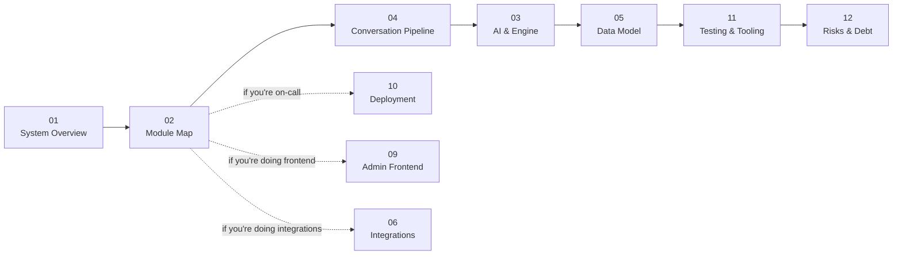

# DirectMate — Architecture Documentation

> **Audience.** A senior engineer joining the project who needs to become a technical owner.
> **Method.** Reverse-engineered from source (`apps/api`, `apps/admin`, `packages/shared`, `infra`, `scripts`)
> in August 2026. Where this documentation and `CLAUDE.md` disagree, **the code is the truth** and the
> discrepancy is called out explicitly.

---

## What DirectMate is, in one paragraph

DirectMate is a **multi-tenant AI sales-assistant platform for Instagram DMs**. A customer messages a
store on Instagram; DirectMate classifies the message with an LLM, resolves the product and variant
against the store's live catalogue, renders a reply from **store-authored templates**, and either sends
it back through the Meta Graph API or escalates the conversation to a human manager over Telegram.

The single most important architectural fact:

> **The AI classifies. Templates generate. A deterministic engine routes.**
>
> The LLM never writes a customer-facing reply on the happy path. It emits one structured tool call
> (intent + entities + slot action), and a ~7,400-line deterministic engine decides what happens next.
> This is a product decision, not an implementation detail — it is what makes replies auditable,
> brand-consistent, and cheap.

One engine, many stores. Behaviour is configuration (`store_configs`, `response_templates`,
`tenant_settings`), not code.

---

## How to read these documents

| # | Document | Read it when you need to… |
|---|---|---|
| [01](01-system-overview.md) | **System Overview** | Get the whole picture: containers, request paths, the six ways a message can enter the system |
| [02](02-module-map.md) | **Module Map** | Find which module owns what; see the NestJS dependency graph and per-module cards |
| [03](03-ai-engine.md) | **AI & Engine Layer** | Understand the classifier, template engine, policy engine, and every LLM call in the system |
| [04](04-conversation-pipeline.md) | **Conversation Pipeline** | Debug or extend `ReplyEngineService` — the 10-stage pipeline, state machine, and memory model |
| [05](05-data-model.md) | **Data Model** | Write a query or a migration: 44 tables, the FK graph, jsonb shapes, migration history |
| [06](06-integrations-and-channels.md) | **Integrations & Channels** | Work on Instagram, n8n, Shopify, Torgsoft, Telegram, Monobank, or Replicate |
| [07](07-auth-and-tenancy.md) | **Auth & Multi-Tenancy** | Add an endpoint, or audit who can reach what |
| [08](08-async-and-events.md) | **Async, Workers & Events** | Understand background jobs, debouncing, and the asynchronous failure modes |
| [09](09-admin-frontend.md) | **Admin Frontend** | Work on the React SPA, the landing page, or the public demo widget |
| [10](10-deployment.md) | **Deployment & Operations** | Deploy, debug production, or reason about scaling limits |
| [11](11-testing-and-tooling.md) | **Testing & Developer Tooling** | Reproduce a bug, run the simulator, seed a tenant, or evaluate a classifier change |
| [12](12-risks-and-tech-debt.md) | **Risks & Technical Debt** | Plan work: dead code, security gaps, correctness hazards, scaling ceilings |

### Suggested first-week path



**Day 1:** read 01 and 02. Then run `npm run simulate -- --tenant men-demo-store --message "Привіт"`
and read the trace it prints. That single command exercises most of the system.

**Day 2–3:** read 04 alongside `apps/api/src/modules/conversations/reply-engine.service.ts`. It is the
heart of the product and the file you will spend the most time in.

**Before your first PR:** read 12. Several sharp edges in this codebase look like bugs but are
deliberate, and several things that look fine are known hazards.

---

## Repository layout

```
direct-mate/
├── apps/
│   ├── api/                  NestJS backend — 21 feature modules, ~249 TS files
│   │   ├── src/modules/      the feature modules (see 02-module-map.md)
│   │   ├── src/database/     38 hand-written migrations + data-source + seed
│   │   ├── src/scripts/      seeds, simulator, classifier eval, backfills
│   │   ├── src/testing/      YAML conversation test runner + log replay
│   │   └── test/             e2e (demo + catalog import)
│   ├── admin/                React 18 + Vite SPA — admin panel + landing page + demo widget
│   └── (packages/shared)     enums only, compiled to JS and committed
├── infra/
│   ├── docker/               local dev compose (Postgres on 5433)
│   └── production/           prod compose, nginx vhosts, certbot, vsftpd, deploy.sh
├── scripts/                  FTP tenant CLIs, CDN docs, prod→local data sync
└── docs/architecture/        ← you are here
```

---

## The ten-second orientation

- **Backend:** NestJS 11, TypeORM 0.3 + `SnakeNamingStrategy`, PostgreSQL 16, `synchronize: false`,
  hand-written migrations.
- **Frontend:** React 18, Vite 5, TanStack Query v5, Tailwind 3, react-router 6. No Redux.
- **AI:** OpenAI (default) with an Anthropic seam, routed **by model id**. Forced tool calls, no streaming.
- **Orchestration:** n8n for catalogue/stock/order sync, driven by an `x-internal-key`-guarded internal API.
- **Deployment:** one VPS, Docker Compose, nginx + Let's Encrypt, GitHub Actions rsync-and-rebuild.
- **Scale posture:** **single replica by design.** Several correctness-critical caches are in-process
  `Map`s. See [08](08-async-and-events.md) and [10](10-deployment.md).

---

## Conventions used in these documents

- `file.ts:123` — a concrete source location. Line numbers drift; the symbol name is the stable anchor.
- **⚠️ Hazard** — something that will bite you if you do not know it.
- **💀 Dead** — code that exists, compiles, and is never reached. Flagged so you neither trust it nor
  delete it without checking.
- **📌 Deliberate** — a design choice that looks wrong and is not. The reasoning is given.
