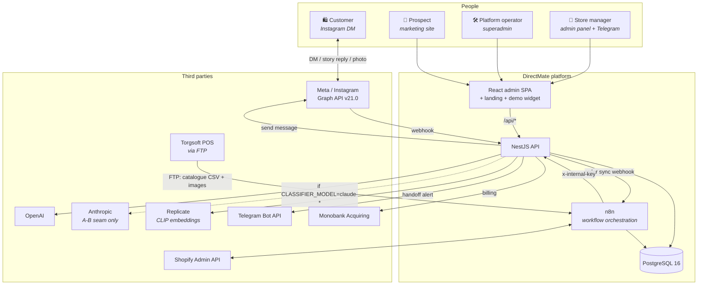
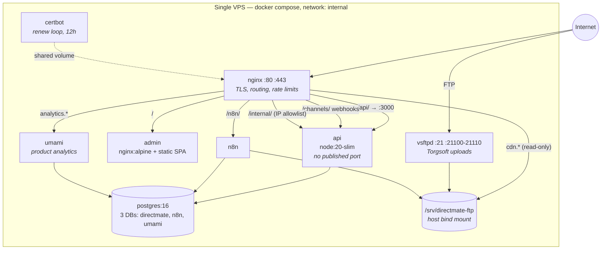
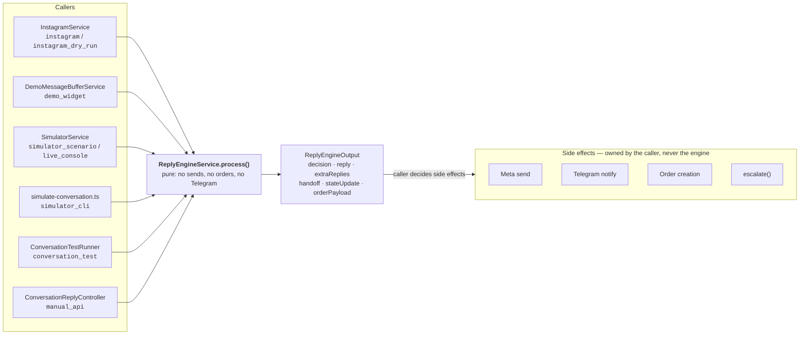
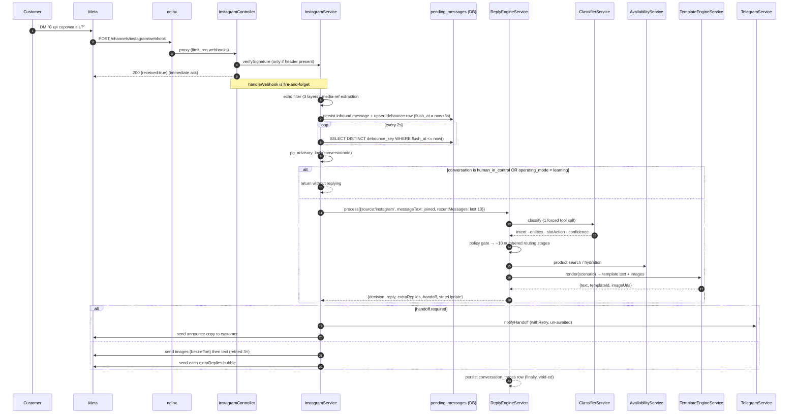
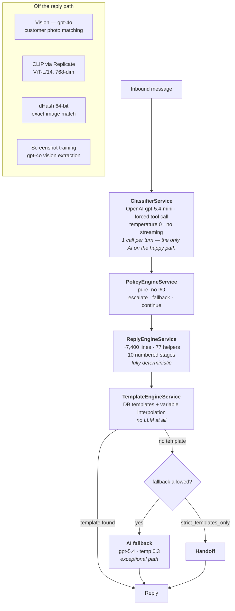
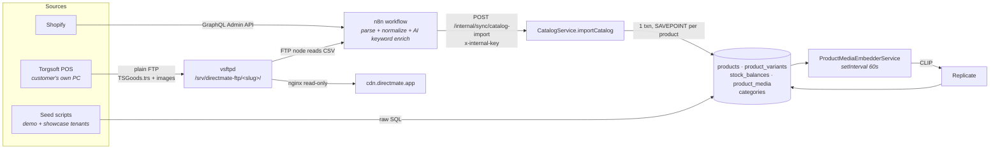
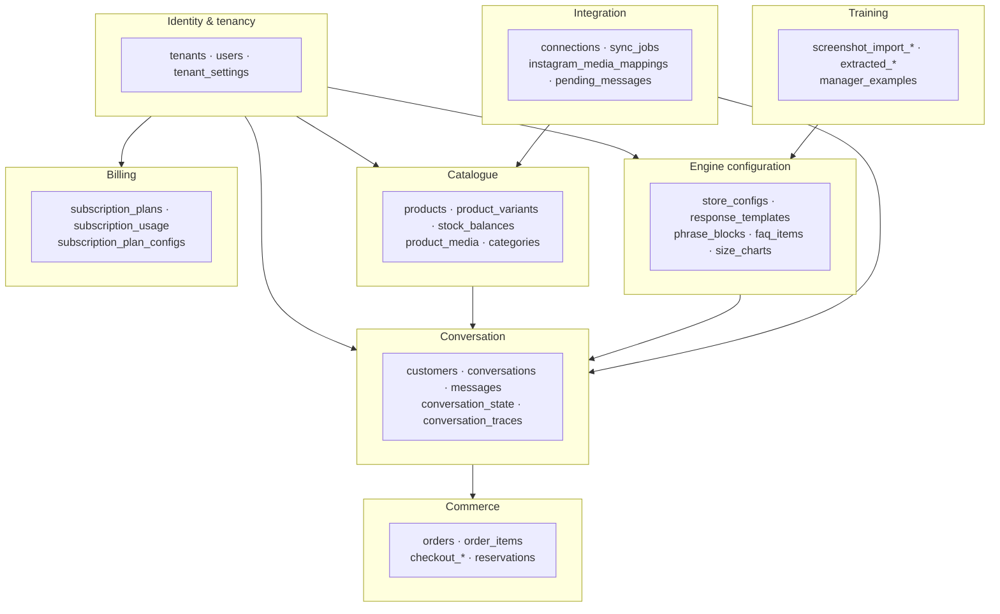

# 01 — System Overview

← [Index](00-README.md) · Next: [02 Module Map](02-module-map.md)

---

## 1. The product in architectural terms

DirectMate automates the routine half of Instagram DM sales conversations and escalates the rest to a
human. Every architectural decision follows from two product rules:

1. **Automate routine interactions; escalate uncertain or risky ones.**
2. **The code defines the engine. The admin panel defines the store's behaviour.**

Rule 2 is why there is no per-tenant code anywhere. A store's voice, flow, checkout fields, escalation
policy and reply copy all live in database rows (`store_configs`, `response_templates`, `faq_items`,
`tenant_settings`). Adding a customer means seeding rows, not shipping a branch.

Rule 1 is why the LLM's authority is deliberately tiny. It classifies; it does not speak. When the
deterministic engine cannot resolve a turn, the system hands off to a human rather than improvising.

---

## 2. System context

---

## 3. Container view (production)

Everything runs on **one VPS** under Docker Compose. Only nginx and the FTP server publish host ports.

**Three domains, one nginx:**

| Host | Serves |
|---|---|
| `${DOMAIN}` (directmate.app) | admin SPA, `/api/*`, Instagram webhooks, OAuth, Swagger, `/n8n/` |
| `cdn.directmate.app` | Torgsoft product images from `/srv/directmate-ftp` — regex-whitelisted to `/{tenant}/images/*.{jpg,png,webp,gif}` |
| `analytics.directmate.app` | self-hosted Umami |

📌 **Deliberate:** the CDN's regex whitelist is a security boundary. The same directory holds each
tenant's `sync/TSGoods.trs` catalogue export, which is unreachable purely because the regex only admits
`images/`. "Just serve the tree" would leak customer catalogues.

Full detail: [10 — Deployment](10-deployment.md).

---

## 4. The six entry points

`ReplyEngineService.process()` is the single funnel for conversational logic. Six different callers
drive it, and each is tagged with a `TraceSource` so a trace can never be mistaken for production
traffic.

📌 **Deliberate — the engine is pure.** It never sends a message, never creates an order, never pings
Telegram. Callers suppress side effects at their own boundary. The demo path simply *does not call*
`ordersService.createFromConversation()`; there is no `isDemo` flag threaded through the engine. Any new
caller must follow this pattern.

⚠️ **Hazard:** `buildOrderPayload` sets `customerId = input.state.conversationId` — a placeholder.
`InstagramService` overwrites it with the real `customer.id` before calling `OrdersService`. A new
caller that forgets writes a garbage `orders.customer_id`, and there is no FK to catch it.

---

## 5. The primary request path: an inbound Instagram DM

**Timing:** the webhook is acked in milliseconds; the reply lands ~5 s later (debounce) plus classifier
latency. The debounce window **slides** — every message in a burst pushes the deadline out another 5 s,
so the batch flushes 5 s after the customer *stops* typing.

---

## 6. Where the AI is (and is not)

Per turn on the happy path there is **exactly one LLM call**. Everything else is deterministic.
Details in [03 — AI & Engine](03-ai-engine.md).

---

## 7. Data flow: how a catalogue gets in

There are three ingestion paths, and they do not share code.

⚠️ **Hazard:** n8n workflow definitions are **not in this repo**. They live only in the `n8n_data`
Docker volume. Losing that volume loses the Torgsoft and Shopify pipelines.

---

## 8. Technology inventory

| Concern | Choice | Notes |
|---|---|---|
| API framework | NestJS 11 (Express platform) | `rawBody: true` for webhook signature verification |
| ORM | TypeORM 0.3 + `SnakeNamingStrategy` | `synchronize: false`; 38 hand-written migrations |
| Database | PostgreSQL 16 | `pg_trgm` for fuzzy search. **No pgvector** — deliberately |
| Vector search | raw `BYTEA` + in-JS cosine | 768-dim CLIP; fine to ~5–10k images/tenant |
| Image hashing | 64-bit **dHash** via `sharp` | column is named `phash`; the algorithm is dHash |
| LLM | OpenAI SDK 6.x, Anthropic SDK 0.111 | routed per-call by model id |
| Auth | passport-jwt, bcrypt | plus an internal API key and 3 webhook signature schemes |
| Scheduling | `@nestjs/schedule` + raw `setInterval` | 3 crons + 2 interval workers, all in-process |
| Frontend | React 18, Vite 5, TanStack Query 5, Tailwind 3 | no state library; polling, no websockets |
| Prerender | react-snap | 4 public routes for SEO |
| Analytics | self-hosted Umami | replaced PostHog |
| Payments | Monobank Acquiring | signed webhooks (SHA256 + fetched public key) |
| Orchestration | n8n (self-hosted) | shares the Postgres instance |
| Infra | Docker Compose, nginx, certbot, vsftpd | single VPS, no orchestrator |
| CI/CD | GitHub Actions → rsync → build on server | no tests in CI |

---

## 9. Bounded contexts

`tenants` is the root of the cascade tree — 33 of 44 tables carry `tenant_id`, and almost all FKs to it
are `ON DELETE CASCADE`. Deleting a tenant is a very large, very fast delete.

Full schema: [05 — Data Model](05-data-model.md).

---

## 10. What is deliberately *not* here

Knowing the negative space saves you from looking for things that do not exist:

- **No message queue.** Debouncing uses a Postgres table plus a 2-second poller. Background work is
  `@Cron` and `setInterval` in the API process.
- **No websockets.** The admin panel polls (5s–60s intervals depending on the page).
- **No row-level security and no automatic tenant filter.** Every query passes `tenant_id` by hand.
- **No horizontal scaling.** Several correctness-critical caches are per-process `Map`s.
- **No pgvector.** Embeddings are `BYTEA`, ranked in Node.
- **No tests in CI.** The `build` job is a compile-check gate; the simulator is run manually.
- **No backups in the repo.** No `pg_dump` cron, no snapshot script.
- **No error tracking / APM / alerting.** Observability is `conversation_traces`, `audit_logs`,
  `conversations.log`, and `docker logs`.

Each of these is revisited with severity and options in [12 — Risks & Tech Debt](12-risks-and-tech-debt.md).
