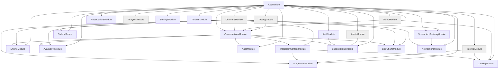
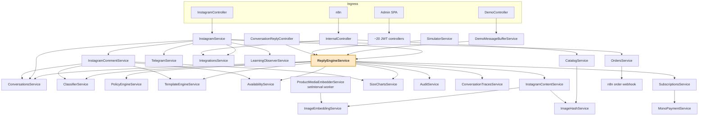

# 02 — Module Map

← [01 System Overview](01-system-overview.md) · [Index](00-README.md) · Next: [03 AI & Engine](03-ai-engine.md)

Every backend module: purpose, responsibilities, dependencies, and its inbound/outbound call edges.

---

## 1. The NestJS dependency graph

`AppModule` (`apps/api/src/app.module.ts`) registers 21 feature modules plus `ConfigModule` (global),
`ScheduleModule`, and `DatabaseModule`. There is **no `@Global()` module in the codebase** — the only
globals are `ConfigModule` (explicit `isGlobal: true`) and TypeORM's `DataSource`.

Grey = leaf modules that export nothing.

### What each module exports

| Module | Exports |
|---|---|
| `AuditModule` | `AuditService` |
| `AuthModule` | `AuthService` |
| `AvailabilityModule` | `AvailabilityService` |
| `CatalogModule` | `CatalogService`, `ImageHashService`, `ImageEmbeddingService`, `TypeOrmModule` |
| `ConversationsModule` | `ConversationsService`, `ConversationTracesService`, **`ReplyEngineService`** |
| `EngineModule` | `ClassifierService`, `TemplateEngineService`, `PolicyEngineService` |
| `InstagramContentModule` | `InstagramContentService` |
| `IntegrationsModule` | `IntegrationsService` |
| `NotificationsModule` | `TelegramService` |
| `OrdersModule` | `OrdersService`, `CheckoutService` |
| `ReservationsModule` | `ReservationsService` (💀 nothing imports it) |
| `ScreenshotTrainingModule` | `ScreenshotExtractionService`, `ScreenshotApprovalService`, `LearningObserverService` |
| `SettingsModule` | `SettingsService` |
| `SizeChartsModule` | `SizeChartsService` |
| `SubscriptionsModule` | `SubscriptionsService` |
| `TenantsModule` | `TenantsService` (💀 unused), `TypeOrmModule` |
| `AdminModule`, `AnalyticsModule`, `ChannelsModule`, `DemoModule`, `InternalModule`, `TestingModule` | *nothing — leaves* |

⚠️ **`ChannelsModule` exports nothing**, so `InstagramService` is only reachable from its own controller.
That is why `InstagramCommentService` duplicates the Graph API senders instead of importing them.

---

## 2. Runtime service call graph

This is the graph that matters at runtime — the NestJS import graph above only says what *can* be
injected.

---

## 3. Module cards

Each card follows the same shape. **Inbound** = who calls it. **Outbound** = what it calls.

---

### 3.1 `ConversationsModule` — the core

**Path** `apps/api/src/modules/conversations/`

**Purpose.** Owns the conversation aggregate (customer → conversation → messages → state) *and* hosts
`ReplyEngineService`, the deterministic decision engine that is the heart of the product.

| | |
|---|---|
| **Responsibilities** | Conversation lifecycle (create/reuse/staleness/takeover/release/escalate); message persistence with explicit ordering; the 10-stage reply pipeline; per-turn trace persistence |
| **Key classes** | `ConversationsService`, `ReplyEngineService` (7,373 lines, 76 private methods), `ConversationTracesService`, `ConversationsController`, `ConversationReplyController` |
| **Depends on** | `AvailabilityModule`, `AuditModule`, `EngineModule`, `InstagramContentModule`, `SubscriptionsModule`, `SizeChartsModule` + repos for `TenantSettings`, `ManagerExample`, `StoreConfig`, `Product` |
| **Inbound** | `InstagramService`, `DemoMessageBufferService`, `SimulatorService`, `ConversationTestRunner`, `simulate-conversation.ts`, `ConversationReplyController`, `ConversationsController` |
| **Outbound** | `ClassifierService`, `PolicyEngineService`, `TemplateEngineService`, `AvailabilityService`, `InstagramContentService`, `SizeChartsService`, `AuditService`, `ConversationTracesService`, `SubscriptionsService`, OpenAI SDK, `conversations.log` |
| **Tables** | `conversations`, `customers`, `messages`, `conversation_state`, `conversation_traces` |
| **HTTP** | `GET/POST /conversations*` (JWT); `GET /conversations/:id/traces` (JWT **+ inline superadmin check**); `POST /conversation/reply` (InternalApiKey) |
| **Async** | none — no cron, no lifecycle hooks |

Deep dive: [04 — Conversation Pipeline](04-conversation-pipeline.md).

---

### 3.2 `EngineModule` — classify, decide, render

**Path** `apps/api/src/modules/engine/`

**Purpose.** The AI/decision layer. Stateless and passive — it owns no scheduler, no lifecycle hook, and
no conversation state. It is orchestrated entirely by `ReplyEngineService`.

| | |
|---|---|
| **Responsibilities** | LLM classification (one forced tool call); escalation policy; template selection + variable interpolation + image attachment; admin CRUD for all store configuration |
| **Key classes** | `ClassifierService` (1,320 lines), `TemplateEngineService` (1,571), `PolicyEngineService` (161), `StoreConfigController`, `llm/classifier-llm.ts` (provider adapters), `color-i18n.ts` |
| **Depends on** | `ConfigService`, OpenAI SDK, Anthropic SDK, repos for `StoreConfig`/`ResponseTemplate`/`PhraseBlock`/`FaqItem` |
| **Inbound** | `ReplyEngineService`, `InstagramCommentService`, `eval-classifier.ts` |
| **Outbound** | OpenAI, Anthropic (only when `CLASSIFIER_MODEL=claude-*`) |
| **Tables** | `store_configs`, `response_templates`, `faq_items` (reads); `phrase_blocks` (💀 injected, never queried) |
| **HTTP** | 13 routes under `/engine/*` (JWT) |

Deep dive: [03 — AI & Engine](03-ai-engine.md).

---

### 3.3 `ChannelsModule` — Instagram

**Path** `apps/api/src/modules/channels/instagram/`

**Purpose.** The only production channel. Webhook ingress, echo filtering, DB-backed debouncing,
manager-takeover detection, and outbound Graph API sends.

| | |
|---|---|
| **Responsibilities** | Webhook verify + HMAC; parse `messaging[]`/`changes[]`; 3-layer echo suppression; 5 s debounce via `pending_messages`; `pg_advisory_lock` per conversation; send text (retried) + images (best-effort) + `extraReplies`; handoff side effects; order dispatch; auto-resume after 30 min manager silence |
| **Key classes** | `InstagramService` (1,001 lines, `OnModuleInit` + 2 s poller), `InstagramController`, `InstagramCommentService` (357), `InstagramContentService` (1,448 — in `InstagramContentModule`) |
| **Depends on** | `ConversationsModule`, `IntegrationsModule`, `OrdersModule`, `NotificationsModule`, `InstagramContentModule`, `ScreenshotTrainingModule`, `EngineModule`, `AvailabilityModule`, `SizeChartsModule`, `CryptoService` |
| **Inbound** | `InstagramController` only (the module exports nothing) |
| **Outbound** | `graph.facebook.com/v27.0`, `ReplyEngineService`, `OrdersService`, `TelegramService`, `LearningObserverService`, `IntegrationsService` |
| **Tables** | `pending_messages` (owner), `conversations`, `messages`, `customers`, `store_configs`, `connections` |
| **HTTP** | `GET/POST /channels/instagram/webhook` — **unauthenticated**; signature checked only when the header is present |
| **Async** | `OnModuleInit` → startup recovery + `setInterval(2000)` flush/auto-resume; in-memory echo maps |

Deep dive: [06 — Integrations & Channels](06-integrations-and-channels.md).

---

### 3.4 `InstagramContentModule` — media ↔ product resolution

**Path** `apps/api/src/modules/channels/instagram/instagram-content.*`

**Purpose.** Maps Instagram posts/stories to catalogue products, and resolves a customer's photo to a
product through a three-stage pipeline.

| | |
|---|---|
| **Responsibilities** | Sync IG media into `instagram_media_mappings`; auto-link by SKU-in-caption, story-from-post inheritance, and GPT vision; resolve a pasted post URL; **`matchCustomerPhoto`**: dHash → CLIP retrieval → GPT-4o verification |
| **Key classes** | `InstagramContentService`, `InstagramContentController`, `InternalInstagramContentController` |
| **Depends on** | `IntegrationsModule`, `CatalogModule` (`ImageHashService`, `ImageEmbeddingService`), `CryptoService`, OpenAI |
| **Inbound** | `ReplyEngineService` (5 call sites), `InstagramCommentService`, both its controllers |
| **Outbound** | Graph API, OpenAI vision, raw SQL over `product_media` |
| **Tables** | `instagram_media_mappings` (owner); reads `connections`, `products`, `product_variants`, `product_media`, `store_configs` |
| **HTTP** | 6 admin routes (JWT) + 2 internal routes (InternalApiKey) |

📌 **Imported by both `ChannelsModule` and `ConversationsModule`** — the latter is what lets
`ReplyEngineService` inject it. Nest deduplicates, so its controllers register once.

---

### 3.5 `CatalogModule` — product ingestion

**Path** `apps/api/src/modules/catalog/`

**Purpose.** Owns all *writes* to the product graph. It is the single ingestion point for connector
payloads. It is **not** on the conversational read path.

| | |
|---|---|
| **Responsibilities** | `importCatalog` (idempotent diff-based bulk upsert, one transaction, SAVEPOINT per product, archive-not-delete); `importStock`; admin product listing with colour→image resolution; dHash computation at sync time; CLIP embedding backfill worker |
| **Key classes** | `CatalogService` (809 lines), `ImageHashService`, `ImageEmbeddingService`, `ProductMediaEmbedderService` |
| **Inbound** | `InternalController` (n8n), `CatalogController` (JWT), `DemoController` (public) |
| **Outbound** | `ImageHashService`, Replicate (via `ImageEmbeddingService`) |
| **Tables** | `products`, `product_variants`, `stock_balances`, `product_media`, `categories`, `product_categories` |
| **HTTP** | `GET /products`, `GET /products/search` (JWT) |
| **Async** | `ProductMediaEmbedderService`: `OnModuleInit` + `setInterval(60s)`, batch 10, 15-min per-row backoff |

---

### 3.6 `AvailabilityModule` — the conversational read path

**Path** `apps/api/src/modules/availability/`

**Purpose.** Every product lookup the reply engine performs. Returns the `ProductSearchResult[]` shape
the template engine interpolates.

| | |
|---|---|
| **Responsibilities** | `getCategories` (feeds the classifier's category enum — called every turn); `checkAll` (the main multi-strategy search, capped at 5 products); `findAllByProductId`/`findAllByProductIds` (hydration); `loadProductImages` (public so the in-memory narrow path can re-hydrate images) |
| **Inbound** | `ReplyEngineService` (11 call sites), `InstagramCommentService`, `AvailabilityController`, `eval-classifier.ts` |
| **Outbound** | raw SQL over the catalogue tables |
| **HTTP** | `POST /availability/check` (JWT) — 💀 the engine never uses this route |

**Search ladder** (`checkAll`): category-scoped with an AND-narrow → category-only retry (Ukrainian
inflection breaks substring AND) → title/`search_keywords` ILIKE → description AND-match.

📌 **Deliberate:** every query is two-step — an inner `SELECT product ids LIMIT 10`, then load *all*
variants of those products. A flat `take(N)` on the joined query truncates a product's variant matrix
mid-way and the engine then renders a 5-size product as having one size.

📌 **Deliberate:** with no category and no surviving search terms, `checkAll` returns `[]`
**without touching the DB**. That is the substrate for "a browse that names nothing gets the catalogue,
not a human".

---

### 3.7 `OrdersModule` — commerce

**Path** `apps/api/src/modules/orders/`

**Purpose.** Order persistence, the manager-confirmation lifecycle, and the outbound push to the
tenant's e-commerce platform via n8n.

| | |
|---|---|
| **Responsibilities** | `createFromConversation` (one txn: synthesizes `checkout_*` rows so a conversational order looks like an HTTP-checkout order); `triggerExternalSync` → n8n; `handleSyncCallback` (idempotency-keyed); status transitions; manager webhook notification |
| **Key classes** | `OrdersService` (534 lines), `CheckoutService` (89 — 💀 dormant), `OrdersController` |
| **Inbound** | `InstagramService` (the **only** non-controller caller), `OrdersController` |
| **Outbound** | n8n webhook, tenant-configured `notificationWebhookUrl` |
| **Tables** | `orders`, `order_items` (owner); writes `checkout_sessions`, `checkout_items`, `checkout_customer_info` |
| **HTTP** | 7 JWT routes + `POST /internal/orders/:id/sync-callback` (InternalApiKey) |

⚠️ **Two checkout implementations exist and only one is live.** `CheckoutService` + `/checkout/*` +
`/orders/draft` is a dormant HTTP path. The live checkout is conversational state in `AssistantMemory`,
gated by `TemplateEngineService.enforceStageGates`. `checkout_sessions` is best read as a denormalized
customer-info side-table hung off orders.

⚠️ **OpenCart order sync does not exist.** `triggerExternalSync` filters `ConnectionType.Shopify` only,
and the enum has no OpenCart member. The `platform` variable and the comments are aspirational.

---

### 3.8 `IntegrationsModule` + `InternalModule` — connections & the n8n API

**Paths** `apps/api/src/modules/integrations/`, `apps/api/src/modules/internal/`

| | |
|---|---|
| **Purpose** | Own the `connections` table (encrypted credentials, Instagram OAuth, long-lived token lifecycle) and expose the `x-internal-key`-guarded API that n8n drives |
| **Key classes** | `IntegrationsService`, `IntegrationsController` + `InternalConnectionsController` + `InstagramOAuthController` (three in one file), `InternalController`, `InternalApiKeyGuard` |
| **Inbound** | n8n, `InstagramService`, `InstagramCommentService`, `InternalInstagramContentController`, the admin SPA |
| **Outbound** | `graph.facebook.com/v27.0` (Unified Login OAuth, assigned accounts, subscribed_apps), `CryptoService` |
| **Tables** | `connections`, `sync_jobs`; borrows `telegram_connect_tokens` as an OAuth state store |
| **HTTP** | 9 connection routes (mixed JWT/internal/public-callback) + 5 `/internal/sync/*` routes |

⚠️ **The highest-value endpoint in the app** is `POST /internal/connections/resolve-credentials` — it
returns a **decrypted** access token to anyone holding `INTERNAL_API_KEY`.

⚠️ `POST /internal/sync/catalog` and `/sync/stock` are dead ends: they insert a `queued` `sync_jobs` row
and return. **No worker polls that table.** Do not model them as "kick off a sync".

---

### 3.9 `DemoModule` — the public surface

**Path** `apps/api/src/modules/demo/`

**Purpose.** The single unauthenticated, internet-facing surface: the landing-page chat widget driving
the real engine against `is_demo=true` tenants, behind three independent abuse controls.

| | |
|---|---|
| **Key classes** | `DemoController`, `DemoService` (boot-time slug→id `Map`), `DemoMessageBufferService` (debounce + long-poll), `DemoRateLimiterService`, `DemoBudgetService`, `createDemoCorsMiddleware` |
| **Controls** | CORS origin whitelist (mounted **before** global CORS) → per-`(ip, tenantSlug)` session rate limit (5/hour, tumbling) → per-model daily spend cap in `demo_spend_daily` (fail-closed) → 500-char cap |
| **Inbound** | `DemoWidget.tsx`, `CatalogPanel.tsx` |
| **Outbound** | `ReplyEngineService`, `ConversationsService`, `CatalogService` |
| **HTTP** | `POST /demo/message`, `GET /demo/catalog` — **both public** |

📌 **Side effects are suppressed by omission.** The demo path never calls
`ordersService.createFromConversation()`, `conversationsService.escalate()`, Telegram, or Meta.

⚠️ `DemoService` resolves demo tenants **once at boot**. Seeding a new demo tenant requires an API
restart — which is why the deploy workflow restarts the container after `seed:demo:prod:all`.

---

### 3.10 `ScreenshotTrainingModule` — learning

**Path** `apps/api/src/modules/screenshot-training/`

**Purpose.** Two ingestion paths that terminate in the same review queue: manager-uploaded chat
screenshots (GPT-4o vision extraction), and **learning mode** — shadow-observing live conversations to
pair a customer message with the human manager's real reply.

| | |
|---|---|
| **Key classes** | `ScreenshotUploadController`, `ScreenshotExtractionService` (642 lines), `ScreenshotReviewController`, `ScreenshotApprovalService`, `LearningObserverService`, `LearningSchedulerService` |
| **Pipeline** | upload → fire-and-forget `processJob` (concurrency 3) → per-file vision extraction → LLM grouping pass → human review → `applyFragment` → `manager_examples` |
| **Inbound** | `InstagramService` (learning observer), the admin Training page |
| **Outbound** | OpenAI vision, `TelegramService` |
| **Async** | `@Cron(EVERY_DAY_AT_10AM)` — 14-day learning-period Telegram nudge |

⚠️ **Only `applyFragment` produces a downstream artifact**, and it reads only `transcriptJson` +
`scenarioSuggestion`. Approving a phrase or voice signal writes a column and stops — nothing consumes
`extracted_phrases` or `extracted_voice_signals`.

⚠️ **Extraction is fire-and-forget in-process.** No queue, no retry; a restart mid-job strands the job
in `processing` forever, and the UI polls it indefinitely.

---

### 3.11 Supporting modules

| Module | Purpose | Notable |
|---|---|---|
| `AuthModule` | Register/login/me/delete-account; JWT issuance; seeds a tenant's default config + starter templates + trial plan on signup | ⚠️ `@Throttle` on `/auth/register` is **dead** — `ThrottlerGuard` is registered nowhere |
| `TenantsModule` | Entity home for `Tenant`, `User`, `TenantSettings` | 💀 `TenantsService` has zero callers; every consumer re-registers the entities |
| `SettingsModule` | Brand tone, business hours, handoff rules, manager Q&A examples | ⚠️ `DELETE /settings/examples/:id` has **no tenant scoping** |
| `SizeChartsModule` | Tenant-scoped size-chart *images* with brand/category tag resolution | Two unrelated things are called "size chart" — see [03](03-ai-engine.md) |
| `AuditModule` | Append-only engine-decision log | `integration_events` is fully orphaned |
| `AnalyticsModule` | Tenant dashboard, 6 raw-SQL queries, fixed 30-day window | No `TypeOrmModule.forFeature` — injects `DataSource` |
| `AdminModule` | Platform-operator console: tenants, global stats, plan configs, impersonation | `@Roles('superadmin')` — the only use of `RolesGuard` in the codebase |
| `SubscriptionsModule` | Trial/paid plans, Monobank billing, the `isActive` gate | ⚠️ Usage metering is **fully dead code**; only plan *status* is enforced |
| `NotificationsModule` | Telegram handoff alerts + deep-link connect flow | Chat ids live in `store_configs.handoff_config`, not a table |
| `ReservationsModule` | Soft stock holds | 💀 **Entirely unreachable** — no controller, nothing injects it; the cron scans an always-empty table |
| `TestingModule` | Scenario simulator + persisted test runs | ⚠️ `ConversationTestRunner` hardcodes the pilot tenant and wipes its conversations |
| `ReservationsModule` / `CheckoutService` | — | Both dormant; see [12](12-risks-and-tech-debt.md) |

---

## 4. Cross-cutting infrastructure

**Path** `apps/api/src/common/`

| Component | Role |
|---|---|
| `CryptoService` | AES-256-GCM (`iv‖tag‖ciphertext`, base64). Encrypts `connections.access_token`. Throws at DI time if `ENCRYPTION_KEY` is not 64 hex chars. ⚠️ Provided in **four** modules independently, exported from none |
| `withRetry` | Exponential backoff (3 attempts, 1 s base). 8 call sites: Meta sends, comment replies, Telegram handoff, n8n order push |
| `JwtAuthGuard` / `RolesGuard` / `InternalApiKeyGuard` | See [07 — Auth & Tenancy](07-auth-and-tenancy.md) |
| `@CurrentUser()` | ⚠️ Silently rewrites `tenantId` from an `X-Tenant-Id` header when `role === 'superadmin'` |
| `AllExceptionsFilter` | Normalizes everything to `{error:{code,message,details?}}` |
| `format.ts` | `formatCurrency` (UAH → грн), `sortSizes` (letter order, then numeric, then locale) |

---

## 5. `packages/shared`

Enums only — 18 of them (`UserRole`, `OrderStatus`, `ConversationStatus`, `ReplyDecision`, …). No types,
no interfaces, no runtime logic.

⚠️ **Three quirks that will confuse you:**

1. `packages/shared/dist/` is **deliberately committed** so a fresh clone can import before any build.
   Editing `src/enums.ts` alone changes nothing at runtime — you must `npm run build` **and commit `dist/`**.
2. `packages/shared/src/` also contains stale checked-in `.js`/`.d.ts` artifacts that **contradict**
   `dist/` (they lack `UserRole.Superadmin` and `OrderStatus.Shipped/Delivered`). Nothing consumes them,
   but grepping `src/` for the enum shape gives the wrong answer.
3. **`apps/admin` does not import it at all** — every enum string is hand-duplicated on the frontend.

---

## 6. Finding your way around

| I want to… | Start here |
|---|---|
| Change what the bot says | `response_templates` rows, or `apps/api/src/scripts/seed/templates/` for demo tenants |
| Change how the bot decides | `apps/api/src/modules/conversations/reply-engine.service.ts` |
| Change what the AI extracts | `apps/api/src/modules/engine/classifier.service.ts` → then run `npm run eval:classifier` |
| Add an endpoint | the module's `*.controller.ts`; check the guard matrix in [07](07-auth-and-tenancy.md) |
| Add a column | a new migration in `apps/api/src/database/migrations/` + the entity; **never** `synchronize` |
| Debug a live conversation | admin → Conversations → Trace tab (superadmin), or `npm run replay` |
| Reproduce a bug | `npm run simulate -- --tenant <slug> --message "<text>"` |
