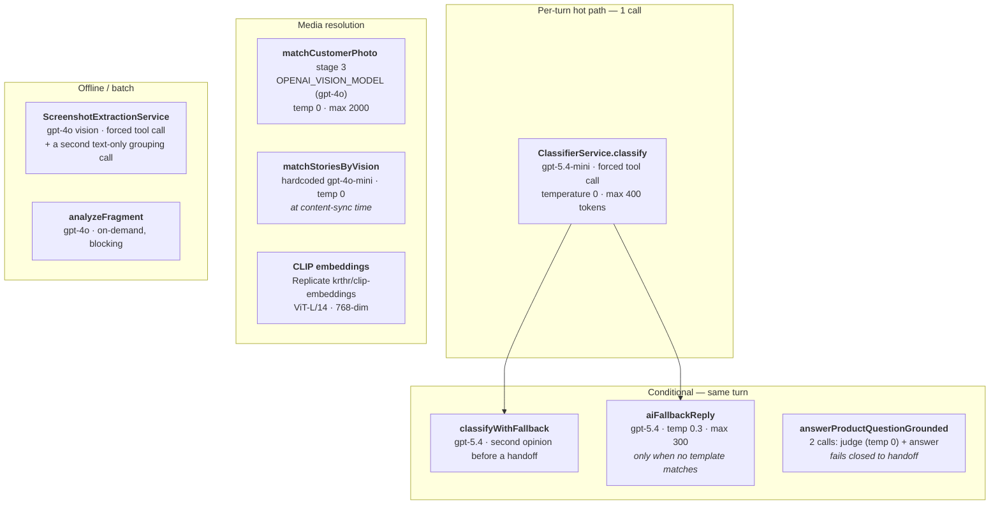
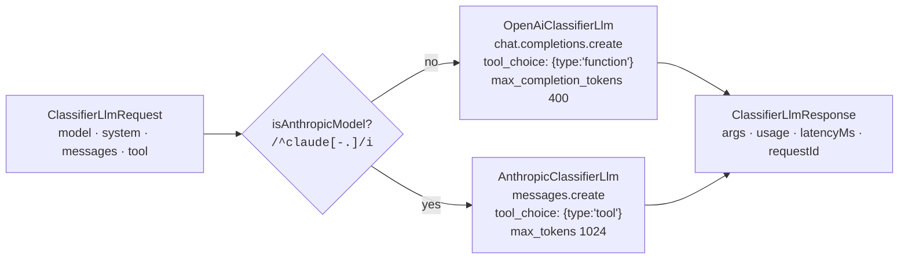
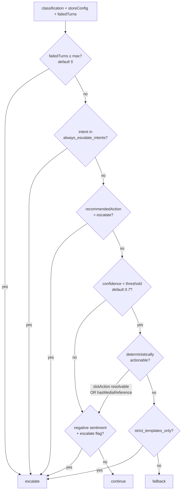
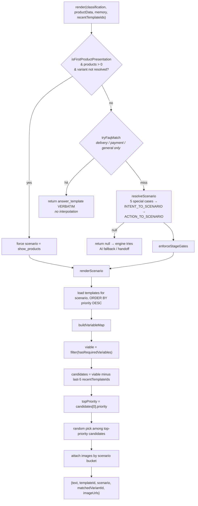
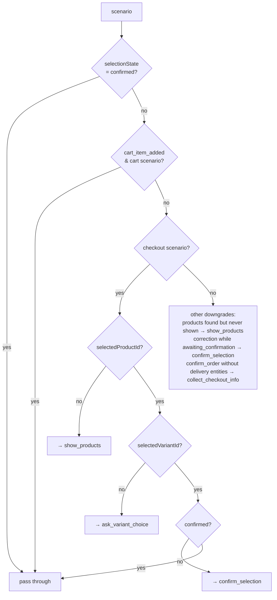
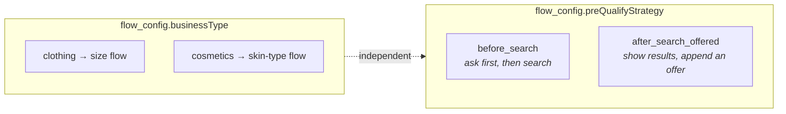
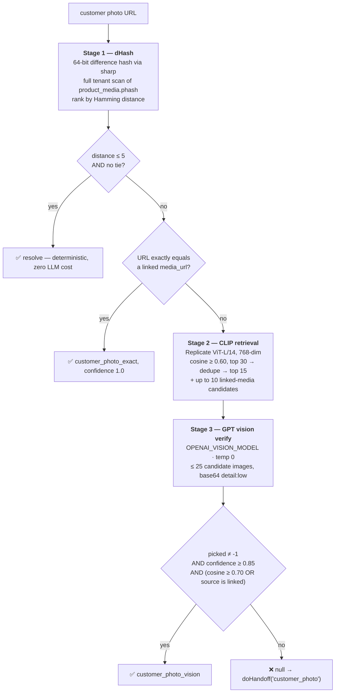
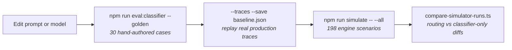

# 03 — AI & Engine Layer

← [02 Module Map](02-module-map.md) · [Index](00-README.md) · Next: [04 Conversation Pipeline](04-conversation-pipeline.md)

Everything AI-related in DirectMate, and the deterministic machinery around it.

---

## 1. The core principle

> **AI classifies only. Templates generate replies. Slot-filling drives the conversation.**

On the happy path there is **exactly one LLM call per customer turn** — a forced tool call that returns
structured data, never prose. Reply text comes from tenant-authored `response_templates` rows with
`{variable}` interpolation.

This is not cost optimisation (though it is 10–50× cheaper). It is the product:

- Replies are **auditable** — you can point at the exact DB row that produced a sentence.
- Replies are **brand-consistent** — a store owner edits copy in the admin panel, not a prompt.
- The bot **cannot invent facts** about stock, price, or delivery.
- When the deterministic path cannot resolve a turn, the system **escalates to a human** rather than
  improvising.

---

## 2. Inventory of every AI call in the system



### Model configuration

| Purpose | Config key | Env var(s) | Default | Used by |
|---|---|---|---|---|
| Classifier | `openai.classifierModel` | `CLASSIFIER_MODEL` → `OPENAI_CLASSIFIER_MODEL` | `gpt-5.4-mini` | `ClassifierService` |
| Handoff second opinion | `openai.fallbackModel` | `OPENAI_FALLBACK_MODEL` | `gpt-5.4` | `classifyWithFallback` |
| AI fallback reply | `openai.model` | `OPENAI_MODEL` | `gpt-5.4` (config) / `gpt-4o` (Joi) ⚠️ | `ReplyEngineService.aiFallbackReply` |
| Vision | `openai.visionModel` | `OPENAI_VISION_MODEL` | `gpt-4o` | photo matching, screenshot extraction |
| Prompt version | *(raw env)* | `CLASSIFIER_PROMPT` | `v1` | `ClassifierService` constructor |
| Anthropic auth | `anthropic.apiKey` | `ANTHROPIC_API_KEY` | `''` | only when the classifier model is `claude-*` |

⚠️ **`OPENAI_MODEL` has two conflicting defaults** — `gpt-4o` in `validation.schema.ts`, `gpt-5.4` in
`configuration.ts`. Joi populates `process.env` before the `load` factory runs, so the **Joi default
almost certainly wins** when the var is unset. Verify empirically before relying on it.

⚠️ **`ANTHROPIC_API_KEY` and `CLASSIFIER_MODEL` are not forwarded** in
`infra/production/docker-compose.prod.yml`. The Anthropic path is unreachable in production today.

---

## 3. `ClassifierService`

**File** `apps/api/src/modules/engine/classifier.service.ts` (1,320 lines)

### 3.1 What it returns

```ts
interface ClassificationResult {
  primaryIntent: string;      // 18-value enum
  entities: { productName?, category?, color?, size?, skinType?,
              quantity?, customerName?, phone?, city?, deliveryBranch? };
  conversationStage: string;  // 11-value enum
  sentiment: 'positive' | 'neutral' | 'negative';
  confidence: number;         // 0–1
  dialogueAct: string;        // 8-value enum
  recommendedAction: string;  // 13-value enum
  slotAction: string;         // 7-value enum
}
```

**`slot_action` is the field that actually drives routing.** It answers "what kind of move did the
customer just make?", independent of topic:

| Value | Meaning |
|---|---|
| `new_inquiry` | first time asking about something |
| `fills_missing_slot` | supplies info we asked for (a colour after a variant question) |
| `correction` | "ні, я хочу Rosewood" — replaces a previous value |
| `confirmation` | a **pure** "так"/"беру" carrying no new information |
| `rejection` | a pure "ні" |
| `adds_to_cart` | "і ще крем" |
| `asks_question` | "скільки коштує?" |

### 3.2 The tool schema

Function `classify_message`, **`strict: true`**, `additionalProperties: false`, every field in
`required` (strict mode forces optional fields to be nullable unions).

📌 **`entities.category` is enum-constrained to the tenant's real categories**, fetched per turn from
`AvailabilityService.getCategories(tenantId)`. With `strict: true`, OpenAI enforces the enum at decode
time — no more hallucinated categories from the model's training distribution.

Two entity fields carry long inline descriptions that do real work:

- **`color`** — forced to masculine-nominative Ukrainian or lowercase canonical English, regardless of
  the inflected form the customer typed.
- **`size`** — canonical `XS S M L XL XXL` / numeric 36–50; Cyrillic→Latin normalisation (`ХЛ→XL`,
  `Л→L`, `М→M`, `С→S`); an explicit "NEVER extract the meta-word розмір/размер/size".

### 3.3 Prompt assembly

**v1 (default).** A static preamble plus **eight conditionally-included rule blocks**, each keyed on
conversation memory:

| Block | Fires when |
|---|---|
| `cosmeticsRule` | `tenantBusinessType === 'cosmetics'` |
| `pendingOfferRule` | `memory.awaitingPreQualifyAnswer` |
| `sizeEstablishedRule` | `memory.lastAction && memory.recommendedSize` |
| `alternativesOfferedRule` | `lastAction === 'told_variant_not_available'` |
| `sizeChartJustSentRule` | `memory.sizeChartJustSent` |
| `awaitingVariantRule` | `lastAction === 'asked_variant'` or `selectionState === 'awaiting_variant'` |
| `postSelectionRule` | product selected + `awaiting_confirmation` |
| `productSizeExtractionRule` | tenant categories look clothing-like (substring heuristic) |

Which blocks fired is logged as `[CLASSIFIER_BLOCKS]` — the documented way to diagnose prompt-token
deltas.

**v2** (behind `CLASSIFIER_PROMPT=v2`) is a structural rewrite: one **slot-action ladder** (7 first-match
-wins rules) instead of five overlapping rule sets, static-content-first ordering for prompt caching, and
a calibrated confidence rubric. Both versions share `runClassification()` so an A/B differs **only** by
system prompt.

⚠️ **The memory block vanishes on turn 1.** `buildMemoryContext` returns `''` when `memory.lastAction`
is unset, so every conditional block is off and the opening message is classified with categories only.

### 3.4 Failure handling

| Failure | Behaviour |
|---|---|
| Transport throw | **No retry.** Propagates → `doHandoff('ai_failure')` |
| No tool call / unparseable arguments | logs `[CLASSIFIER_FALLBACK]`, returns `defaultClassification()` |
| Off-enum value | `coerceToSchema` rewrites to `unknown`/`clarify`/`new_inquiry`, logs `[CLASSIFIER_SCHEMA_VIOLATION]` |

📌 `defaultClassification()` is **designed to escalate**: `confidence 0.3` (below the 0.7 threshold) and
`slotAction: 'new_inquiry'` (not in the resolvable set), so a tool-call failure lands on
`fallback: 'low_confidence'` rather than being silently swallowed.

⚠️ **`classifyWithFallback` mutates the singleton's `this.model`** and restores it in `finally`. Because
the call is awaited across an HTTP round-trip, a concurrent `classify()` for another conversation in that
window runs on the wrong model. A `modelOverride` parameter already exists (the eval harness uses it) but
is not used here.

---

## 4. The provider seam — `llm/classifier-llm.ts`

Routing is **per-call, by model id**, not by a global provider flag:



📌 **Why per-model-id and not a provider switch:** `classifyWithFallback` swaps in
`OPENAI_FALLBACK_MODEL` for the second-opinion pass, and that must keep hitting OpenAI even while the
primary classifier is a Claude model.

📌 **Why the seam exists at all:** so an OpenAI-vs-Anthropic A/B runs the *same* prompt on both sides.
Anything else measures prompt-fit, not model quality.

`normalizeForAnthropic()` (pure, unit-tested) fixes three ways DirectMate data violates the Messages API
but not Chat Completions: empty content (`messages.text` is nullable), consecutive same-role turns
(debounced bursts, multi-bubble replies), and a leading assistant turn (welcome-first conversations).

**No streaming anywhere.** Every call is a single blocking completion.

---

## 5. `PolicyEngineService`

**File** `apps/api/src/modules/engine/policy-engine.service.ts` (161 lines) — pure, synchronous, no I/O.



The **two exemptions to the confidence gate** are load-bearing:

1. **A resolvable slot action** (`fills_missing_slot`, `confirmation`, `rejection`, `correction`,
   `adds_to_cart`). When the customer names a value or gives a yes/no, the selection state machine owns
   the turn — it matches against the product's *actual* variants and re-asks if it can't.
   Wrong-but-confident is the danger here, not unsure-but-right.
2. **A media turn.** A caption-less photo legitimately classifies as low-confidence `unknown`; the
   product is resolved downstream by dHash→CLIP→vision, which runs *after* this gate.

⚠️ `support_issue` appears in the default `always_escalate_intents` but is **not a member of the
classifier's intent enum** — dead rule.

⚠️ **`always_escalate_intents` is all-or-nothing.** Supplying the key replaces the default list
entirely, silently dropping `complaint`/`request_human` unless the tenant re-lists them.

---

## 6. `TemplateEngineService`

**File** `apps/api/src/modules/engine/template-engine.service.ts` (1,571 lines). Reads
`response_templates` and `faq_items`. **Never calls an LLM. Never writes.**

### 6.1 Selection pipeline



⚠️ **Anti-repetition beats priority.** Recently-used templates are filtered out *before* `topPriority`
is computed. **You cannot reliably raise a template by giving it a higher priority.** This is precisely
why `show_products_with_size` is a render-layer hook rather than a second, higher-priority
`show_products` row — a P95 sized template used last turn would silently demote the next turn to the P90
plain one and flip the header on and off mid-browse.

⚠️ **Priority ties are broken with `Math.random()`** — deliberate tonal variation, but it makes template
selection non-deterministic in tests unless a scenario has exactly one top-priority viable template.

⚠️ **`hasRequiredVariables` treats `''` as missing.** An empty-string variable silently disqualifies a
template and can push a turn all the way to AI fallback or handoff. Both `suppressSizes` colour-axis
guards exist because of exactly this.

### 6.2 `enforceStageGates` — the checkout rule in code



> **Hard rule: you cannot enter checkout until product + variant + confirmation are all resolved.**

### 6.3 Template variables

| Variable | Resolved from |
|---|---|
| `{product_name}` | `memory.selectedProductTitle` → `lastPresentedProducts[0].title` → `productData[0]` → `entities.productName` |
| `{price}` | **paired to `{product_name}`** via exact `titlesEqual`; live `productData` if the titles match, else the matching `lastPresentedProducts` entry, else unresolved + `warn` |
| `{category}` | `entities.category` → `memory.selectedCategory` |
| `{color}` | `localizeColor(entities.color)` → `memory.selectedColor` → the selected variant's colour |
| `{size}` | `entities.size` → `memory.selectedSize` → the auto-selected variant's size (+ a scenario-scoped override to `recommendedSize` for `show_products_with_size` **only**) |
| `{variant_name}` / `{matched_variant_id}` | `memory.selectedVariantName` → last cart item → `matchVariant` result → single-variant auto-select. **Never from raw entities** |
| `{variant_list}` / `{variant_type}` | branch-dependent: colours-only when `suppressSizes`, per-colour size groups at `variantStep='color'`, sizes filtered by colour at `variantStep='size'`, else grouped or flat |
| `{product_list}` | `formatProductList(productData, recommendedSize)` |
| `{order_summary}` | cart lines + total + ПІБ/Телефон/Доставка from entities |
| `{sizes}` / `{other_colors_variants}` / `{color_variant}` | `memory.mediaLink*` — the colour-linked-media scenario |
| `{reason}` | ⚠️ **hardcoded** `'чудова якість та гарні відгуки'`. Nothing ever computes it |

⚠️ **`{skin_type}`, `{phone}`, `{city}`, `{delivery_branch}` are documented in `CLAUDE.md` but are NOT
template variables.** `buildVariableMap` never emits them; phone/city/branch only appear folded into
`{order_summary}`.

📌 **`{product_name}` and `{price}` are resolved as a pair** using an exact, case-folded `titlesEqual` —
deliberately *not* the engine's fuzzier `namesTheSameThing`/`titlesOverlap`. A false positive here quotes
the wrong price to a customer being asked to buy.

### 6.4 Variant matching

Five strategies with descending confidence, and **no fallback to the first variant**:

| # | Strategy | Confidence |
|---|---|---|
| 1 | exact match (incl. translated forms) | 1.0 |
| 2 | unique substring-contains | 0.9 |
| 3 | normalized (strip `ьіїєґ'`) | 0.85 |
| 4 | word overlap | 0.8 / 0.75 |
| 5 | Levenshtein ≤ 3 | 0.7 / 0.65 |

📌 **When the input is a size only, the fuzzy strategies are bypassed entirely** — an exact in-stock size
must exist. `"xl".includes("l")` and `levenshtein('XL','L') === 1` would otherwise latch the wrong SKU.

### 6.5 Image attachment

Four scenario buckets, always sourced from `productData`, never from memory:

| Bucket | Rule |
|---|---|
| `show_products`, `show_products_with_size` | one image per product, preferring the first in-stock variant's image |
| `confirm_color_variant_in_stock` | one per distinct in-stock colour, **linked colour first** |
| `confirm_selection`, `confirm_variant_available`, `recommend_product`, … | the selected variant's image |
| `ask_variant_choice`, `ask_size_for_color`, `ask_color_for_size` | one per candidate variant, narrowed by known axes |

---

## 7. Store configuration — what is actually read

`store_configs` has seven jsonb columns. Only some are live:

| Column | Status |
|---|---|
| **`flow_config`** | 🔥 by far the most load-bearing. `businessType`, `preQualifyStrategy`, `preQualify.{enabled,prompt,fields}`, `sizeChart`, `sizeHelpMode`, `variants.askSequence`, `commentHandling.*` |
| **`escalation_config`** | live — read only by `PolicyEngineService` |
| **`fallback_config`** | live — `mode`, `fallback_disallowed_intents` |
| **`handoff_config`** | live — `telegramChatIds` (read only by `TelegramService`) |
| `brand_config` | only `skuPatterns` is read. The rich seeded blob (language, formality, emoji policy…) has **no reader** — brand voice reaches the AI fallback via `tenant_settings.brandTonePrompt` instead |
| `checkout_config` | 💀 **no runtime reader** — checkout fields are hardcoded in templates |
| `recommendation_config` | 💀 **no runtime reader** |

⚠️ `flow_config` is threaded into `TemplateEngineService.render()` → `buildVariableMap` and **never read
there** — a dead parameter. All business-type branching lives in `ReplyEngineService`.

### Business-type routing

Two orthogonal axes drive per-vertical behaviour:



📌 **`sizeHelpMode`** (`'chart' | 'measurements'`) decides *how* a tenant answers "допоможіть з розміром":
send the chart image and ask, or ask height/weight and recommend. Resolved once in `resolveSizeHelpMode`
and honoured at **three** call sites. `'measurements'` degrades to `'chart'` when there are no usable
numeric ranges, rather than asking for a height it cannot map.

⚠️ **Two unrelated things are both called "size chart":**
- `size_charts` **table** = an uploaded image, resolved by brand/category tags.
- `flow_config.sizeChart` **jsonb** = a numeric map `{ [size]: {heightMin, heightMax, weightMin, weightMax} }`
  used by `recommendSize`.

---

## 8. Vision & image matching

### `matchCustomerPhoto` — three stages, fail-closed



📌 **CLIP is retrieval only, never acceptance.** A high cosine alone never resolves a product — GPT
vision must confirm, *and* the candidate must be corroborated by either a strong cosine or an existing
linked mapping.

📌 **Anti-contamination:** the "trusted linked media" query explicitly **excludes**
`match_method IN (customer_photo_*)`, so past auto-accepted photo matches never become corroboration for
future ones.

⚠️ **The customer-photo cache is written but never read.** `persistCustomerPhotoMatch` inserts a mapping
"so subsequent turns read from cache", but `resolveMediaProduct` branches on
`type === 'customer_photo'` *before* the `findByMediaId` lookup, so the full pipeline re-runs every turn.
The cache key is also a **signed, expiring Meta lookaside URL**, so it would rarely repeat anyway.

⚠️ **Seeded demo tenants cannot Stage-1 match.** `phash` is computed only in `importCatalog`; the seed
builders insert `product_media` with raw SQL and never set it. Their `/uploads/...` relative URLs are
also excluded from the CLIP worker by a `url LIKE 'http%'` filter. Both deliberate.

### Embedding storage

📌 **No pgvector.** `clip_embedding` is raw `BYTEA` (768 × 4 = 3,072 bytes), L2-normalised at write time
so cosine reduces to a dot product, ranked in a JS loop. The migration comments explicitly reject
pgvector at this scale and note the retrieval code is structured so it can drop in later without
changing `matchCustomerPhoto`'s signature.

`ProductMediaEmbedderService` backfills asynchronously (`setInterval`, 60 s, batch 10, 15-minute per-row
backoff) — decoupled from the import hot path because inline CLIP inference used to crash the API process.

---

## 9. AI fallback — the exceptional path

When no template renders and policy allows it, `aiFallbackReply` generates free-form text with
`gpt-5.4`, temperature 0.3, max 300 tokens. Its prompt carries 11 numbered rules, the order state, the
tenant's `brandTonePrompt`, and up to 10 `manager_examples` as few-shot user/assistant pairs.

📌 **Rule 5 of that prompt is `NEVER say "contact manager"`.** The fallback is supposed to *answer*. A
fallback reply that deflects to a manager is a **fake** handoff — no escalation recorded, no Telegram
ping. Real escalation goes through `doHandoff`, which announces the transfer to the customer.

A **layer-3 output safety pass** scrubs fabricated order confirmations from the generated text.

Failure → `failedTurns++` and `doHandoff('ai_fallback_failure')`.

---

## 10. Cost & observability

Every LLM call pushes `{model, promptTokens, completionTokens, latencyMs, requestId, source}` into a
caller-owned sink. `ReplyEngineService` passes `ctx.openaiCalls`, which is persisted to
`conversation_traces.openai_calls` — so per-turn cost attribution by call site is available in the admin
Trace tab.

The public demo additionally enforces a **daily USD-cent cap per model** in `demo_spend_daily`, with
`canSpend()` **fail-closed** on an unknown model id.

⚠️ Demo budget charging uses **estimates** (`chars/3` for tokens, fallback charged at p=0.2) because the
engine exposes no per-call usage to that caller. It over-counts by design. There is also a naming
mismatch: the buffer's "classifier" cap reads `openai.model`, not `openai.classifierModel`.

---

## 11. Changing the AI safely



**Golden set:** `apps/api/src/scripts/eval/golden-cases.json` — 30 cases. Gated fields are
`primaryIntent`, `slotAction`, `recommendedAction`, plus per-key entity equality and confidence bounds.

**Trace regression:** `--traces` replays real `conversation_traces` rows through the current prompt and
FAILs on any change to the three routing fields or any entity add/remove/change. Documented workflow:
`git stash` the prompt edits → `--save baseline.json` → `git stash pop` → `--diff baseline.json`.

**A/B:** `--ab <candidateModel>` scores each side **independently** (an error on one side must never
suppress the other's score) and reports cost per 1k calls.

⚠️ **None of this runs in CI** — it spends real money. It is a manual gate.

📌 There is a documented "tried and reverted" note in the classifier: grafting v2's CONTRAST block into
v1's `alternativesOfferedRule` regressed the golden set from 25/25 to 23–25/25. Do not re-add without
re-running golden 3×.
