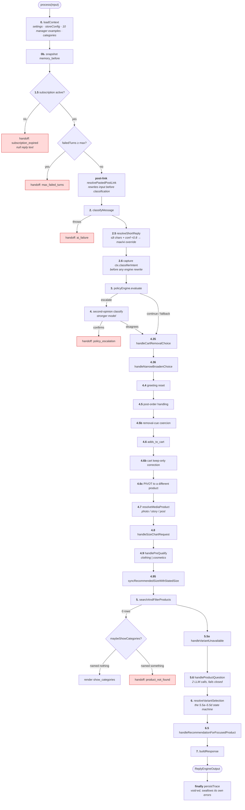
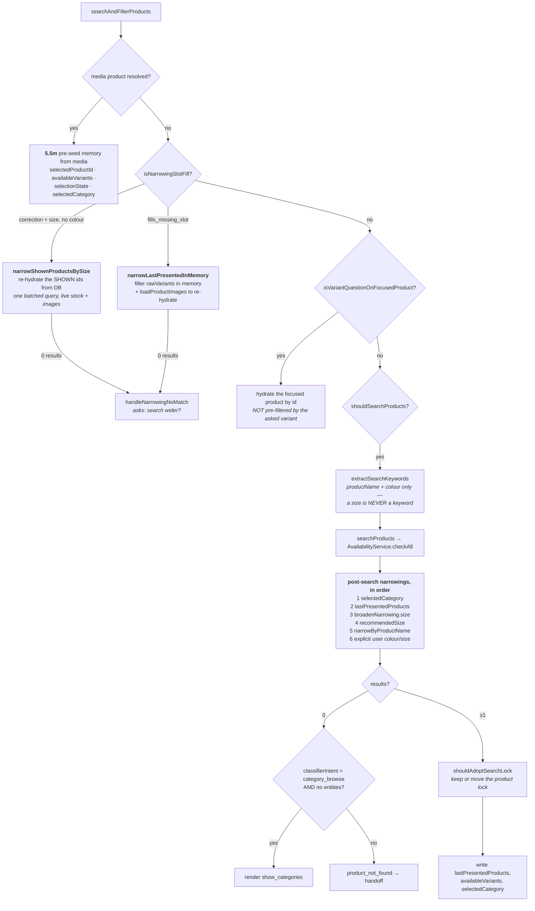
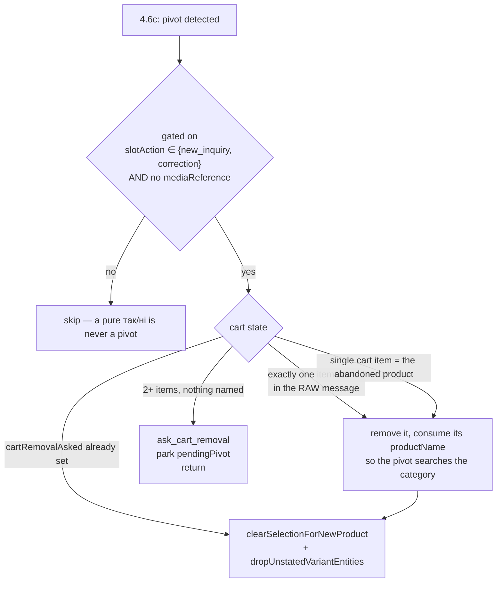
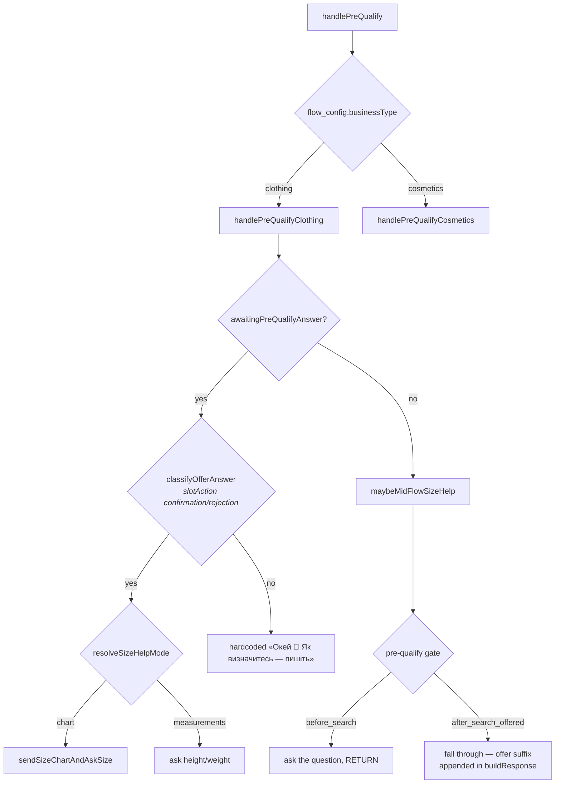
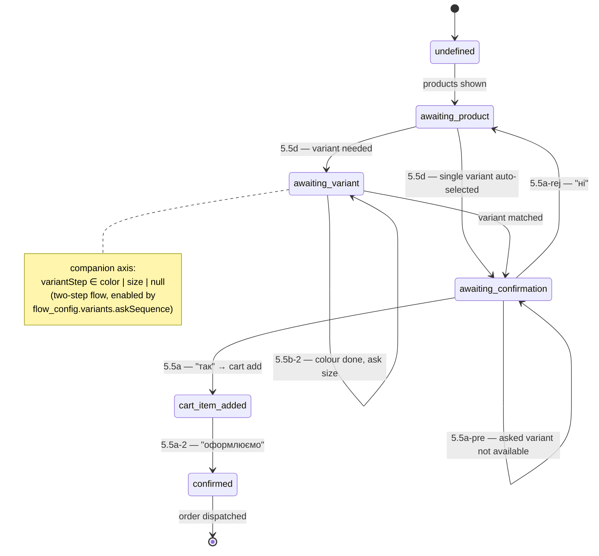
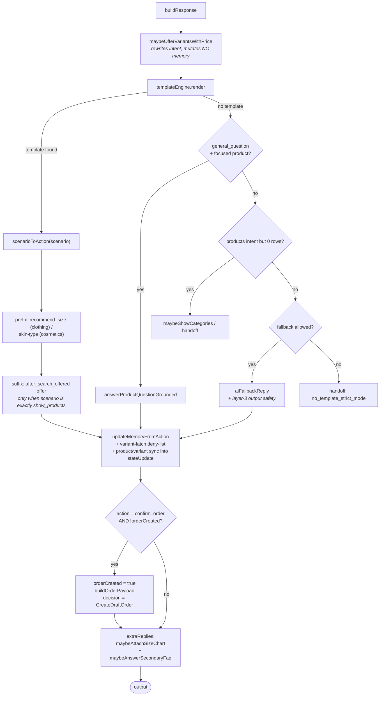

# 04 — The Conversation Pipeline

← [03 AI & Engine](03-ai-engine.md) · [Index](00-README.md) · Next: [05 Data Model](05-data-model.md)

`ReplyEngineService` — 7,373 lines, 76 private methods, 18 handoff exit points. This is the file you
will spend the most time in. This document is the map.

**File:** `apps/api/src/modules/conversations/reply-engine.service.ts`

---

## 1. Contract

```ts
process(input: ReplyEngineInput): Promise<ReplyEngineOutput>
```
| In | |
|---|---|
| `tenantId`, `conversationId` | scope |
| `messageText` | the **joined** debounced burst, `\n`-separated |
| `state` | the `ConversationState` row — loaded **fresh from DB at call time** |
| `recentMessages` | last 10, loaded from DB **at call time**, never cached |
| `mediaReference?` | `{mediaId, type}` for a story reply / post share / customer photo |
| `source` | a `TraceSource` — which environment produced this turn |
| `traceId` | a fresh UUID per turn |

| Out | |
|---|---|
| `decision` | `Reply` \| `Handoff` \| `CreateDraftOrder` \| `Noop` |
| `reply` | `{text, sendNow, imageUrls?}` |
| `extraReplies` | sibling bubbles (size chart, welcome-prepend) |
| `handoff` | `{required, reason}` |
| `stateUpdate` | the whole `contextJson` plus selected product/variant |
| `orderPayload` | only on `CreateDraftOrder` |

📌 **The engine is pure.** It never sends, never creates an order, never pings Telegram, never calls
`escalate()`. Side effects belong to the caller. Do **not** pass an `isDemo` flag into it.

**Constructor injects 13 collaborators:** 4 repositories (`TenantSettings`, `ManagerExample`,
`StoreConfig`, `Product`) plus `AvailabilityService`, `AuditService`, `ClassifierService`,
`TemplateEngineService`, `PolicyEngineService`, `ConfigService`, `InstagramContentService`,
`SubscriptionsService` (via `forwardRef`), `SizeChartsService`, `ConversationTracesService`.

---

## 2. The pipeline, end to end



### Stage reference

| # | Block | Purpose | Early return? |
|---|---|---|---|
| 0 | `loadContext` | Parallel load of settings, store config, manager examples, tenant categories. Builds `ProcessingContext` with `memory = state.contextJson` | no |
| **1.5** | subscription gate | Trial expired / plan inactive → soft-block handoff with **null reply text** | ✅ |
| pre | max failed turns | `failedTurns >= handoffRules.maxFailedTurns` (default 5) | ✅ |
| post-link | `resolvePastedPostLink` | Extracts an `instagram.com/p/...` URL, resolves it to a `mediaId`, strips it from the caption, injects a synthetic `post_reply`. Runs **before** classification so the residual caption drives intent | rewrites input |
| **2** | `classifyMessage` | The one LLM call. Consumes the one-shot `memory.sizeChartJustSent` | ✅ on failure |
| **2.5** | `resolveShortReply` | Text ≤ 8 chars **and** confidence < 0.8 → regex forces `confirmation`/`rejection` at confidence 0.95 | no |
| **2.6** | capture `ctx.classifierIntent` | Freezes what the *customer* asked before the engine rewrites `primaryIntent` | no |
| **3** | `policyEngine.evaluate` | Escalation decision | no |
| **4** | handoff verification | A stronger model gets a second opinion; if it disagrees the classification is **replaced** and the turn continues | ✅ |
| **4.35** | `handleCartRemovalChoice` | Answers "which item should I remove?"; replays `memory.pendingPivot` | no |
| **4.36** | `handleNarrowBroadenChoice` | Answers "Пошукати ширше в каталозі?" | ✅ on "ні" |
| **4.4** | greeting reset | A pure greeting with stale selection state wipes ~20 memory fields | no |
| **4.5** | post-order | Passive intent after an order → hardcoded ack and return; otherwise full reset | ✅ |
| **4.5b** | removal-cue coercion | «не треба / прибери / …» + `adds_to_cart` → coerce to `correction` so 4.6c owns it | no |
| **4.6** | `adds_to_cart` | Commits a pending variant to the cart, then clears the right amount of selection | no |
| **4.6b** | cart keep-only | «хочу тільки X» filters the cart | no |
| **4.6c** | **pivot** | The customer named a *different* product/category — see §4 | ✅ on the removal ask |
| **4.7** | `resolveMediaProduct` | Photo → `matchCustomerPhoto`; story/post → `findByMediaId`; misses hand off | ✅ on both misses |
| **4.8** | `handleSizeChartRequest` | Resolves brand/category, renders `show_size_chart`, or diverts to the measurements flow | ✅ |
| **4.9** | `handlePreQualify` | Vertical dispatcher → clothing / cosmetics; see §5 | ✅ |
| **4.95** | `syncRecommendedSizeWithStatedSize` | Only **updates** an existing `recommendedSize`; never invents one | no |
| **5** | `searchAndFilterProducts` | The search + narrowing pipeline; see §3 | ✅ |
| **5.5o** | `handleVariantUnavailable` | Routes out-of-stock / non-existent variant asks | no |
| **5.6** | `handleProductQuestion` | Grounded attribute answering, 2 LLM calls, **fails closed to handoff** | ✅ |
| **6** | `resolveVariantSelection` | The selection state machine (5.5a … 5.5d); see §6 | no |
| **6.5** | `handleRecommendationForFocusedProduct` | «порадьте» on a focused product → size help, not a product blurb | ✅ |
| **7** | `buildResponse` | Render, update memory, dispatch order; see §7 | terminal |

### `withTrace` — the funnel

Every reply-emitting return goes through a local `withTrace(r)` closure which (1) calls
`maybePrependWelcome`, (2) attaches `ctx.trace`, (3) calls `markRepliedOnResult`, (4) captures the output
for the trace row.

📌 **The conversation-start greeting is prepended in `withTrace`, not after `buildResponse`.** `process()`
has ~15 reply-emitting return paths and only one is `buildResponse`; while the welcome lived at the
bottom, every early return on turn 1 skipped it and the greeting landed on top of the bot's *second*
message.

⚠️ **The `catch` block bypasses `withTrace`.** An internal error returns a hardcoded apology plus
`handoff: internal_error` directly — so an errored turn neither prepends the welcome nor advances
`lastReplyAt`.

---

## 3. Search and narrowing



### Facts that explain most search bugs

📌 **A size is never a search keyword.** `extractSearchKeywords` emits only `productName` and `color`.
This single fact is why:
- `isNarrowingSlotFill` admits size-only corrections (routing them to the DB would produce an empty query,
  0 rows, and a `product_not_found` handoff while the answer sat in `lastPresentedProducts`);
- `ctx.broadenNarrowing.size` is applied by the engine *after* the DB call;
- the focus gate exists at all.

📌 **`lastPresentedProducts[].rawVariants` is SIZE-SCOPED whenever the tenant recommends a size.**
`toPresented` writes it from `productData` *after* the `recommendedSize` filter has pruned it. A size
correction therefore **must not** be answered from memory — `narrowShownProductsBySize` re-hydrates the
shown ids from the DB instead. `null` (cannot narrow) and `[]` (nothing carries it) are semantically
different return values.

📌 **The in-memory narrow must re-hydrate images.** `narrowLastPresentedInMemory` rebuilds rows from
memory, which carries no image data — hence the explicit `loadProductImages` call.

📌 **`memory.recommendedSize` must never prune a product the customer NAMED.** The size filter is gated
on `!entities.productName`, because its "don't over-prune" guard counts *products, not names* — a named
product lacking the recommended size would be deleted and a different product that happens to carry that
size locked instead.

📌 **The focus gate is keyed on entity shape, not an intent allowlist.** «Є розмір М?» classifies as
`availability_check` / `product_inquiry` / `ask_price` / `confirm_choice` depending on phrasing. The gate
fires when a product is in focus and the turn carries a variant entity with no new product identifier —
and it deliberately does **not** pre-filter the hydrated product by the requested variant (an
out-of-stock ask would collapse to 0 rows and land back in the handoff).

⚠️ **`memory.selectedCategory` is set to `entities.category ?? searchKeywords[0]`**, so on a
productName-only search it holds a **product name**, not a category. Contained today by gating 4.6c on
`slotAction ∈ {new_inquiry, correction}`, but the field is not honest.

---

## 4. Pivot detection — "the customer changed their mind"

`isPivotToDifferentProduct` is the **single definition**. A pivot = the turn names a product whose title
doesn't bidirectionally-substring-match `memory.selectedProductTitle`, **or** a category that differs
from `memory.selectedCategory`.



⚠️ **Do NOT use `titlesOverlap` for this.** That helper strips generic nouns (сорочка, футболка, куртка…)
and returns true when either side tokenizes to empty — it exists to *preserve* a lock when the customer
types a bare generic noun. Feeding it «сорочку» answers "same product" and defeats the pivot check on the
exact turn it exists for.

⚠️ **The clear is not optional.** Making a pivot search without it is worse than the bug:
`selectedVariantId` still points at the *previous* product's variant, the search's upgrade check promotes
to `awaiting_confirmation`, and the bot offers "Сорочка з льону, M — оформлюємо?" carrying a jeans variant
id into `buildOrderPayload`.

📌 **Cart removal is deliberately conservative.** The classifier only ever hands us the product pivoted
*to*, never the one cancelled — so a 2+ item cart is ambiguous and the bot asks. Guessing there deletes
the item the customer still wants.

### Three product-name comparison helpers — do not unify them

| Helper | Test | Used for |
|---|---|---|
| `namesTheSameThing` | word **subset** — every word of the shorter appears in the longer | pivot detection, cart matching |
| `titlesOverlap` | any shared token after stripping generic nouns; true if either side empties | **only** `shouldAdoptSearchLock` — preserving a lock on a bare generic noun |
| `titlesEqual` | exact, case-folded | **only** `{product_name}`/`{price}` pairing in the template engine |

Both cheaper tests shipped bugs: substring called «Silk Color Помада» and «Silk Color Collection Помада»
different products and emptied a cart; `titlesOverlap` called «Color Veil Terracotta» the same product as
«Silk Color Collection Помада» on the strength of the word *color*.

---

## 5. Pre-qualification

Two orthogonal axes: **vertical** (`businessType`) and **strategy** (`preQualifyStrategy`).



**The gate skips only on:** a resolved media product, `entities.size` present *in the opening turn*, no
product intent, or the usual mid-flow guards (cart, `orderCreated`, `awaiting_variant/confirmation`).

⚠️ **`entities.productName` must NOT suppress it under `before_search`.** The classifier writes the bare
*category noun* into `productName` — «Хочу замовити футболку» → `'Футболка'` — so that short-circuit
silently disabled the setting for every realistic opener, and non-deterministically (the field is
sometimes omitted), which made it look random rather than off. Hence the term is
`(strategy === 'before_search' || !entities.productName)` and not a flat removal.

📌 **A size the customer STATES beats the size the chart inferred.** `recommendedSize` is sticky (cleared
only by the greeting / post-order resets) and silently drives the variant filter, early-resolve, and
size-suppressed rendering — so a stale value quietly decides the whole order. Three places honour a
stated size: answering the question with a size, correcting it later
(`syncRecommendedSizeWithStatedSize`), and not re-asking for it in the 5.5c colour-matched branch.

---

## 6. The selection state machine



### Block reference

| Block | Guard | Transition |
|---|---|---|
| short-circuit | intent ∈ `{variant_not_available, out_of_stock}` | return immediately so 5.5c/5.5d can't fuzzy-match the OOS ask onto an alternative |
| **5.5a-rej** | `rejection` + `awaiting_confirmation` | → `awaiting_product`, clear variant, `decline_selection` |
| **5.5a-pre** | `awaiting_confirmation` + asked variant absent from `availableVariants` | → `variant_not_available` |
| **5.5a** | `confirmation` + `awaiting_confirmation` + product + variant | **cart add** → `cart_item_added` |
| **5.5a-2** | confirmation on a full cart + `lastAction = asked_continue_or_checkout` | → `confirmed`, start checkout |
| **5.5b** | `confirmation` + product + **no** variant | 1 variant → auto-select; two-axis → `variantStep='color'`; else ask |
| **5.5b-2** | `awaiting_variant` + `variantStep` set | colour step (with early-resolve using `userSize ?? selectedSize ?? recommendedSize`), then size step |
| **5.5c** | `fills_missing_slot`/`correction` + exactly one product | match variant; on failure, **leaked-entity sanity checks** against the resolved product before persisting colour/size |
| **5.5d** | `awaiting_product` + product + `availableVariants` | filter by `recommendedSize`; auto-select or ask |

📌 **`confirm_last_in_stock` requires the *unfiltered* variant list to be a single variant too** —
otherwise a size-filtered collapse told customers «остання позиція в наявності» while every other size
was in stock.

⚠️ **`skipVariantUpdate` deny-list.** After rendering, the post-render hook latches
`templateResult.matchedVariantId` into memory **unless** the scenario is one of 8 non-committing
scenarios (`variant_not_available`, `ask_variant_choice`, `ask_size_for_color`, `ask_color_for_size`,
`confirm_color_variant_in_stock`, `show_products`, `show_products_with_size`,
`show_price_with_variants`). **Every new non-confirming scenario must be added explicitly** or state is
corrupted on the next turn. At 8 entries this is at the documented threshold for promotion to an explicit
`SCENARIOS_THAT_COMMIT_TO_VARIANT` allow-list.

---

## 7. `buildResponse`



📌 **`maybeOfferVariantsWithPrice` mutates no memory on purpose.** The tenant may not have authored
`show_price_with_variants`, in which case `renderScenario` falls back to plain `show_price` and the
post-render hook derives state from the scenario that actually rendered. Setting `selectionState` up
front would strand the fallback render in `awaiting_variant` after a reply that never asked for a variant.

---

## 8. Handoff

**22 `doHandoff` call sites.** Reason codes:

| Reason | Trigger |
|---|---|
| `subscription_expired` | plan gate (not via `doHandoff` — null reply text) |
| `max_failed_turns` | `failedTurns >= 5` |
| `ai_failure` | classifier threw |
| `policy_escalation` (×3) | policy escalate, confirmed / verification threw / no fallback model |
| `customer_photo` | photo matched nothing |
| `unlinked_media_reference` | story or post not mapped to a product |
| `product_not_found` (×2) | search returned 0 rows |
| `product_question_no_data` / `_partial` / `_not_covered` / `_answer_empty` | grounded answering failed closed |
| `ai_fallback_failure` | fallback LLM threw |
| `no_template_strict_mode` | `strict_templates_only` and nothing rendered |
| `size_chart_not_available` | no chart matched brand/category |

📌 **Handoffs are announced, never silent.** `doHandoff` **always** emits customer-visible text: an
optional context line from the caller plus an announce line naming the transfer. The announce is
tenant-authorable via the `handoff_ack` template, with a hardcoded fallback.

> **This supersedes the old silent-handoff convention.** That rule made sense when the bot had few exit
> points; with 22 it produced dead air on most escalations, and it was only ever enforced by accident.

📌 **Senders must not author their own handoff copy.** `instagram.service.ts` used to discard
`result.reply` and send a hardcoded "checking" line, so the engine's per-reason copy never reached a
customer. It now forwards `result.reply.text` plus every `extraReplies[].text`.

⚠️ One handoff reason is a **Ukrainian sentence** rather than a snake_case code (the `general_question`
no-template path). It lands verbatim in `conversations.handoff_reason`.

---

## 9. The memory model

**Everything lives in one jsonb column:** `conversation_state.context_json`, typed as `AssistantMemory`
— defined, unexpectedly, in `apps/api/src/modules/engine/classifier.service.ts:39` (it lives there
because the classifier renders it into the prompt).

> ⚠️ **This is the real schema of the product, and it is unversioned.** ~35 optional fields, several added
> long after rows were written, no migration, no default, no validation. Doc comments explicitly instruct
> readers to "tolerate absence and fail-closed". **Any change to `AssistantMemory` is a live schema change
> against in-flight conversations.**

### Field groups

| Group | Fields |
|---|---|
| **Selection** | `selectionState`, `selectedProductId`, `selectedProductTitle`, `selectedVariantId`, `selectedVariantName`, `selectedCategory`, `availableVariants[]`, `totalVariantsForSelectedProduct` |
| **Presentation** | `lastPresentedProducts[]` (title, price, `productId`, `rawVariants[]`, `searchKeywords`), `recentTemplateIds[]` |
| **Cart / order** | `cartItems[]`, `orderCreated`, `orderItems` (💀 read but never written) |
| **Two-step variant** | `variantStep`, `selectedColor`, `selectedSize`, `requestedVariant` |
| **Media link** | `mediaLinkSizes`, `mediaLinkOtherColors` |
| **Pre-qualify** | `preQualifyData`, `preQualifyCollected`, `recommendedSize`, `recommendedSkinType`, `skinTypeCollected`, `shouldOfferSizeHelp`, `awaitingPreQualifyAnswer` |
| **Pending questions** | `pendingPivot` + `cartRemovalAsked`; `pendingNarrowBroaden` + `narrowBroadenAsked` |
| **Bookkeeping** | `lastAction`, `awaitingField`, `failedTurns`, `sizeChartJustSent`, `welcomedAt`, `lastReplyAt` |

### Lifecycle hazards

⚠️ **Three partial-reset field lists exist** — the greeting reset (4.4), the post-order reset (4.5), and
`clearSelectionForNewProduct`. Keeping three in sync is exactly the drift that produced the
`selectedCategory` bug. Promote to one `resetSelection(memory, ctx, {keepCart, keepPreQualify})` when a
fourth appears.

⚠️ **`recommendedSize` is sticky** — cleared only by the greeting / post-order resets, and it silently
drives the variant filter, early-resolve, and size-suppressed rendering.

⚠️ **`slotAction='correction'` does not reset `selectedColor`/`selectedSize` in the general case.** The
partial-variant flow defends with explicit clears of the opposite axis; a broader fix was deferred.

⚠️ **Media-link axis scoping must be cleared by every 5.5m branch that downgrades routing.** Centralised
in `clearMediaLinkAxisScoping`; five branches call it, and any new one must too. Without it, the template
engine filters `{variant_list}` to the linked colour's sizes and renders them into a body that promises
colours ("є в кольорах: S, M, L").

⚠️ **`failedTurns` is incremented only on AI-fallback failure and never reset** by any code path outside
the greeting/post-order resets — which do not list it.

### The classifier-intent rule

📌 **A gate that means "what did the customer ask for" must read `ctx.classifierIntent`, not
`classification.primaryIntent`.** At least three engine blocks rewrite `primaryIntent` mid-turn
(pre-qualify coerces to `category_browse`; 5.5 rewrites to `variant_not_available`/`out_of_stock`), so a
late gate reading the live value is reading the engine's own bookkeeping, not the customer.

**Cause of record:** «у мене сильна алергія на парабени» classifies `product_inquiry`, gets coerced to
`category_browse` by the cosmetics pre-qualify block, and reached `maybeShowCategories` — answering an
allergy concern with a category menu instead of escalating.

---

## 10. Colour handling

📌 **Colour equality must go through `colorsOverlap(a, b)`**, never raw `a.toLowerCase() === b.toLowerCase()`.
Raw equality silently fails when a tenant's catalogue stores English while the classifier emits
Ukrainian (mixed-language Torgsoft/Shopify imports), or when `handleColorLinkedMedia` writes
`memory.selectedColor` from `instagram_media_mappings.linked_color` in a different language form.

Three sites use raw equality deliberately — both sides originate from the same DB `v.color` column, so a
language mismatch is impossible by construction. Size equality stays raw lowercase: sizes have no
translation table.

📌 **Two colour helpers with the same job description — do not unify:**
- `color-i18n.localizeColor` — **render-side display** only (UA nominative for the customer).
- `reply-engine.translateColor` / `colorsOverlap` — **search-side canonicalisation** against raw stored
  values. The whole point is that stored values stay faithful to the connector feed.

---

## 11. Observability

Every turn writes a `conversation_traces` row (best-effort, `void`-ed in `finally`, swallows its own
errors twice — it can never fail a turn, and can never be relied on either):

`traceId · source · decision · templateScenario · handoffReason · traceSteps[] · stageTimings ·
classifierOutput · openaiCalls[] · memoryBefore · memoryAfter · recentMessages · outboundReply · error`

📌 **`source` defaults to `'unknown'`, never `'instagram'`.** A caller that forgets must not have its
traces read as production traffic — this was once diagnosed as a production bug.

⚠️ `stageTimings` only ever records `classify_ms` and `classify_fallback_ms`. The declared `search_ms`,
`render_ms`, `send_ms` fields are always absent — no `timed()` wrapper exists for those stages.

`conversations.log` is a parallel append-only JSONL trace read by `npm run replay`. **Any early return
that emits a customer-visible reply must log its own `reply` event** — a branch that doesn't leaves a
hole between two classifications, which is how a wrong `narrowing_no_match` once hid inside a
green-looking run.

---

## 12. Test coverage

| Spec | Locks |
|---|---|
| `reply-engine.service.spec.ts` (1,187 lines) | `maybeMidFlowSizeHelp` firing conditions (14 cases), `handleSizeChartRequest` diversion (5), `matchVariant` colour-in-title (9), `narrowByProductName` (6), `markRepliedOnResult` (5), `colorsOverlap` (7), `show_products` fallthrough hygiene (5), **the `before_search` pre-qualify gate (6)** |
| `reply-engine.predicate.spec.ts` (645 lines) | `isCheckoutCommitOnFullCart` (13 + an invariant suite proving it is a strict subset of the 5.5a-2 trigger), `isPivotToDifferentProduct` (11), `matchCartItems` (5), `isNarrowingSlotFill` (8), `syncRecommendedSizeWithStatedSize` (6) |
| `reply-engine.variant-unavailable.spec.ts` | the 5.5o guard: a bare «Так» with a *leaked* size must not become `variant_not_available` |

Beyond unit tests, **198 simulator scenarios** across 8 tenant packs exercise the engine end-to-end
against a real DB and real OpenAI. See [11 — Testing & Tooling](11-testing-and-tooling.md).

---

## 13. Debugging playbook

Classify the issue **before** fixing it:

1. **Bug** — code doesn't do what the architecture intended (missing memory write, wrong variable). Quick fix.
2. **AI went wrong** — the classifier returned a wrong intent/slotAction/entities. Fix the prompt, add a
   few-shot, or enrich the context. **Then run `npm run eval:classifier`.**
3. **Architectural** — the design can't handle this case (missing state, no template, unsupported path).
   Needs a plan.

State the classification before proposing a fix. It prevents over-engineering bugs and under-engineering
architectural gaps.

**Investigation order:**

```bash
# 1. Reproduce
npm run simulate -- --tenant <slug> --message "<text>"

# 2. Read the inline trace — the engine emits a structured step list

# 3. Wrong classification?  → path 2 above
# 4. Right classification, wrong action? → walk process() from stage 0
# 5. Unexpected selectionState? → check the 5.5 blocks

# 6. Cross-turn view + state-corruption detectors
npm run replay -- --last 3
```

`npm run replay` has three built-in bug detectors: `awaiting_confirmation`/`confirmed` with no
`selectedProductId` (❌ BUG), `confirmed` with no `selectedVariantId` (⚠ WARN), and the same non-fallback
`templateId` three turns running (❌ REPEATED TEMPLATE).
