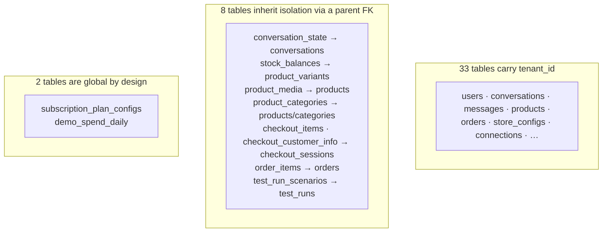
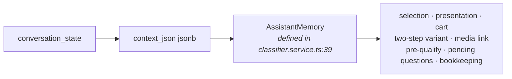
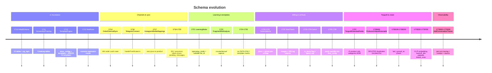

# 05 — Data Model

← [04 Conversation Pipeline](04-conversation-pipeline.md) · [Index](00-README.md) · Next: [06 Integrations](06-integrations-and-channels.md)

**44 tables + 1 sequence.** 42 have entity classes; two (`product_categories`, `demo_spend_daily`) are
raw-SQL only.

---

## 1. Storage technology

| | |
|---|---|
| Engine | PostgreSQL 16 (`postgres:16-alpine`) |
| ORM | TypeORM 0.3 with `SnakeNamingStrategy` (camelCase props → snake_case columns) |
| Schema management | **Hand-written migrations only.** `synchronize: false`, `migrationsRun: false` |
| Extensions | `pg_trgm` (fuzzy search). `gen_random_uuid()` — core in PG13+, **`pgcrypto` is never created** |
| Vector search | **No pgvector** — `BYTEA` + in-JS cosine |
| Connection | `DATABASE_URL` only. **No SSL config, no pool tuning** — `pg` defaults (max 10) |

⚠️ **Two DataSource definitions exist and differ:**

| | `database/data-source.ts` (CLI, seeds, scripts) | `database/database.module.ts` (runtime) |
|---|---|---|
| entities | glob `**/*.entity.{ts,js}` | `autoLoadEntities: true` |
| logging | on unless `NODE_ENV=production` | always off |
| migrations | run by CLI/CI | `migrationsRun: false` |

⚠️ **Entity `@Index` decorators are decorative.** With `synchronize: false`, the migrations are the only
truth about what indexes exist. Do not read an entity's index list as a statement about the live DB.

📌 **Seed scripts bypass the ORM entirely** and use `AppDataSource.query()` raw SQL — deliberately, to
avoid `SnakeNamingStrategy` friction on bulk inserts.

---

## 2. Entity-relationship overview

```mermaid
erDiagram
    tenants ||--o{ users : ""
    tenants ||--|| tenant_settings : ""
    tenants ||--|| store_configs : ""
    tenants ||--o{ connections : ""
    tenants ||--o{ customers : ""
    tenants ||--o{ conversations : ""
    tenants ||--o{ products : ""
    tenants ||--o{ orders : ""
    tenants ||--o{ response_templates : ""
    tenants ||--o{ size_charts : ""
    tenants ||--|| subscription_plans : ""

    customers ||--o{ conversations : ""
    conversations ||--|| conversation_state : ""
    conversations ||--o{ messages : ""
    conversations ||--o{ conversation_traces : ""

    products ||--o{ product_variants : ""
    products ||--o{ product_media : ""
    products ||--o{ product_categories : ""
    categories ||--o{ product_categories : ""
    product_variants ||--|| stock_balances : ""
    products ||--o{ instagram_media_mappings : ""

    orders ||--o{ order_items : ""
    checkout_sessions ||--o{ checkout_items : ""
    checkout_sessions ||--|| checkout_customer_info : ""

    screenshot_import_jobs ||--o{ screenshot_import_files : ""
    screenshot_import_files ||--o{ extracted_conversation_fragments : ""
    extracted_conversation_fragments ||--o{ extracted_phrases : ""
    extracted_conversation_fragments ||--o{ extracted_voice_signals : ""

    test_runs ||--o{ test_run_scenarios : ""
```



### The cascade tree

`tenants` is the root. Almost every FK to it is `ON DELETE CASCADE`, so deleting a tenant removes ~25
tables' worth of rows in one statement. This is what makes the demo seed's `deleteTenantBySlug` fast —
and dangerous.

### ⚠️ Referential-integrity holes

Several uuid columns carry **no FK constraint**:

| Table | Unenforced references |
|---|---|
| **`checkout_sessions`** | `tenant_id`, `conversation_id`, `customer_id`, `reservation_id` — **zero foreign keys on the entire table** |
| `orders` | `checkout_session_id`, `customer_id` |
| `order_items`, `checkout_items` | `product_id`, `variant_id` |
| `reservations` | `conversation_id`, `customer_id`, `variant_id` |
| `audit_logs` | `tenant_id`, `conversation_id` (deliberate — survives conversation deletion) |
| `messages` | `tenant_id` (only `conversation_id` is FK'd) |
| `pending_messages` | `tenant_id`, `connection_id` |
| `conversation_state` | `selected_product_id`, `selected_variant_id`, `active_checkout_session_id` |

⚠️ **`checkout_sessions` is the largest hole.** Deleting a tenant cascades away conversations and orders
but silently **orphans every checkout session, its items, and its customer PII**
(`checkout_customer_info.full_name/phone/city`).

⚠️ `conversations.customer_id` has **no `ON DELETE`** clause (i.e. NO ACTION). Deleting a tenant works by
ordering luck; deleting a single customer directly would fail.

---

## 3. Tables by bounded context

### 3.1 Tenancy & auth

| Table | Key columns | Notes |
|---|---|---|
| `tenants` | `slug` UNIQUE, `business_type`, `timezone`, `is_active`, **`is_demo`** | `idx_tenants_is_demo` partial `WHERE is_demo = true`. ⚠️ `tenants.business_type` is a *different field* from `store_configs.flow_config->>'businessType'` — the engine reads the latter |
| `users` | UNIQUE `(tenant_id, email)`, `password_hash`, `role` | a `superadmin` lives on the fixed system tenant `00000000-…-0` |
| `tenant_settings` | UNIQUE `tenant_id`; jsonb `supported_languages`, `business_hours`, `handoff_rules`, `ai_settings`; `brand_tone_prompt` | 💀 `business_hours` has no reader |

### 3.2 Catalogue

| Table | Notes |
|---|---|
| `products` | The most-migrated table (6 migrations). `external_product_id` + partial UNIQUE `(tenant_id, external_product_id) WHERE NOT NULL`; `sku` defaults from a **sequence**, not the connector's SKU; Torgsoft extras (`material`, `gender`, `season`, `sale_price`, `model_name`); `search_keywords` (AI-enriched, trigram-GIN); `last_synced_at` |
| `product_variants` | `tenant_id` is **denormalized** purely so `idx_variants_tenant_barcode_uniq (tenant_id, barcode) WHERE NOT NULL` is expressible (PG rejects subqueries in index expressions). `color`/`size` are semantically overloaded for non-clothing verticals |
| `stock_balances` | 1:1 with variant. Getter `effectiveAvailable = available - reserved - pendingCheckout`. ⚠️ **no UNIQUE on `variant_id`** despite being modelled `@OneToOne` |
| `product_media` | The image-matching substrate: `phash CHAR(16)` (dHash), `clip_embedding BYTEA` (768×4 = 3,072 B), `embedding_attempted_at` (worker backoff), `color` (colour-keyed images) |
| `categories` + `product_categories` | M2M added for Torgsoft. `idx_categories_tenant_lower_name_uniq (tenant_id, lower(name))`. The junction has **no entity class** |

**Freshness triple** — three different "when" columns, all meaningful:
- `products.updated_at` — last column change (suppressed by the diff-skip)
- `products.last_synced_at` — last seen in the connector feed
- `stock_balances.last_synced_at` — last quantity change

### 3.3 Conversations

| Table | Notes |
|---|---|
| `customers` | UNIQUE `(tenant_id, channel, external_user_id)` |
| `conversations` | `status`, `needs_handoff`, `handoff_reason`, `channel_account_id` (demo sessions key on this), `auto_resume_at` (partial index) |
| **`conversation_state`** | 1:1, CASCADE. **`context_json` jsonb = the entire `AssistantMemory`** — see §5 |
| `messages` | `direction`, `role`, `raw_payload` (verbatim Meta webhook), `tool_calls` |
| `conversation_traces` | Per-turn observability; the only table whose lifecycle spans three consecutive migrations. 4 indexes incl. a partial one on `decision = 'error'` |

### 3.4 Engine configuration

| Table | Notes |
|---|---|
| `store_configs` | UNIQUE `tenant_id`. **7 jsonb config columns** + `operating_mode` (`learning`/`active`/`paused`) + learning timestamps |
| `response_templates` | `scenario`, `blocks jsonb`, `required_variables jsonb`, `priority int`, `active`. **Six migrations INSERT rows here** |
| `phrase_blocks` | 💀 seeded, CRUD-able from the admin panel, **read by no runtime code** |
| `faq_items` | `question_tags jsonb` (string[] keyword tags), `answer_template` |
| `size_charts` | `categories text[]` + `brands text[]` with **GIN** indexes; `uniq_default_per_tenant UNIQUE (tenant_id) WHERE is_default` — a business rule enforced in the DB |

### 3.5 Commerce

| Table | Notes |
|---|---|
| `orders` | `status`, `total_amount`, plus the external-sync block (`external_sync_status`, `external_order_metadata`, `..._triggered_at`, `..._completed_at`). ⚠️ **no index other than the PK** |
| `order_items` | `product_id`/`variant_id` unenforced |
| `checkout_sessions` / `_items` / `_customer_info` | The dormant HTTP-checkout path; in practice a denormalized customer-info side-table hung off orders |
| `reservations` | 💀 **effectively orphaned** — see §7 |

### 3.6 Integrations

| Table | Notes |
|---|---|
| `connections` | Encrypted `access_token_encrypted` (AES-256-GCM), `external_account_id` (IG Business Account ID), `token_expires_at`. ⚠️ **no indexes beyond the PK** — including none on `tenant_id` or `external_account_id`, which the webhook path looks up on **every inbound message** |
| `sync_jobs` | `status` defaults `queued`. ⚠️ Nothing polls this table |
| `instagram_media_mappings` | UNIQUE `(tenant_id, instagram_media_id)`; `linked_color`, `match_method`, `match_confidence`, `confirmed` |
| `pending_messages` | The DB-backed 5 s debounce buffer. No FKs; indexed on `flush_at` and `debounce_key` |
| `telegram_connect_tokens` | ⚠️ **also used as a generic OAuth state store** by the Instagram OAuth flow. The table name lies about its contents |

### 3.7 Training, testing, billing, demo

| Table | Notes |
|---|---|
| `screenshot_import_jobs` / `_files` | Upload pipeline |
| `extracted_conversation_fragments` | The hub. `file_id` **nullable** (null ⇒ live observation), `transcript_json`, `source`, plus learning-mode `classification_json`/`bot_reply`/`template_scenario` |
| `extracted_phrases` / `_voice_signals` | 💀 reviewed and approvable; **nothing consumes them** |
| `manager_examples` | The output of approval and an input to AI fallback. `tags text[]` |
| `test_runs` / `test_run_scenarios` | Persisted scenario runs with human review status |
| `subscription_plans` | UNIQUE `tenant_id`. `amount` in **integer kopiyky**, `currency` is the **numeric** ISO-4217 code `980` |
| `subscription_usage` | 💀 never written — see [12](12-risks-and-tech-debt.md) |
| `subscription_plan_configs` | **Global — no `tenant_id`.** Seeded with starter/professional/business |
| `demo_spend_daily` | **No entity class.** PK `(day, model)` — the only composite-natural-key table, the only one without a uuid PK. **Global across all demo tenants** |

---

## 4. Multi-tenancy



⚠️ **There is no row-level security and no automatic tenant filter.** Every query passes `tenant_id` by
hand.

⚠️ **The inherited-isolation tables are the risk surface.** A query on `stock_balances` or `product_media`
that forgets to join up to `products.tenant_id` sees every tenant's rows. `checkout_items` /
`checkout_customer_info` / `order_items` are worse — their parents have no FK back to `tenants` at all,
so a join cannot even be enforced structurally.

⚠️ **`product_variants.tenant_id` stores the same isolation fact twice** (also on `products`), with no
constraint keeping them in agreement. Sync code populates it from the parent; nothing prevents drift.

⚠️ **`demo_spend_daily` is global** — one demo tenant can exhaust the daily budget for all of them.

⚠️ **`tenants.is_demo` is read in exactly one place** — `DemoService.onModuleInit`. `CLAUDE.md` states
"Analytics queries must filter `is_demo=false`"; **no query in `AnalyticsService` or `AdminService`
references it.** Tenant dashboards are implicitly safe (every query is `WHERE tenant_id = $1`), but the
superadmin global stats, revenue sums, top-tenants and daily-conversation charts **are inflated by demo
traffic**.

---

## 5. `context_json` — the schema inside the schema

This is the single most important jsonb column in the system.



- **~35 optional fields**, several added long after rows were written.
- **No migration, no default, no validation.** Readers must tolerate absence and fail closed.
- **Any change to `AssistantMemory` is a live schema change against in-flight conversations.**

Field-by-field breakdown: [04 §9](04-conversation-pipeline.md#9-the-memory-model).

### All jsonb columns

| Table.column | Shape |
|---|---|
| `conversation_state.context_json` | **`AssistantMemory`** |
| `conversation_traces.{memory_before,memory_after}` | `AssistantMemory` snapshots |
| `conversation_traces.trace_steps` | `string[]` pipeline breadcrumbs |
| `conversation_traces.stage_timings` | `{classify_ms, search_ms, render_ms, send_ms, openai_*}` |
| `conversation_traces.{classifier_output,openai_calls,recent_messages,inbound_media_ref,error}` | see the entity |
| `store_configs.{brand,flow,checkout,escalation,recommendation,handoff,fallback}_config` | 7 columns — see [03 §7](03-ai-engine.md#7-store-configuration--what-is-actually-read) |
| `tenant_settings.{supported_languages,business_hours,handoff_rules,ai_settings}` | typed interfaces |
| `response_templates.{blocks,required_variables,tone_tags}` | `string[]` |
| `phrase_blocks.scenario_tags`, `faq_items.question_tags` | `string[]` |
| `messages.raw_payload` | verbatim Meta webhook envelope |
| `orders.external_order_metadata` | Shopify draft-order response |
| `extracted_conversation_fragments.{transcript_json,classification_json}` | `{speaker,text}[]` / classifier output |
| `test_run_scenarios.steps` | per-turn assertion results |
| `products.metadata`, `product_variants.metadata`, `connections.metadata`, `customers.metadata`, `sync_jobs.summary`, `audit_logs.details`, `integration_events.payload`, `pending_messages.media_reference` | free-form |

---

## 6. Indexing strategy

**Partial indexes are the house style** — 14 of them. The stated reasoning: most legacy rows are NULL for
newer columns, so `WHERE col IS NOT NULL` keeps the index tiny.

Two are partial-**unique** used as business rules:
- `uniq_default_per_tenant` — "at most one default size chart per tenant"
- `idx_variants_tenant_barcode_uniq` — tenant-scoped barcode uniqueness

**Expression indexes:** `idx_categories_tenant_lower_name_uniq ON (tenant_id, lower(name))`,
`idx_products_material ON (tenant_id, lower(material))`.

**Trigram GIN:** `IDX_products_title_trgm`, `idx_products_search_keywords_trgm` — the fuzzy half of
product search.

**`text[]` GIN:** `size_charts.brands`, `size_charts.categories`.

⚠️ **Missing indexes worth knowing:** `orders` has none beyond its PK (yet analytics and admin both filter
by `tenant_id`); `connections` has none (yet it is looked up on every inbound webhook);
`integration_events` and `sync_jobs` have none.

---

## 7. Orphaned and dead

| Item | Status |
|---|---|
| **`integration_events`** | 💀 Fully orphaned. `AuditService.recordIntegrationEvent` is the sole writer and has **zero callers**. No reader exists. No FKs, no indexes |
| **`reservations`** + the reserve-side of `stock_balances` | 💀 `ReservationsService` has no controller and nothing injects it. `create`/`cancel` are unreachable; the `@Cron('*/5 * * * *')` scans an always-empty table. Consequently `reserved_qty` is permanently 0, `pending_checkout_qty` is written by **nothing at all**, and every `effectiveAvailable` expression degenerates to `available_qty` |
| `checkout_sessions.reservation_id` | 💀 always NULL |
| `product_variants.image_url` | 💀 read once, written by nothing in the seed path — real per-variant images live in `product_media` keyed by `(product_id, color)` |
| `subscription_plan_configs.{ig_accounts,products,connections,team_members}_limit`, `history_days` | 💀 seeded and editable; **nothing enforces them** |
| `product_sku_seq` | referenced only as a column DEFAULT |
| `phrase_blocks` | 💀 seeded, CRUD'd by the admin UI, read by no runtime code |
| `stock_balances.warehouse_code` | 💀 never written |
| `AuditLogType.SyncEvent` / `.ReservationCreated` | 💀 declared, never written |
| `ConnectionStatus.Error` | 💀 never set — a "health check" workflow can only observe, not record |

---

## 8. Migration history

38 files, timestamped `1710000000000-InitialSchema` → `1779200000000-AddConversationTraceSource`.



### Migrations that touch DATA, not just schema

| Migration | What |
|---|---|
| `1712` TemplateEngine | seeds 14 templates, 8 phrase blocks, 3 FAQ items, a full store_config per tenant |
| `1724`, `1726`, `1727`, `1729` | data-only template inserts, guarded by `WHERE NOT EXISTS` |
| `1725` CrossSellTemplate | **intentional no-op** — emptied but kept so the `migrations` table stays consistent |
| `1731` | seeds 3 plan config rows |
| `1732` | seeds 2 `show_size_chart` templates |
| `1735`, `1736` | `jsonb_set` backfills into `flow_config` (`preQualifyStrategy`, `businessType`) |
| `1738000` | ⚠️ **DELETEs duplicate products**, keeping the newest per `(tenant_id, external_product_id)` |
| `1778600` ClipDimUpgrade | ⚠️ **NULLs every `clip_embedding`** whose `octet_length <> 3072`; `down()` is a deliberate no-op |

⚠️ **Template-inserting migrations delete by `scenario` across all tenants in `down()`.** Reverting one
would drop a tenant's hand-authored template too. This convention was superseded by the `backfill:*` npm
scripts precisely because a reseed hard-deletes with CASCADE.

📌 **`1738000` is the migration to read if you want to understand this codebase's failure culture.** Its
comment reconstructs a production incident end to end (whitespace in a Torgsoft Articul column → two
products → an in-loop INSERT invisible to the pre-built lookup map → the next sync's barcode UNIQUE
aborts the transaction) and then explains why a partial UNIQUE index is the right fix. Several other
migrations (`1778500`, `1778600`, `1779200`) follow the same "here is the bug this column prevents"
format.

⚠️ **Timestamp `1715000000000` is missing** and git shows no deleted file. Either a migration was renamed
before commit or the number was skipped. If a deployed environment ever ran a `1715…` migration, this
repo cannot revert it — worth checking the `migrations` table on prod.

---

## 9. Working with the schema

```bash
# Run migrations (local)
cd apps/api && npm run migration:run

# Generate one from entity diffs — then HAND-EDIT it; the convention is raw SQL in up()/down()
npm run migration:generate -- src/database/migrations/MyChange

# Revert the last
npm run migration:revert

# Reset conversation data without touching catalogue/config
docker exec docker-postgres-1 psql -U postgres -d directmate -c \
  "DELETE FROM audit_logs; DELETE FROM messages; DELETE FROM conversation_state; \
   DELETE FROM conversations; DELETE FROM customers;"
```

**Conventions to follow:**
1. Raw SQL in `up()` and `down()`. No query-builder migrations.
2. Timestamped filename, class name matching.
3. Partial indexes where most rows are NULL.
4. If the migration seeds or backfills data, say so in a comment — and make it idempotent
   (`WHERE NOT EXISTS`, `ON CONFLICT`, or a value guard like `octet_length(...) <> 3072`).
5. Document the bug the change prevents. That is the house style and it is genuinely useful.

⚠️ **Never enable `synchronize`.** ⚠️ **Never assume `migration:generate` output is correct** — the
naming strategy and the hand-written history will disagree with it.

---

## 10. Open questions for the incoming owner

1. **`stock_balances` has no UNIQUE on `variant_id`** despite `@OneToOne` and `findOne({variantId})`.
   `warehouse_code` exists and is nullable, suggesting multi-warehouse was intended. If two rows per
   variant are possible, every `effectiveAvailable` read silently picks an arbitrary one.
2. **Is `integration_events` dead by intent or by regression?** Fully implemented writer, zero callers.
3. **Do any production rows exist in `reservations`?** If a prior version wrote them, stale `reserved_qty`
   could be permanently deflating availability. Needs `SELECT count(*) FROM reservations` on prod.
4. **Production `DATABASE_URL` SSL/pooling.** Nothing in the repo sets either. PgBouncer in transaction
   mode would break the `INSERT … ON CONFLICT` row-lock assumption in `DemoBudgetService`.
5. **`conversation_traces` retention.** Written every turn with several large jsonb blobs; **no TTL, no
   partitioning, no purge job.** `subscription_plan_configs.history_days` exists and is unenforced —
   possibly the intended lever.
6. **Test, simulator and demo data land in the same tables as production.** `conversation_traces.source`
   is the only column anywhere that distinguishes them, it defaults to `'unknown'`, and it exists only on
   traces. `conversations`, `messages` and `orders` have no equivalent.
