# 06 — Integrations & Channels

← [05 Data Model](05-data-model.md) · [Index](00-README.md) · Next: [07 Auth & Tenancy](07-auth-and-tenancy.md)

Every external system DirectMate talks to, and the internal API that n8n drives.

---

## 1. The integration landscape

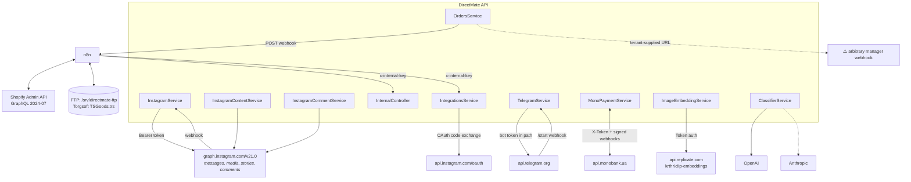

### Complete outbound inventory

| Service | Endpoint | Auth |
|---|---|---|
| Instagram Graph — messaging | `graph.instagram.com/v21.0/me/messages` | `Authorization: Bearer <decrypted page token>` |
| Instagram Graph — content | `/me/media`, `/me/stories`, `/{mediaId}`, `/{userId}`, `/{commentId}/replies` | Bearer or query token |
| Instagram OAuth | `api.instagram.com/oauth/access_token`, `graph.instagram.com/access_token`, `/refresh_access_token` | client id + secret |
| Telegram | `api.telegram.org/bot<token>/sendMessage` | token in path |
| Monobank | `api.monobank.ua/api/merchant/{subscription/create, invoice/status, invoice/cancel, pubkey}` | `X-Token`; inbound webhooks verified with SHA256 against the fetched public key |
| Replicate | `api.replicate.com/v1/predictions` | `Authorization: Token`, `Prefer: wait` + polling fallback |
| OpenAI / Anthropic | SDK defaults | API keys |
| n8n | `N8N_ORDER_SYNC_WEBHOOK_URL` | **none — the URL is the secret** |
| Manager webhook | `tenant_settings.ai_settings.notificationWebhookUrl` | **none — arbitrary tenant-supplied URL (SSRF surface)** |
| Image CDNs | any catalogue / Instagram / customer-photo URL | none |

---

## 2. Instagram — the production channel

### 2.1 Webhook ingress

| Route | Guard | Behaviour |
|---|---|---|
| `GET /channels/instagram/webhook` | none | `hub.mode === 'subscribe'` and `hub.verify_token === META_WEBHOOK_VERIFY_TOKEN` → echo `hub.challenge` |
| `POST /channels/instagram/webhook` | none | HMAC-SHA256 of the **raw** body with `META_APP_SECRET`, compared with `timingSafeEqual` |

⚠️ **The signature check is conditional:** `if (req.rawBody && signature)` — with **no `else`**. A POST
carrying no `x-hub-signature-256` header is processed unverified. Since `entry.id` (the IG Business
Account ID) is publicly derivable, this is an unauthenticated write path into any tenant. **This is the
highest-severity finding in the codebase.** See [12](12-risks-and-tech-debt.md).

⚠️ `timingSafeEqual` **throws `RangeError` on a length mismatch**, so a malformed signature produces a
500 rather than a clean 401.

📌 The controller acks `200 {received:true}` immediately and processes fire-and-forget. Meta never sees
processing errors, and since Meta only retries non-2xx, **the ack forfeits all provider-side retry**.

### 2.2 Tenant resolution

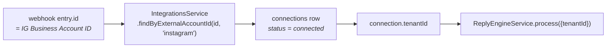

⚠️ `connections` has **no index on `external_account_id`** — this lookup happens on every inbound message.

### 2.3 Payload shapes handled

| Shape | Handling |
|---|---|
| `messaging[].message` | normal DM → `extractMediaReference` → `handleIncomingMessage` |
| `messaging[].message.is_echo` | 3-layer echo suppression; a survivor is treated as a **manager reply** |
| `messaging[].message_edit` (`num_edit === 0`) | Meta dev-mode shape where a *new* message arrives with no text — refetched via `GET /{mid}`. ⚠️ This path **never carries a media reference** |
| `changes[].field === 'comments'` | delegated to `InstagramCommentService`, fire-and-forget per change |

`extractMediaReference` priority: `reply_to.story.id` → `story_reply`; `reply_to.mid` → `post_reply`;
`attachments[].payload.ig_post_media_id` → `post_share`; `attachments[].type ∈ {image,video}` →
`customer_photo` with **`mediaId` = the signed Meta lookaside URL**, not an id.

### 2.4 Echo suppression — three layers

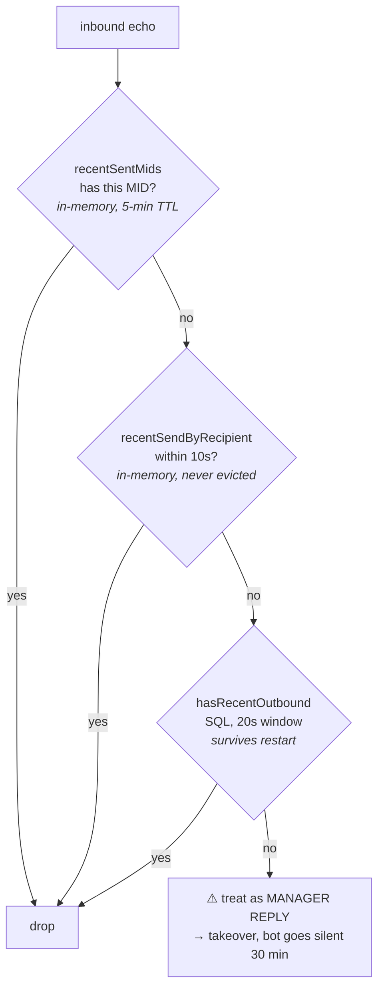

📌 Layer 3 is DB-backed **on purpose** — it is the post-restart case, when the in-memory maps are empty.

⚠️ Miss all three and the bot's own message is misread as a manager reply, freezing the conversation to
`human_in_control`. ⚠️ `hasRecentOutbound` is **not tenant-scoped** — two tenants sharing a customer
IGSID can suppress each other's detection for 20 s.

### 2.5 Debounce

**Not an in-memory buffer** (unlike the demo path) — a Postgres table.

| | |
|---|---|
| Table | `pending_messages` |
| Key | `debounce_key = "${externalUserId}:${channelAccountId}"` |
| Window | `DEBOUNCE_MS = 5000`, **sliding** — every new message pushes `flush_at` out again |
| Poller | `setInterval(2000)` started in `onModuleInit` |
| Flush | `find({debounceKey})` → `delete({debounceKey})` → join texts with `\n`, take the **first** media reference |

⚠️ **This is not a durable queue.** Rows are `DELETE`d *before* processing, with no lease, no attempt
counter, no failure state. A crash between the delete and the send **silently drops a paying customer's
message**. There is no `FOR UPDATE SKIP LOCKED`, so two replicas would both claim the same key and the
customer would get two replies.

### 2.6 Manager takeover & auto-resume

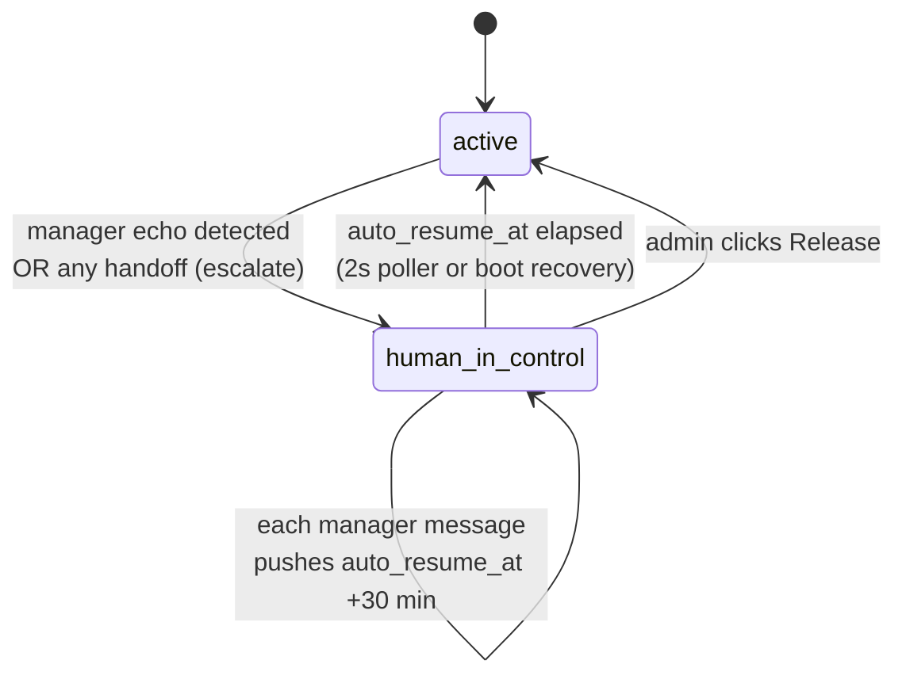

⚠️ **A handoff also sets `human_in_control`** (via `escalate`), but only `handleManagerReply` sets
`auto_resume_at`. **A handoff with no manager reply stays paused indefinitely.**

### 2.7 Outbound send

| Payload | Retry | On failure |
|---|---|---|
| Images | `withRetry` 3× / 2 s | **swallowed at WARN** |
| Primary text | `withRetry` 3× / 2 s | `escalate('send_failed')` |
| `extraReplies` text | `withRetry` 3× / 2 s | same catch |
| Handoff texts | **not retried** | logged only |

📌 **Images are supplementary, text is essential.** A rotated CDN URL or a Meta "Upload attachment
failure" must not escalate a healthy conversation.

📌 **`extraReplies` are essential text, not decoration.** On a first-turn handoff the welcome takes over
`result.reply` and pushes the real announce into `extraReplies[0]` — a sender that only delivers `reply`
produces dead air on exactly the turn the announce exists for.

⚠️ **No rate-limit handling.** No 429 parsing, no `X-Business-Use-Case-Usage` inspection, no backoff
beyond `withRetry`'s exponential delay.

⚠️ `APP_BASE_URL` **must be the public HTTPS origin** — `toPublicImageUrl` absolutizes relative paths
against it, and a localhost fallback makes Meta return a silent 400 on every image send.

---

## 3. Instagram comments

A **separate, single-shot funnel** that deliberately bypasses `ReplyEngineService`.

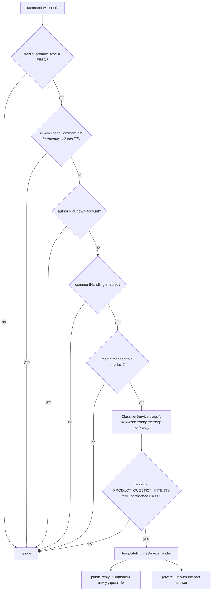

📌 Persisted under channel `'instagram_comment'` — isolated from DM threads by the customer key. The
customer's follow-up arrives as a normal DM on channel `'instagram'` and starts a fresh conversation.
The comment conversation is an audit record, not a funnel.

📌 The Graph senders and `toPublicImageUrl` are **deliberately duplicated** here rather than imported, to
keep the dependency one-directional (`InstagramService` → `InstagramCommentService`). Any change to
attachment semantics must be made in both files.

---

## 4. Media ↔ product mapping

`instagram_media_mappings` links an Instagram post/story to a catalogue product.

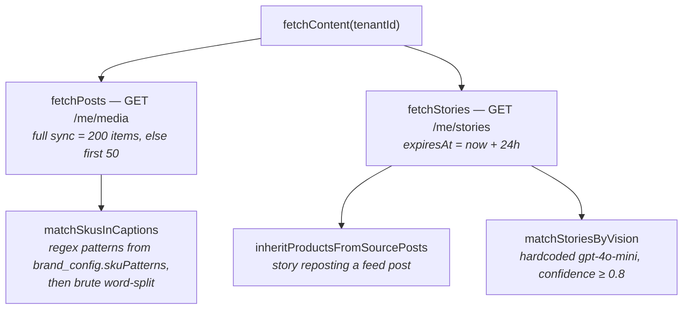

`match_method` vocabulary: `manual`, `bulk_import`, `sku_from_caption`, `story_from_post`,
`ai_vision_match`, `customer_photo_phash`, `customer_photo_exact`, `customer_photo_clip`,
`customer_photo_vision`.

📌 **`linked_color`** enables colour-level links (a story showing the black variant). When set,
`resolveMediaProduct` loads the **full** variant matrix (not the single variant) so the bot can pitch
other colours, then `handleColorLinkedMedia` writes the axis-scoping memory.

⚠️ **`source_post_url` is never written by any code path.** `fetchPosts` omits it and `fetchStories`
passes `null`, so `inheritProductsFromSourcePosts` always finds zero candidates. Either an out-of-band
script populates it or the feature is dead.

Admin surface: `ContentLinkingPage` — list, manual add, bulk fetch, paste-a-link parsing, link/unlink
with an optional colour.

---

## 5. n8n — the orchestration layer

n8n runs as a container in the same compose stack, shares the Postgres instance, and is reachable at
`/n8n/` behind basic auth.

⚠️ **The workflow definitions are not in this repo.** They live only in the `n8n_data` Docker volume.
Losing that volume loses the Torgsoft and Shopify pipelines, and there is no version control over them.

### 5.1 The internal API contract

Every route is guarded by `InternalApiKeyGuard` (`x-internal-key` header).

| Route | Body | Semantics |
|---|---|---|
| `POST /internal/sync/catalog-import` | `CatalogImportDto` | The main ingestion path. One transaction, SAVEPOINT per product |
| `POST /internal/sync/stock-import` | `StockImportDto` | Quantity updates by `externalVariantId` |
| `POST /internal/sync/catalog` \| `/stock` | `SyncTriggerDto` | ⚠️ **Dead ends** — insert a `queued` `sync_jobs` row and return. Nothing polls that table |
| `PATCH /internal/sync/jobs/:id` | `SyncJobStatusDto` | Close a job. **Also stamps `connections.last_sync_at`** |
| `POST /internal/connections/resolve-credentials` | `{connectionId, tenantId, platform, purpose}` | ⚠️ Returns a **decrypted** access token |
| `GET /internal/connections/shopify` | — | Tenant discovery for scheduled workflows |
| `POST /internal/orders/:id/sync-callback` | `SyncCallbackDto` | Order sync result, idempotency-keyed |
| `POST /internal/instagram/fetch-content` | `{tenantId?}` | Omit tenantId to fan out over every connected tenant |
| `POST /internal/instagram/refresh-tokens` | — | Refresh IG tokens expiring within 7 days |
| `POST /conversation/reply` | `ConversationReplyDto` | Full engine invocation on any tenant |

### 5.2 `CatalogImportDto` — the shape an n8n node must produce

```
tenantId       uuid
connectionId   uuid                      // ownership-verified against tenantId
products[]     max 10000
  externalProductId  string   required   // dedup key with tenant
  title              string   required
  description        string?
  category           string?             // legacy single; categories[] wins
  categories         string[]?           // max 10, each ≤100 chars, case-insensitive match
  brand, material, season, modelName     string?
  gender             'male'|'female'|'unisex'|'kids'|null   // @IsIn — anything else 400s
  searchKeywords     string?             // AI-enriched Ukrainian blob
  image              string?             // single URL; images[] wins
  images[]           {url, color?, sortOrder?}
  status             string? default 'active'
  variants[]         required (may be empty)
    externalVariantId string  required
    sku, barcode, size, color  string?
    price             number  @Min(0) required
    salePrice         number?  must be ≥0 AND ≤ price
    currency          string?
    inventoryQty      number?            // negatives ACCEPTED (Torgsoft oversell), clamped to 0
    imageUrl          string?
```

### 5.3 Import semantics

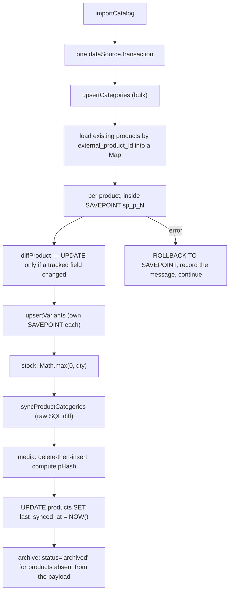

📌 **SAVEPOINT-per-row is what makes import errors legible.** Without it a single constraint violation
turns every later statement into "current transaction is aborted" and the real error is lost.

📌 **Media is delete-then-insert, and only when `images` is present.** `undefined` = "the connector sends
no image signal, keep what's there"; `[]` = "the connector checked, there are none, wipe them".

📌 **Archive, never delete.** Products absent from the payload become `status='archived'`.

📌 **Variant identity is tenant-wide `external_variant_id`, not `(product_id, external_variant_id)`** —
deliberate, so n8n's merge step can re-parent variants onto a canonical product.

### ⚠️ Failure modes an n8n node author must know

1. **Import failures return HTTP 200** with `{success:false, error}`. A node checking only the status code
   reports green on a total failure. (The `sync_jobs` row *is* marked failed.)
2. **`ValidationPipe` uses `forbidNonWhitelisted: false`** — a typo'd field name is silently **stripped**,
   not rejected. Combined with (1), silent data loss is the default failure mode of this API.
3. **`last_sync_at` is only stamped by `PATCH /internal/sync/jobs/:id`.** A workflow that imports but
   never PATCHes leaves it NULL forever — and that is the field `GET /internal/connections/shopify`
   surfaces as an incremental-sync cursor.
4. **nginx caps the body at 20 MB** while the app allows 50 MB. 20 MB is the effective ceiling.
5. `queueSyncJob(tenantId, connectionId ?? '', …)` passes an **empty string** into a uuid column when
   `connectionId` is omitted — Postgres will reject it, so the "optional connectionId" path likely 500s.

---

## 6. Torgsoft — the FTP pipeline

There is **no Torgsoft client in the API**. It is a filesystem pipeline.

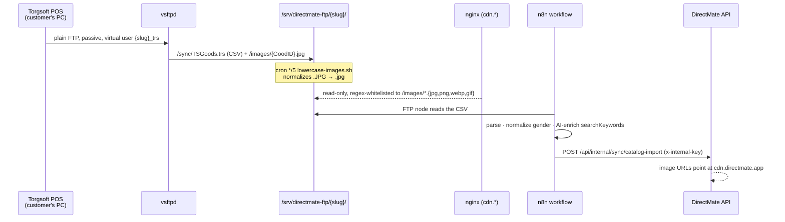

📌 **`/sync/` is unreachable from the internet by construction** — the CDN vhost's regex only admits
`images/` with image extensions. A "just serve the tree" simplification would leak customer catalogues.

📌 A `connections` row with `type='torgsoft'` is inserted **by hand**, purely so
`verifyConnectionOwnership` passes. Its `metadata` (`ftp_login`, `sync_path`, `image_url_prefix`) is
documentation — **no code reads it**. This works because `connections.type` is unconstrained `TEXT`,
which equally means a typo (`'shopfiy'`) is an invisible no-op.

📌 **No FTPS.** Torgsoft only speaks plain FTP. The accepted mitigations are a 128-bit random per-tenant
password, firewalled ports, chroot, no shell, and no backend consumption of the credentials.

Operator CLIs live in `scripts/ftp/`: `add-tenant.sh`, `remove-tenant.sh` (archives rather than deletes),
`list-tenants.sh` (drift report), `lowercase-images.sh`.

---

## 7. Orders → Shopify

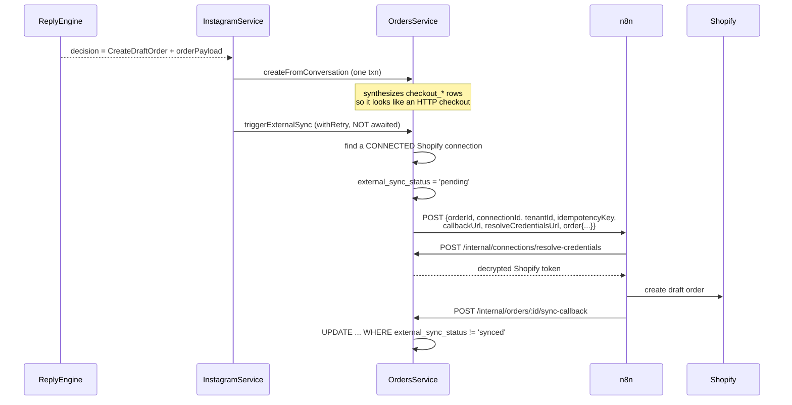

📌 **Credentials are never in the outbound webhook body** — n8n calls back for them.

⚠️ **OpenCart does not exist.** `triggerExternalSync` filters `ConnectionType.Shopify` only, and the enum
has no OpenCart member. WooCommerce / KeyCrm / SalesDrive connections likewise never sync.

⚠️ **Fire-and-forget in three layers**: the caller doesn't await, non-2xx is logged not thrown, network
errors are swallowed. An order can sit at `external_sync_status='pending'` **forever** — there is no
reconciliation cron and no timeout. The only recovery is a human clicking "retry sync".

⚠️ **`idempotencyKey` is constant per order** (`order-{id}-sync-1`). Retries reuse it, so a downstream
dedupe keyed on it would silently swallow every retry. The `-1` suffix implies an attempt counter that
was never implemented.

---

## 8. Telegram

**Two directions, both thin.**

**Outbound (handoff alerts):** fired from `InstagramService`, **not** the engine. `notifyHandoff` formats
a Ukrainian message and fans out over `store_configs.handoff_config.telegramChatIds`.

⚠️ **The retry on the most safety-critical notification in the product is structurally dead.**
`TelegramService.sendMessage` swallows *every* failure — missing token, non-2xx, network throw — and
returns normally. `withRetry` therefore observes a resolved promise every time and can never fire. When
the bot escalates and Telegram is down, **nobody finds out**, and there is no delivery audit trail.

**Inbound (connect flow):**

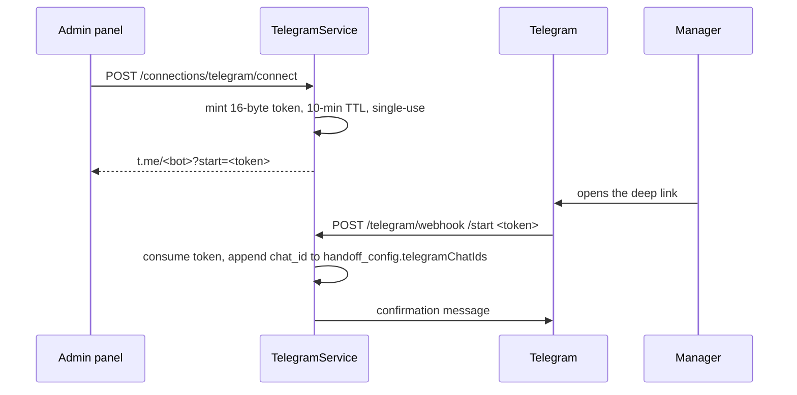

⚠️ **The webhook is fail-open**: `if (expectedSecret && secretToken !== expectedSecret)` — when
`TELEGRAM_WEBHOOK_SECRET` is unset (the default; it is not in the Joi schema) the check is **skipped
entirely**.

⚠️ **Nothing in the repo registers the webhook URL** with the Bot API. It must be done out of band.

⚠️ Chat ids live in `store_configs.handoff_config`, **not** `flow_config.handoff` as `CLAUDE.md` states.

---

## 9. Monobank billing

The only fail-**closed** webhook in the system, and the model to copy.

| | |
|---|---|
| Outbound | `createSubscription` → `{amount, ccy: 980, interval: '1m', redirectUrl, webHookUrls}` |
| Inbound | `POST /subscriptions/webhook/{charge,status}` — **no guard**, verified in-handler |
| Verification | `crypto.createVerify('SHA256')` against a public key fetched from `/api/merchant/pubkey` and **cached in-process forever** |
| Missing signature or rawBody | `BadRequestException` — **fail-closed** |

⚠️ A Monobank key rotation requires an API restart (the PEM cache is never invalidated).

⚠️ `cancelPlan` sets `cancelled` **immediately and never calls Mono** to stop the recurring charge — the
customer loses access at once while Monobank keeps billing. `MonoPaymentService.cancelInvoice` exists and
is unused.

⚠️ Trial→paid promotion **matches the plan by price** (`configRepo.findOne({where:{price: plan.amount}})`).
Two plans at the same price, or a price change between checkout and the first charge webhook,
mis-assigns the plan.

---

## 10. Connections model

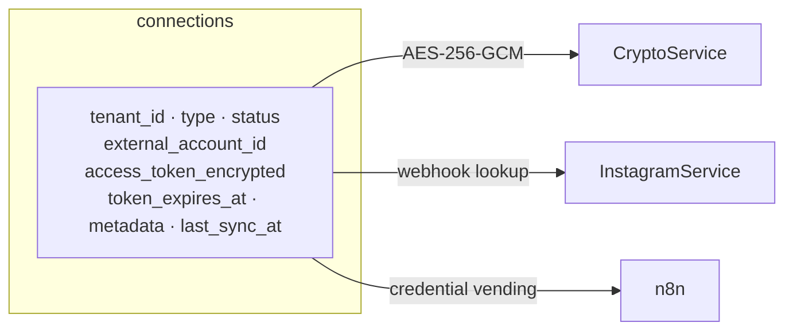

**Supported in practice:** `instagram`, `shopify`, and the hand-inserted `torgsoft`.
💀 `keycrm`, `salesdrive`, `woocommerce`, `google_sheets` are dead enum members.
`telegram` is **not** a connections row at all.

### Instagram OAuth

`POST /connections/instagram/oauth/start` (JWT) mints a 16-byte state token — stored, oddly, in
**`telegram_connect_tokens`** (deliberate reuse, commented in the source) with a 10-minute single-use TTL.
`GET /auth/instagram/callback` is unauthenticated by necessity; the `state` param is the sole tenant
binding.

📌 `external_account_id` must be the **Business Account ID** (matching webhook `entry.id`), not the OAuth
IGSID — the callback deliberately re-queries `graph.instagram.com/me?fields=user_id` to get it, falling
back to the IGSID on failure. ⚠️ A silent failure there produces a connection that **never matches an
inbound webhook**.

⚠️ **Long-lived token exchange failure is swallowed** — `connectInstagram` logs a warning and stores the
~1-hour short-lived token with `tokenExpiresAt = null`. `refreshExpiringTokens` filters on
`tokenExpiresAt < now+7d`, so a NULL expiry is **never picked up** and that connection quietly dies.

⚠️ **Nothing in-process refreshes tokens.** `refreshExpiringTokens` runs only when n8n calls
`POST /internal/instagram/refresh-tokens`. **If n8n is down, Instagram tokens silently expire.**

---

## 11. Adding a new channel

The engine is channel-agnostic. Replicate the production pattern:

```ts
const recentMessages = (await conversationsService.findById(conversationId))
  .messages.slice(-10).map(m => ({ role: m.role, text: m.text }));

await replyEngineService.process({
  source: 'my_channel',          // add to the TraceSource union
  tenantId, conversationId,
  messageText: combinedText,     // joined buffer texts if you debounce
  state: freshState,             // load fresh from DB before the call
  recentMessages,                // last 10, at call time — never cached
  mediaReference,                // optional
  traceId: randomUUID(),
});
```

**Rules:**
1. **Never pass an `isDemo` or channel flag into the engine.** Suppress side effects at your boundary.
2. Load `state` and `recentMessages` **fresh from the DB at call time**.
3. Consume `extraReplies` — they carry essential text.
4. If you emit an order payload, **override `customerId`** with the real customer id.
5. Add your `TraceSource` value, or your traces record `'unknown'`.
