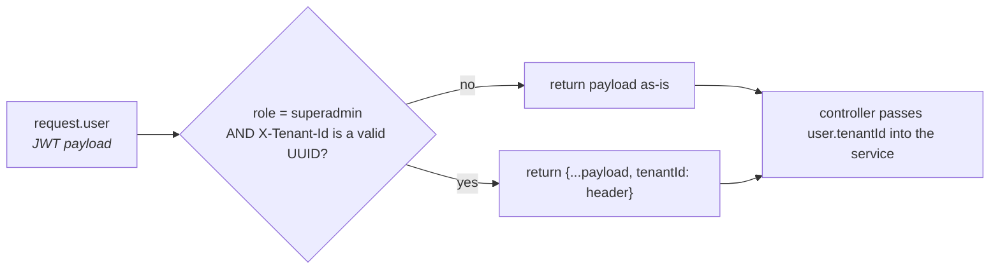
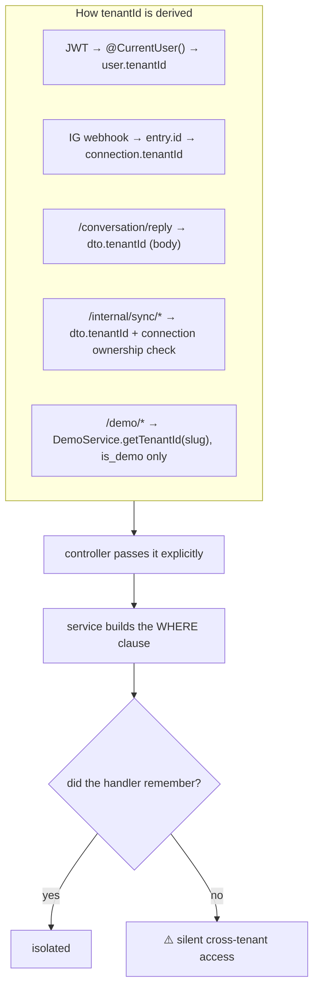
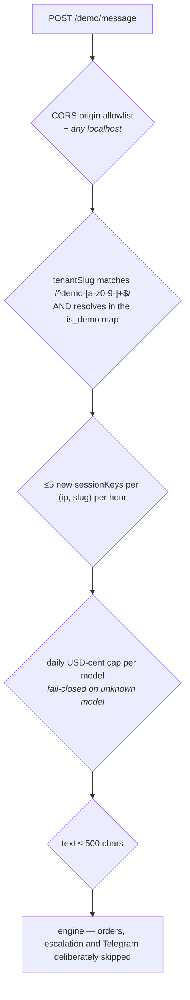

# 07 — Authentication, Authorization & Multi-Tenancy

← [06 Integrations](06-integrations-and-channels.md) · [Index](00-README.md) · Next: [08 Async & Events](08-async-and-events.md)

**117 routes, 7 trust boundaries, 3 guards.** Read this before adding an endpoint.

---

## 1. The seven trust boundaries

```mermaid
flowchart TB
    subgraph B1["1 — Admin JWT"]
        A1["Bearer token · HS256 · 7d<br/>localStorage['accessToken']<br/>→ 17 controllers"]
    end
    subgraph B2["2 — Internal API key"]
        A2["x-internal-key header<br/>static, no rotation<br/>→ cross-tenant n8n surface"]
    end
    subgraph B3["3 — Meta webhook"]
        A3["hub.verify_token (GET)<br/>HMAC-SHA256 rawBody (POST)<br/>⚠️ conditional"]
    end
    subgraph B4["4 — Demo public"]
        A4["no credential<br/>CORS + rate limit + budget + length cap"]
    end
    subgraph B5["5 — Monobank"]
        A5["X-Sign vs fetched public key<br/>✅ fail-closed"]
    end
    subgraph B6["6 — Telegram"]
        A6["x-telegram-bot-api-secret-token<br/>⚠️ fail-open when unset"]
    end
    subgraph B7["7 — Instagram OAuth state"]
        A7["16-byte single-use token<br/>10-min TTL"]
    end
```

⚠️ **Webhook verification is inconsistent across the three webhooks.** Mono fails closed. Meta fails
open on a missing header. Telegram fails open on an unset env var. Standardising on Mono's shape is the
obvious cleanup.

---

## 2. The JWT

| Property | Value |
|---|---|
| Claims | `{ sub, email, role, tenantId }` — nothing else |
| Algorithm | HS256, secret `JWT_SECRET` (Joi-**required**, so boot fails without it) |
| Expiry | `JWT_EXPIRES_IN`, default **7d**. Impersonation tokens are **2h** (a second `JwtModule` in `AdminModule`, same secret) |
| Refresh | **None.** No refresh token, no rotation, no revocation list |
| Logout | `POST /auth/logout` is a **client-side no-op** |
| Validation | `JwtStrategy.validate` only asserts `payload.sub` is truthy |
| Storage | `localStorage['accessToken']`, attached by an axios request interceptor |

⚠️ **The strategy never re-reads the DB.** `users.is_active = false`, a role downgrade, or a deleted user
**does not invalidate a live token** until it expires. A leaked token is good for its full 7 days.

⚠️ **Impersonation JWTs transit in a URL** — `POST /admin/tenants/:id/impersonate` returns a token, and
the frontend opens `/login?impersonate=<jwt>`. It lands in browser history, referrers, and nginx access
logs. There is no `act`/`impersonatedBy` claim either, so **audit logs attribute impersonated actions to
the tenant owner**.

---

## 3. Guards

| Guard | Mechanism | Applied to |
|---|---|---|
| `JwtAuthGuard` | 3 lines: `extends AuthGuard('jwt')`. No `@Public()` escape hatch | 17 controllers (13 class-level, 4 per-route) |
| `RolesGuard` | Reads `'roles'` metadata handler-first-then-class; **`if (!roles) return true`** (open by default) | **exactly one** controller: `AdminController` |
| `InternalApiKeyGuard` | Plain `!==` compare of `x-internal-key` vs `INTERNAL_API_KEY` (Joi-required) | 4 controllers + 1 route |

⚠️ **There is no global guard.** `APP_GUARD` appears nowhere in the codebase. Anything without an
explicit `@UseGuards` is **unauthenticated**.

⚠️ **`RolesGuard` is fail-open by design** and depends on `JwtAuthGuard` running first to populate
`request.user`. `AdminController` orders them correctly.

### The role model

`UserRole` declares `owner | manager | admin | superadmin`. **Only `owner` and `superadmin` are ever
checked.** `manager` and `admin` are functionally identical to `owner` for every tenant-scoped endpoint,
`AuthService.register` always creates `owner`, and there is **no invite/team-member endpoint anywhere** —
so they are unreachable states today.

Superadmin is not a separate auth realm: it is a row in `users` with `role='superadmin'` on the fixed
system tenant `00000000-…-0`. Separation is `RolesGuard` on `/admin/*` plus **three ad-hoc in-handler
checks**: `ConversationsController.traces`, `TestingController.assertSuperadmin` (the 4 live-console
routes), and `TestingController.filterScenariosForRequest`.

---

## 4. ⚠️ `@CurrentUser()` can rewrite tenant identity

This is the single most surprising thing in the auth layer.

The override lives inside a **param decorator**, not a guard or interceptor. Consequences:

- **Every `JwtAuthGuard`-only route inherits cross-tenant impersonation** without opting in — settings,
  analytics, training review, Telegram connect, all of it.
- Code that reads `request.user` **directly** (only `TestingController.filterScenariosForRequest` today)
  sees the un-overridden value — which is exactly what makes "superadmin with no override sees all
  scenarios" expressible.
- Nothing in nginx strips a client-supplied `X-Tenant-Id`; it reaches Nest verbatim. Harmless today
  because the decorator gates on role, but it is a header the app trusts.

The admin SPA drives this from `localStorage['overrideTenantId']` via the tenant switcher.

---

## 5. Tenant isolation

**Application-level only.** There is **no Postgres RLS**, no `CREATE POLICY`, no request-scoped context,
no `AsyncLocalStorage`, no TypeORM global scope. Every guarantee is a hand-written `WHERE tenant_id = :x`.

> **A reviewer's checklist for any new handler:** does it take `@CurrentUser()`, and does that
> `tenantId` reach the `where` clause?

⚠️ **Optional `tenantId?` parameters are a footgun.** `ConversationsService.findById`, `takeover`,
`release` and `OrdersService.findById` all accept it optionally — passing `undefined` **silently
disables the filter**.

### 5.1 Known IDOR gaps

Nine of 117 routes drop the tenant filter. Neighbouring handlers in the same files scope correctly, which
reads as oversight rather than decision — **confirm with the author before filing**.

| ID | Route | Sink | Impact |
|---|---|---|---|
| **A2** | `PATCH`/`DELETE /engine/templates/:id`, `DELETE /engine/phrase-blocks/:id`, `PATCH`/`DELETE /engine/faq/:id` | `store-config.controller.ts` — `.update(id, body)` / `.delete(id)` | **Highest impact.** Cross-tenant tampering with the bot's entire customer-facing voice |
| **A1** | `GET /logs/conversation/:id` | `audit.service.ts` `getConversationLogs(conversationId)` | Read another tenant's full audit trail. Contrast `ConversationsController.traces`, which deliberately re-checks ownership first |
| **A4** | `PATCH /checkout/:id/customer-info` | `checkout.service.ts` | Overwrite another tenant's customer PII. The controller doesn't even accept `@CurrentUser()` |
| **A5** | `POST /orders/draft` | `orders.service.ts` `createDraft(sessionId)` | Creates an order under *that session's* tenant |
| **A6** | `POST /checkout/start` | `checkout.service.ts` — variant looked up by id alone | Reference another tenant's product |
| **A3** | `DELETE /settings/examples/:id` | `settings.service.ts` | Cross-tenant soft-delete |
| **A7** | `GET /testing/runs/:id` | `testing.service.ts` | Read another tenant's simulated transcripts |
| **A8** | `PATCH /testing/runs/:runId/scenarios/:scenarioId` | `testing.service.ts` — **`runId` is ignored entirely** | Cross-tenant write |
| **A9** | `PATCH`/`POST /instagram/media-mappings` | `instagram-content.service.ts` | The *mapping* is scoped, but the incoming `productId`/`variantId` are not checked — point your IG media at a foreign product |

📌 **Correct-by-contrast examples** worth copying: `ConversationsService.findById(id, tenantId)`,
`SizeChartsService.update/delete`, `ScreenshotApprovalService.applyFragment(fragmentId, tenantId)`,
`InternalController.verifyConnectionOwnership`, `IntegrationsService.resolveCredentials`.

### 5.2 Over-disclosure

| ID | Where | Detail |
|---|---|---|
| **C1** | `GET /auth/me` | Returns the raw `User` entity. `passwordHash` is a plain `@Column` with no `@Exclude`, and there is **no global `ClassSerializerInterceptor`** — so the endpoint returns the caller's own bcrypt hash. Note `login()` deliberately hand-projects the user to avoid this; `me()` was missed |
| **C2** | `GET /connections` | Returns full `Connection` entities including `accessTokenEncrypted`. Ciphertext only, so low severity — but needless, and it survives into devtools and cached query state |

---

## 6. The endpoint → guard matrix

**Unauthenticated surface** (intentional unless flagged):

| Method | Path | Protection |
|---|---|---|
| GET | `/health` | none — leaks only `db: connected\|disconnected` |
| GET | `/docs` | ⚠️ **none** — Swagger enumerates the entire API including `/internal/*` |
| GET | `/static/*` | none — privacy/terms HTML, a Meta app-review requirement |
| GET | `/uploads/*` | ⚠️ **none** — capability-URL security only (`randomUUID()` filenames) |
| POST | `/auth/register` | ⚠️ `@Throttle` present but **not enforced** |
| POST | `/auth/login` | ⚠️ nothing but nginx `limit_req` |
| POST | `/auth/logout` | no-op |
| GET/POST | `/channels/instagram/webhook` | verify token / HMAC — ⚠️ **conditional** |
| POST | `/telegram/webhook` | secret header — ⚠️ **fail-open when unset** |
| POST | `/subscriptions/webhook/{charge,status}` | ✅ Mono signature, fail-closed |
| GET | `/auth/instagram/callback` | single-use OAuth `state` |
| POST | `/demo/message` | CORS + rate limit + budget + 500-char cap |
| GET | `/demo/catalog` | CORS only — ⚠️ **no rate limit** |

**Guarded surface** (summary — full 117-row table in the source reports):

| Guard | Controllers |
|---|---|
| `JwtAuthGuard` class-level | Analytics, Audit, Availability, Catalog, Conversations, StoreConfig, Integrations, InstagramContent, ScreenshotReview, ScreenshotUpload, Settings, SizeCharts, Testing |
| `JwtAuthGuard` per-route | Auth (2 of 5), Orders (7 of 8), Subscriptions (4 of 6), Telegram (3 of 4), InstagramOAuth (1 of 2) |
| `JwtAuthGuard` + `RolesGuard` + `@Roles('superadmin')` | Admin (all 10 routes) |
| `JwtAuthGuard` + inline superadmin check | `GET /conversations/:id/traces`, the 4 `/testing/simulator/live/*` routes |
| `InternalApiKeyGuard` | Internal (5), InternalConnections (2), InternalInstagramContent (2), ConversationReply (1), Orders sync-callback (1) |

---

## 7. The internal API key

One static secret grants **cross-tenant** access to: catalogue and stock imports, sync-job status, order
sync callbacks, **decrypted connection credentials**, IG content fetch, IG token refresh, and a full
engine invocation on any tenant.

| | |
|---|---|
| Issued | out of band, a static env var |
| Rotation | **none** — no key versioning, no second key |
| Scope | **tenant-agnostic** — the caller names the tenant in the body |
| Comparison | plain `!==`, not constant-time |

📌 **`InternalController.verifyConnectionOwnership` is the one thing that closes the "any tenant" hole**
for catalogue/stock imports — it loads the connection and throws unless `conn.tenantId === dto.tenantId`.
It is **not** applied to `PATCH /internal/sync/jobs/:id`.

⚠️ **The nginx `/internal/` IP allowlist is bypassable.** `location /api/` does
`proxy_pass http://api:3000/` with a trailing slash, which strips the prefix — so
`POST /api/internal/sync/catalog-import` reaches the same handler **without** hitting the
`allow 172.16.0.0/12; deny all;` block. The Torgsoft onboarding doc instructs operators to use exactly
that bypassing form. Additionally, `ConversationReplyController` mounts at `/conversation/reply`,
**outside** the `/internal` prefix, so the allowlist never covered it.

> **`InternalApiKeyGuard` is the real control. The nginx rule is partial defence-in-depth and is easy to
> over-trust.**

---

## 8. The public demo surface

Four independent layers, none of which is a credential:

📌 **CORS is browser-enforced only.** A non-browser client bypasses it entirely — which is precisely why
the rate limiter and budget cap exist.

⚠️ **`app.set('trust proxy', true)` is fully permissive**, so any client-supplied `X-Forwarded-For`
becomes `req.ip`. The per-IP limiter is trivially evaded by anything that can reach the Node process
without traversing nginx.

⚠️ The rate limiter is a per-process `Map` — effective quota is `limit × replicas`.

---

## 9. Rate limiting

⚠️ **`@nestjs/throttler` is installed, configured, and never enforced.** `ThrottlerModule.forRoot` is
imported in `AuthModule` and `@Throttle` decorates `POST /auth/register`, but **no `APP_GUARD` provider
exists anywhere** — and from v5 you must register `ThrottlerGuard` yourself.

> **Net effect: `/auth/login` and `/auth/register` have no application-level rate limit at all** —
> unlimited credential stuffing against bcrypt-10, which is also a CPU-exhaustion vector.

What *is* enforced:

| Layer | Scope |
|---|---|
| nginx `limit_req zone=api` | 60 r/s, burst 20, per IP on `/api/` — **the only thing between the internet and `/auth/login`** |
| nginx `limit_req zone=webhooks` | 30 r/s, burst 10, on `/channels/` |
| `DemoRateLimiterService` | 5 new sessions/hour per (IP, tenant), in-memory |
| `DemoBudgetService` | daily USD-cent caps per model, Postgres-backed, fail-closed |

---

## 10. Secrets at rest

| Class | Items |
|---|---|
| **Encrypted** (AES-256-GCM, `ENCRYPTION_KEY`) | `connections.access_token_encrypted`, `refresh_token_encrypted` |
| **Hashed** | `users.password_hash` (bcrypt cost 10) |
| **Plaintext in DB** | `telegram_connect_tokens.token` (single-use, 10 min), Telegram chat ids, **all conversation content** (`messages.text`, `raw_payload`), customer PII (`checkout_customer_info`), `conversation_traces` (full classifier I/O + memory snapshots) |
| **Plaintext in env** | `JWT_SECRET`, `INTERNAL_API_KEY`, `META_APP_SECRET`, `OPENAI_API_KEY`, `ANTHROPIC_API_KEY`, `TELEGRAM_BOT_TOKEN`, `MONO_MERCHANT_TOKEN`, `REPLICATE_API_TOKEN`, `ENCRYPTION_KEY` |

⚠️ **`ENCRYPTION_KEY` is not in the Joi schema.** The guard is the `CryptoService` constructor, which
throws `InternalServerErrorException` at DI time if the key is not exactly 64 hex chars — a boot failure,
but with a 500-shaped error rather than a clear startup validation message.

⚠️ **`CryptoService` is provided in four modules and exported from none**, so each injector scope gets
its own instance. Harmless (stateless after construction) but it means adding a fifth consumer requires
adding it to that module's `providers`.

⚠️ **Uploaded files are world-readable by URL.** `POST /size-charts/upload` and
`POST /training/screenshots/upload` both write uuid-named files into one flat, **tenant-shared**
`uploads/` directory that `main.ts` serves publicly at `/uploads` with no auth and no path scoping.
Training screenshots are real customer DM captures.

---

## 11. Checklist for a new endpoint

1. **Pick a guard.** No guard = public. There is no global default.
2. **Take `@CurrentUser()`** and pass `user.tenantId` into the service.
3. **Scope the query.** For `:id` routes, filter on `{ id, tenantId }` — not `id` alone.
4. **Validate the body with a DTO class.** `StoreConfigController` and `POST /settings/examples` use
   `Partial<Entity>` / `any`, which bypasses the global `ValidationPipe` entirely.
5. **Never return a raw entity** that has a sensitive column. There is no serializer interceptor.
6. **If it is a webhook, fail closed** — copy the Monobank handler, not the Meta one.
7. **If it writes to `uploads/`**, remember the directory is public.

---

## 12. Open questions

1. **Is `POST /channels/instagram/webhook` reachable without a signature in production?** The handler
   allows it; nothing in nginx blocks it. A Cloudflare WAF or Meta-IP allowlist would close it — unverified.
2. **Is `TELEGRAM_WEBHOOK_SECRET` actually set in prod?** Absent from `.env.example` and the Joi schema.
3. **How is `INTERNAL_API_KEY` distributed to and rotated in n8n?** Nothing in `docker-compose.prod.yml`
   passes it to the n8n service.
4. **Were `manager`/`admin` roles ever intended to differ?** Nothing creates or checks them.
5. **Are the A1–A9 IDOR gaps known and accepted, or missed?** `CLAUDE.md` documents extensive engine-level
   debt but says nothing about tenant scoping.
6. **Is `X-Tenant-Id` stripped at the edge?** Nothing in nginx does.
