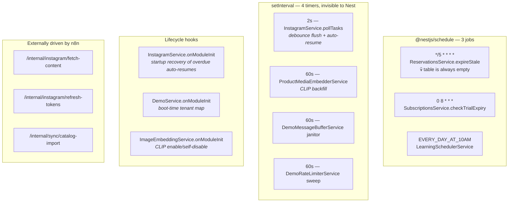
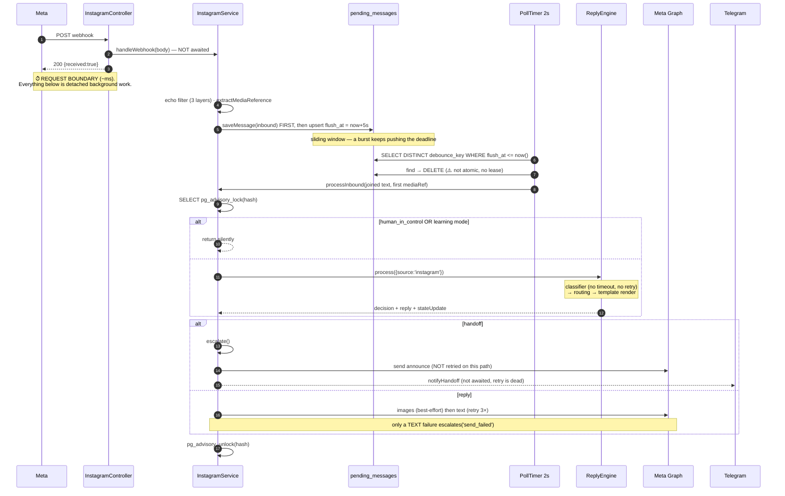

# 08 — Async, Background Workers & Event Flows

← [07 Auth & Tenancy](07-auth-and-tenancy.md) · [Index](00-README.md) · Next: [09 Admin Frontend](09-admin-frontend.md)

> **There is no message broker, no BullMQ, no Redis, no EventEmitter, and no separate worker process
> anywhere in this repo.** Everything below runs inside the single `apps/api` Node process, alongside HTTP
> request handling.

That one fact explains most of this document.

---

## 1. The full background-work inventory



### Scheduled jobs

| Expression | Job | Failure behaviour | Multi-replica safe? |
|---|---|---|---|
| `*/5 * * * *` | `ReservationsService.expireStale` | **No try/catch** — a throw aborts the pass mid-loop | ❌ read-then-update with no locking → double-decrement. 💀 Moot: the table is never written |
| `0 8 * * *` | `SubscriptionsService.checkTrialExpiry` | no try/catch around the loop | Idempotent, but **cache invalidation is process-local** — another replica serves a stale verdict for ≤5 min |
| `EVERY_DAY_AT_10AM` | `LearningSchedulerService.checkLearningPeriodExpiry` | per-tenant try/catch, logs and continues ✅ | Partially — `learning_notified_at` is the dedup stamp but check and write are not atomic |

### `setInterval` timers

⚠️ These are **not registered with `SchedulerRegistry`**, so they are invisible to Nest's scheduler
introspection and to a `@Cron` grep.

| Interval | What | Multi-replica hazard |
|---|---|---|
| **2 s** | `flushReadyMessages()` + `autoResumeExpired()` | ❌ **The worst one.** `find` → `delete` is not atomic and there is no `FOR UPDATE SKIP LOCKED`. Two replicas both claim a key → duplicate OpenAI spend and **two replies to the customer** |
| 60 s | CLIP backfill, batch 10, sequential, 15-min per-row backoff | ❌ but degrades gracefully — duplicate Replicate calls (money), not corruption |
| 60 s | demo buffer janitor — force-flush entries idle > 60 s | per-process by construction |
| 60 s | demo rate-limiter sweep | quota multiplied by replica count |

---

## 2. In-memory state — the scaling ceiling

Eight stateful singletons. **Only one cross-process-safe counter exists in the entire system**
(`demo_spend_daily`, via `INSERT … ON CONFLICT`).

| Holder | Contents | Eviction | Hazard under >1 replica |
|---|---|---|---|
| `InstagramService.recentSentMids` | MIDs the bot just sent | `setTimeout` 5 min | A sends, B receives the echo → **B treats the bot's own message as a manager reply** and freezes the conversation |
| `InstagramService.recentSendByRecipient` | recipientId → last send ts | ⚠️ **never evicted** | Same blindness + a slow memory leak proportional to lifetime distinct customers |
| `InstagramCommentService.processedCommentIds` | answered comment ids | `setTimeout` 10 min | Duplicate public reply + duplicate DM. **No DB-level dedup exists for comments** |
| `LearningObserverService.recentCustomerMessages` | customer msg awaiting a manager reply | only on `recordManagerReply` → ⚠️ **leaks forever** if the manager never answers | Customer on A, manager echo on B → fragment silently dropped |
| `SubscriptionsService.activePlanCache` | tenant → plan-active verdict | 5-min TTL, lazy | A tenant who just paid stays soft-blocked; a cancelled tenant keeps replying, for ≤5 min |
| `DemoService.demoTenants` | slug → tenantId | boot only | Consistent only if all replicas restarted after the seed |
| `DemoMessageBufferService.buffers` | debounce texts **+ the held-open HTTP resolvers** | timer + 60 s janitor | **Sticky sessions required** |
| `DemoRateLimiterService.entries` | new-session counts per (IP, slug) | 60 s sweep | quota × replicas |

> ⚠️ **Treat single-replica as a hard constraint, not a default.** The production compose file runs one
> `api` service, which is why none of this has bitten yet.

---

## 3. Fire-and-forget — the invisible failure modes

Ordered by blast radius. These are the calls that fail silently.

| Site | Call | Consequence |
|---|---|---|
| `instagram.controller.ts:51` | `handleWebhook(body).catch(console.error)` | ⚠️ **The entire inbound pipeline is fire-and-forget.** Meta gets `200` regardless. A throw anywhere = message silently lost, no retry, no DLQ |
| `instagram.service.ts:429` | `await handleIncomingMessage(...)` bare inside the `for (messaging)` loop, **no try/catch** | One DB error **aborts every remaining event in the same webhook batch**. The `changes` loop three lines below *is* protected per-item |
| `instagram.service.ts:763` | `withRetry(telegramService.notifyHandoff).catch(log)` | **Manager never told a customer is waiting** — and the retry is structurally dead (§6) |
| `orders.service.ts:128` | `withRetry(notifyManager).catch(log)` — **started inside `dataSource.transaction()`** | The promise outlives the transaction; if it rolls back, the webhook still fires for an order that doesn't exist |
| `orders.service.ts:460` | `triggerExternalSync(saved).catch(log)` on status → confirmed | Admin sees "confirmed" while Shopify never received the order |
| `reply-engine.service.ts:386` | `void persistTrace(...)` in `finally` | Trace missing. `ConversationTracesService.persist` **also** swallows its own errors — failures are double-buried |
| `reply-engine.service.ts:218` | `fs.appendFile(LOG_FILE, line, () => {})` — **empty error callback** | `conversations.log` writes fail completely silently (full disk, permissions) |
| `screenshot-upload.controller.ts:97` | `processJob(id).catch(console.error)` | Job stuck at `processing` forever. **No resume on restart** |
| `auth.service.ts:160` | `setTimeout(() => createTrialForTenant(...), 0)` | New tenant with **no `subscription_plans` row**. Fails open (`isActive` returns true for a missing plan) but no reconciliation job exists |
| `reply-engine.service.ts:1255` | `saveUnlinkedMedia(...).catch(log)` then immediately `return doHandoff(...)` | The admin never sees the media that needs linking |

---

## 4. The canonical async lifecycle: an inbound DM



**Customer-perceived latency:** 5 s debounce + 0–2 s poll jitter + 1–2 LLM round trips + Meta send
≈ **7–15 s**.

📌 The demo widget is the mirror image: it **holds the HTTP response open** across the whole engine call
(~3–10 s), so any proxy idle timeout below ~30 s breaks the demo before the engine does.

---

## 5. Retry, idempotency, and what passes for a queue

### `withRetry` — the only retry primitive

Exponential `baseDelayMs × 2^(attempt-1)`, 3 attempts. **No jitter, no per-attempt timeout, no error-class
discrimination** — a 400 from Meta is retried exactly like a 503.

| Site | Awaited? | Note |
|---|---|---|
| IG images | yes → swallowed at WARN | supplementary by design |
| IG primary text | yes | the only failure that escalates |
| IG `extraReplies` text | yes | |
| **IG → Telegram handoff** | **no** | ⚠️ **structurally dead** — see §6 |
| IG → order sync | no | |
| Orders → manager webhook | no, and started inside a transaction | |
| Comment public reply | yes → `.catch(log)` | |
| Comment private DM | yes | |

⚠️ **Not retried at all:** every OpenAI/Anthropic call, every Replicate call (beyond its internal poll),
token refresh, OAuth code exchange, and all `pending_messages` DB work.

### Idempotency

| Mechanism | Where |
|---|---|
| ✅ `order-{id}-sync-1` + conditional `UPDATE … WHERE external_sync_status != 'synced'` | order sync callback — a real atomic check-and-set |
| ✅ `INSERT … ON CONFLICT (day, model) DO UPDATE` | demo spend |
| ✅ `ON CONFLICT DO NOTHING` | customer-photo match cache |
| ✅ diff-based upsert | catalogue import |
| ⚠️ in-memory `Set`, 10-min TTL, no DB check | comment dedup |
| ❌ **none** | **the Instagram webhook itself** — Meta resends land as new rows and are processed again |

### Failure persistence

| Store | Semantics |
|---|---|
| `product_media.embedding_attempted_at` | ✅ **The only true retry-with-backoff queue.** Stamped after *every* attempt, 15-min per-row backoff so a dead URL can't dominate |
| `orders.external_sync_status` | `pending` forever on a thrown fetch — no auto-retry, no alert, manual `retry-sync` only |
| `sync_jobs.status` | an audit trail, **not** a work queue — nothing polls `queued` |
| `conversations.auto_resume_at` | ✅ recovered at boot and polled every 2 s |
| `pending_messages` | ⚠️ **not a durable queue** — see below |
| `screenshot_import_jobs` / `test_runs` | no resume on restart; stuck rows need manual intervention |

> **There is no dead-letter queue anywhere.** Every terminal failure is a `logger.error` line.

---

## 6. Two structural bugs worth knowing on day one

### ⚠️ 6.1 The Telegram retry can never fire

`TelegramService.sendMessage` **swallows every failure** — missing token, non-2xx, network throw — and
returns normally. `withRetry` therefore observes a resolved promise every single time.

> **The retry wrapper on the most safety-critical notification in the product is dead code.** Any review
> that "adds retry to Telegram" without changing `sendMessage` changes nothing. When the bot escalates
> and Telegram is down, nobody finds out, and there is no delivery audit trail.

### ⚠️ 6.2 The advisory lock almost certainly leaks

```ts
await this.dataSource.query('SELECT pg_advisory_lock($1)', [key]);   // connection A
// ... the whole turn ...
await this.dataSource.query('SELECT pg_advisory_unlock($1)', [key]); // possibly connection B
```

`dataSource.query()` acquires a pooled connection, runs the statement, and **returns the connection to
the pool**. Session-level advisory locks belong to the session that took them, so the unlock returns
`false` (with a Postgres WARNING) and **the original lock persists until that pooled connection closes**.
Subsequent conversations hashing to the same key on that connection block forever.

The in-code comment even mentions `pg_advisory_xact_lock` — but the code calls the *session* variant, and
there is no surrounding transaction for the xact variant to attach to.

**Before touching this, verify against production:**
```sql
SELECT * FROM pg_locks WHERE locktype = 'advisory';
```
The fix is a dedicated `QueryRunner` held for the turn's duration, or moving the whole turn into a
transaction with `pg_advisory_xact_lock`.

⚠️ Related: `conversationLockKey` folds a UUID into a **signed 32-bit int**, so unrelated conversations
serialise against each other. Harmless for correctness, invisible in latency debugging.

---

## 7. What should be queued and is not

Ranked by value.

1. **The inbound DM turn.** `pending_messages` *looks* like a queue but rows are `DELETE`d **before** the
   engine runs — no lease, no visibility timeout, no attempt counter, no failure state. A crash, a
   SIGTERM, or a thrown error between the DELETE and the Meta send **silently drops a paying customer's
   message**. Fix: atomic claim (`UPDATE … SET claimed_at WHERE claimed_at IS NULL RETURNING *` or
   `SELECT … FOR UPDATE SKIP LOCKED`) and delete only after successful delivery.
2. **Catalogue import.** 1–5 MB payloads inside **one open transaction spanning hundreds of external
   image fetches and `sharp` decodes**. Long-held transaction → bloat, lock contention, total loss on a
   tail network hiccup. At minimum, move pHash computation out of the transaction.
3. **`POST /internal/instagram/fetch-content` with no tenantId** iterates *every* connected tenant,
   paginating the Graph API and running GPT-4o vision inline, in one HTTP request. Unbounded duration, no
   checkpoint.
4. **Telegram handoff notification** — needs an outbox row (see §6.1).
5. **Order → n8n sync** — nothing reconciles stale `pending` orders.
6. **Comment handling** — fire-and-forget, deduped only in memory.
7. **Screenshot extraction and test runs** — no checkpointing, no resume.
8. **Trial creation** via `setTimeout(…, 0)` outside the registration transaction.
9. **The learning dry-run** — a second full engine turn (real LLM cost) per inbound message, with no
   accounting and no backpressure.
10. ⚠️ **Per-turn LLM calls have no timeout.** A hung provider connection pins the advisory lock and a DB
    connection indefinitely — and because `flushReadyMessages` is sequential, **one stuck turn stalls
    every other tenant's flush on that replica**.

---

## 8. Shutdown behaviour

⚠️ **No graceful shutdown.** `main.ts` enables no shutdown hooks; there is no `OnApplicationShutdown`
anywhere.

| On SIGTERM | Result |
|---|---|
| `InstagramService.onModuleDestroy` | clears the poller — **does not drain in-flight `processInbound`**. A turn mid-flight loses its reply and leaves the advisory lock held |
| `DemoMessageBufferService.onModuleDestroy` | clears timers and the map — ⚠️ **pending resolvers are never resolved or rejected**, so in-flight demo HTTP requests hang until the client times out |
| In-memory state | all of §2 is lost. Rate-limit windows reset, echo maps empty, `conversations.log` (in the container's writable layer) is destroyed |

**Every deploy restarts the api container**, so this is not a rare path — it is the normal one.

---

## 9. Event-driven components: what exists instead

There is no event bus. The closest things:

| Pattern | Implementation |
|---|---|
| **Inbound event** | Meta webhook → fire-and-forget dispatch |
| **Deferred work** | `pending_messages` + a 2 s poller |
| **Retry-with-backoff** | `product_media.embedding_attempted_at` + a partial index |
| **Callback** | n8n → `POST /internal/orders/:id/sync-callback` |
| **Scheduled** | 3 `@Cron` + 4 `setInterval` |
| **Eventual consistency for the UI** | ⚠️ **polling** — 3 s to 60 s per page. No websockets, no SSE |

Admin polling intervals: conversation detail 5 s · traces 10 s · conversations list 15 s · dashboard 60 s
· test runs 3–5 s · Telegram pairing 3 s.

---

## 10. Open questions

1. **Does the advisory-lock leak manifest in production?** Reasoned from `DataSource.query` semantics, not
   observed. Check `pg_locks` before designing a fix.
2. **Postgres pool size** — `database.module.ts` sets no `extra.max`, so it is node-pg's default of 10.
   With a hung LLM call pinning a connection, that is a small budget.
3. **n8n schedule cadences** — the workflows are not in this repo; the 30-min/10-min/15-min figures come
   from `CLAUDE.md` prose only.
4. **Does Meta retry webhooks we ack with 200 and then drop internally?** Meta documents retries only for
   non-2xx, so the fire-and-forget ack almost certainly forfeits provider-side retry.
5. **Were `checkConversationLimit` / `incrementConversationCount` removed, never wired, or expected to be
   driven externally?** Both have zero callers.
