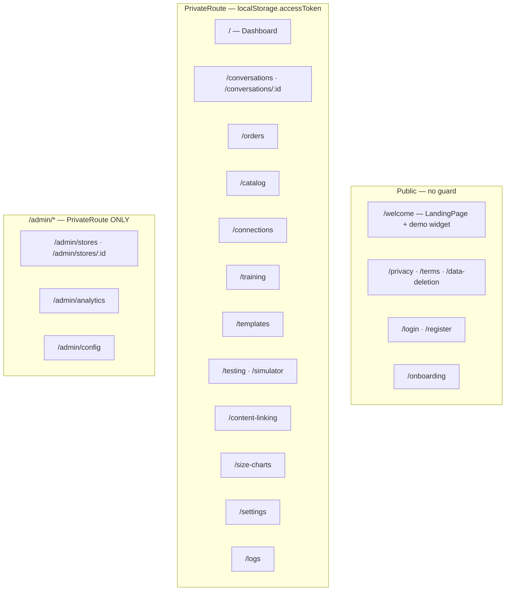
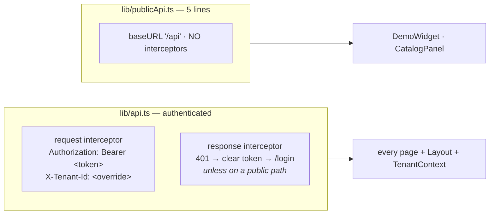
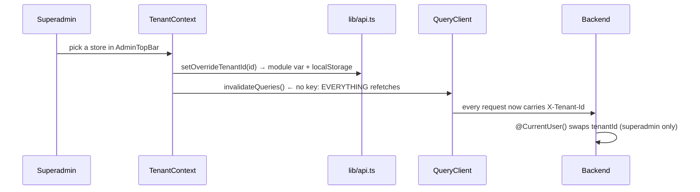
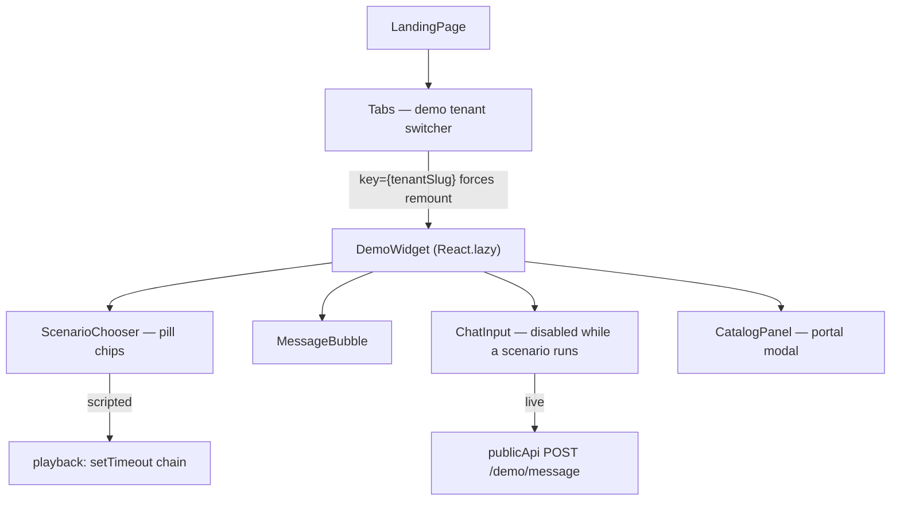
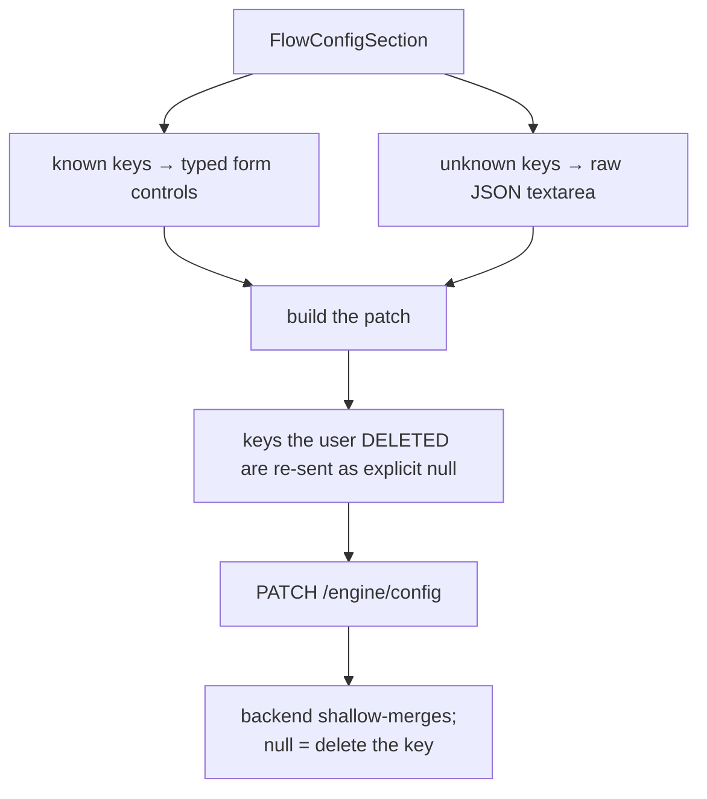

# 09 — Admin Frontend

← [08 Async & Events](08-async-and-events.md) · [Index](00-README.md) · Next: [10 Deployment](10-deployment.md)

One React SPA serves **three audiences**: the public marketing site + demo widget, the per-tenant store
operator panel, and the platform-superadmin console.

**Path:** `apps/admin/`

---

## 1. Stack

| Concern | Choice |
|---|---|
| Framework | React 18 + TypeScript, Vite 5 |
| Routing | react-router-dom v6 |
| Server state | **TanStack Query v5** — `retry: 1`, `staleTime: 30s` |
| Client state | `useState` + **two** contexts (`LangContext`, `TenantContext`). No Redux/Zustand/Jotai |
| Styling | Tailwind 3, hand-rolled UI kit (8 primitives), `lucide-react` icons |
| Charts | `recharts` — used on the dashboard only |
| HTTP | axios, two instances |
| i18n | hand-rolled dot-path dictionary, `uk` (default) + `en` |
| Prerender | `react-snap` for 4 public routes |
| Analytics | self-hosted Umami via `window.umami.track` |

⚠️ **No environment variables at all.** `grep import.meta.env` returns zero hits; `.env.local` is empty.
The API origin is the hard-coded relative base `/api`, so production **requires** a reverse proxy that
maps `/api/*` → API root, `/uploads/*` → API static, and serves `index.html` for unknown paths.

---

## 2. Route map



⚠️ **The `/admin/*` routes have no client-side role gate.** They are hidden from navigation (the
`AdminTopBar` renders only for superadmins) but directly reachable by URL. The API's
`@Roles('superadmin')` is the only enforcement, so a non-superadmin who guesses the URL sees an
empty/erroring page rather than a redirect.

⚠️ **No `*` catch-all route** — an unknown path renders a blank document.

⚠️ **No error boundary anywhere.** A render throw blanks the app.

---

## 3. The API client

Two axios instances, split by a deliberate need.



📌 **`publicApi` exists purely to *not* have the 401 interceptor.** A demo call returning 401/429 must
never bounce a logged-out marketing visitor to `/login`.

📌 **`overrideTenantId` is a module-level `let`, seeded from `localStorage` at import time** — deliberate,
so the header is in place before any request fires (a documented fix for a request-before-effect race on
reload). Consequence: it is process-global and shared across tabs on the origin.

⚠️ **`PrivateRoute` reads `localStorage` during render, not reactively.** Logging out in another tab does
not unmount the app; only a 401 response moves you.

⚠️ **Two independent "am I superadmin?" mechanisms:** `lib/auth.isSuperadmin()` decodes the JWT locally
(used by `SimulatorPage`), while `Layout` and `TenantContext` each call `GET /auth/me` under **different
query keys** (`['me']` vs `['auth-me']`) — so that endpoint is fetched twice per cold load. Neither is a
security boundary.

---

## 4. Multi-tenant switching



📌 A self-healing effect drops the selection if the persisted id is not in the loaded tenant list
(deleted store, or lost visibility) so a stale override cannot stick.

⚠️ `TenantProvider` sits **outside** `BrowserRouter`, so it cannot use router hooks.

---

## 5. The demo widget

The landing page's headline feature: a fake Instagram DM thread that runs either a **scripted scenario**
(zero network) or a **live** conversation against the real reply engine.



### Scripted playback

📌 **Cancellation is a monotonic ref, not `clearTimeout`.** `runIdRef` is bumped on every scenario
switch/restart/exit, and each scheduled callback compares it before touching state. Stale timers
self-abort. The same shape (`liveSendIdRef`) guards stale live responses.

📌 A turn flagged `isHandoff` deliberately gets **no typing indicator** — "it's a system action, not a
person typing".

### Live mode

| Behaviour | Detail |
|---|---|
| Session | `crypto.randomUUID()` per component instance; the backend reuses one conversation per `(tenantSlug, sessionKey)` |
| Minimum latency | ⏱ **artificially slowed to ≥1.2 s** (+500 ms with images) — faster-than-human replies read as fake |
| `extraReplies` | cascaded as separate bubbles at `800 + idx×600` ms, mimicking separate Instagram DMs |
| `budget_exceeded` | hardcoded UA message; the message counter does **not** tick |
| `429` | reads the `retry-after` header, renders minutes |
| `too_long` | atomically removes the optimistic user bubble **and** appends the apology in one `setMessages`, explicitly to avoid a flicker |

### `MessageBubble`

📌 **The handoff card is an annotation layer, not the bot's message.** It shows the prospect the Telegram
ping a real customer never sees — a deliberate marketing affordance.

📌 Instagram context rendering: `story` → "You replied to their story" + a 3:4 preview; `post` → full IG
post chrome with a derived handle (`"StyleBoutique UA"` → `styleboutique.ua`).

⚠️ **`images.slice(0, 4)`** caps the visual at 4 variants while `{variant_list}` text lists all of them —
a known, documented trade-off.

⚠️ The `cosmetics_safety_handoff` script still carries a comment asserting the **superseded**
silent-handoff invariant. Stale content, harmless.

---

## 6. Page inventory

| Page | Key endpoints | Poll | Notes |
|---|---|---|---|
| `LandingPage` | *(none)* | — | Marketing + demo. Fires all Umami funnel events |
| `DashboardPage` | `GET /analytics/dashboard` | 60 s | 4 stat cards, conversations/day line, handoff-reason donut, conversion funnel. The only `recharts` consumer |
| `ConversationsPage` | `GET /conversations` | 15 s | Filter pills all/handoff/active/closed |
| `ConversationDetailPage` | `GET /conversations/:id`, takeover, release | 5 s | Superadmin gets the Trace tab. ⚠️ sends `managerUserId: 'current-user'`, a literal placeholder |
| `OrdersPage` | `GET /orders`, `PATCH :id/status`, `retry-sync` | — | Status transitions enforced **UI-side only** |
| `CatalogPage` | `GET /products?q=` | — | Client-side freshness traffic light on `lastSyncedAt` |
| `ConnectionsPage` | IG OAuth start, Shopify paste, Telegram connect | 3 s while pairing | ⚠️ heaviest `any` user, pre-existing TS errors |
| `TemplatesPage` | `/engine/templates`, `/phrase-blocks`, `/faq` | — | Holds the hand-maintained scenario tables — see §8 |
| `SettingsPage` (932 lines) | `/settings`, `/engine/config`, `/subscriptions/*` | — | 8 self-fetching sections. ⚠️ three of them independently call `GET /engine/config` under two different query keys |
| `TrainingPage` | upload + review endpoints | 3 s per job | Chat-style transcript, per-phrase approval, `BotAnalysisPanel` for learning-mode fragments |
| `TestingPage` | `/testing/run`, `/testing/runs` | 3–5 s | Run → scenario → step with assertion badges + human review workflow |
| `SimulatorPage` | `/testing/simulator/*` | — | Also accepts a **local JSON upload** and reconciles the two shapes the backend emits |
| `LiveDmConsole` | `/testing/simulator/live/*` | — | **Not routed** — rendered by `SimulatorPage` behind `isSuperadmin()` |
| `ContentLinkingPage` | `/instagram/media-mappings` | — | Three hand-rolled modals; two-step product→colour picker feeding `handleColorLinkedMedia` |
| `SizeChartsPage` | `/size-charts` | — | Multipart upload + `TagInput` for brands/categories |
| `LogsPage` | `/logs/conversation/:id` | — | Paste a UUID |
| `pages/admin/*` | `/admin/*` | — | 4 pages, English-only, `any`-typed |

---

## 7. `TraceTab` — the debugging window

The operator/engineer view into `conversation_traces`. One card per turn, `refetchInterval: 10s`.

Surfaces: `traceSteps[]` (numbered, default open), stage timings as a stacked bar, `classifierOutput`,
`memoryBefore` / `memoryAfter`, the `recentMessages` window handed to the classifier, `outboundReply`,
the per-call OpenAI table (source/model/tokens/latency/request-id), and a stack trace on errors.

📌 **`traceToMarkdown()` — select traces, click copy, paste into an LLM chat.** The docstring says it is
"designed to paste cleanly into a Claude chat". This is the primary engine-debugging workflow, and it is
worth knowing on day one.

📌 The `ConversationTrace` interface is **deliberately duplicated inline** rather than imported from
`packages/shared`, with a comment that the surface is admin-only and may evolve without a versioned
contract.

---

## 8. ⚠️ The hand-maintained mirrors

`TemplatesPage.tsx` holds four module-level constants that are **hand-maintained mirrors of the engine**:

| Constant | Size | Drift risk |
|---|---|---|
| `SCENARIO_LABELS` | 37 scenarios | ⚠️ includes 6 scenarios with **no engine render path** (`pre_qualify`, `ask_skin_type`, `ask_size_choice`, …) — authoring templates under them does nothing |
| `SCENARIO_COLORS` | 20 entries | ⚠️ **17 labelled scenarios have no colour** and silently render grey |
| `STAGE_OPTIONS` | 11 stages | |
| `AVAILABLE_VARIABLES` | one hardcoded string, 25 variables | ⚠️ lists variables the template engine never emits (`{skin_type}`, `{phone}`, `{city}`, `{delivery_branch}`) |

> **Adding an engine scenario requires editing this file too.** The root `CLAUDE.md` "checklist for any
> future `show_products` sibling" names these constants explicitly.

---

## 9. The `flowConfig` save contract

The single most subtle piece of the admin panel, and it is heavily commented in `SettingsPage.tsx`.



**Why:** the API shallow-merges `flowConfig`, and `JSON.stringify` **drops `undefined`** — so a blanked
field would silently no-op. `null` is the only signal that means "remove this". The advanced-JSON
escape hatch exists so a save can't silently drop keys the form doesn't model (`sizeChartMappings`,
`handoff`, `commentHandling`).

---

## 10. Build & deploy

| | |
|---|---|
| Dev | `npm run dev` → Vite on **5173**. Proxies `/api` → `localhost:3000` **stripping the prefix** (the API has no global prefix), and `/uploads` unrewritten |
| Build | `tsc && vite build` → `dist/`. ⚠️ `build.target: 'es2019'` — react-snap's bundled Chromium predates optional chaining |
| Postbuild | `react-snap` prerenders `/welcome`, `/privacy`, `/terms`, `/data-deletion`. `main.tsx` correspondingly calls `hydrateRoot` when `#root` already has children |
| Production | `admin.prod.Dockerfile` → `nginx:alpine` serving static files, `try_files $uri /index.html` |
| SEO | canonical/OG/Twitter tags + a JSON-LD `@graph`; `robots.txt` allows the 4 prerendered routes and disallows every app route |

📌 The dev proxy mirrors production nginx behaviour exactly, so the axios `baseURL: '/api'` is
environment-agnostic.

---

## 11. Known issues and dead code

| Item | Status |
|---|---|
| `ConnectionsPage` | ⚠️ pre-existing TypeScript errors; heaviest `any` usage; `ConnectInstagramForm.onSuccess` is never invoked |
| `SubscriptionManager` | ⚠️ calls `setState` **during render**, not in an effect |
| `RegisterPage.BUSINESS_TYPES` | ⚠️ `beauty\|fashion\|barber` — a **different vocabulary** from `SettingsPage`'s `clothing\|cosmetics`. Nothing maps between them |
| `components/ui/index.ts` | 💀 barrel that every consumer bypasses via deep paths |
| `Layout.adminItems` | 💀 defined, never referenced |
| tailwind `brand.*` colours | 💀 defined, never used |
| `@/*` path alias | 💀 configured in both Vite and tsconfig, used by zero files |
| `TenantDetailPage.planData` | 💀 `enabled: false` with a comment saying so |
| `lib/auth.getTokenPayload` | only `isSuperadmin` is consumed |
| Toasts | 💀 none — `alert()`/`confirm()` are used for user feedback in 5 pages |
| Code splitting | only `DemoWidget` is lazy; all 22 pages (including `recharts`) are statically imported |
| i18n coverage | ⚠️ `TemplatesPage` hardcodes Ukrainian labels + English form text; `TraceTab`, `LiveDmConsole` and all `pages/admin/*` are English-only |
| `@direct-mate/shared` | ⚠️ **not imported** — every enum string is hand-duplicated |

---

## 12. Working on the frontend

```bash
cd apps/admin && npm run dev     # 5173, proxying to the API on 3000
```

**Conventions:**
1. TanStack Query for **all** data fetching (three places deviate — `DemoWidget.handleLiveSend`,
   `CatalogPanel`, `LiveDmConsole.send`).
2. Mutations invalidate by query key in `onSuccess`.
3. UI primitives from `components/ui/` via deep imports.
4. Tenant scoping is automatic via the axios interceptor — never pass `tenantId` in a request body.
5. Adding an engine scenario? Update `SCENARIO_LABELS` **and** `SCENARIO_COLORS` (§8).
