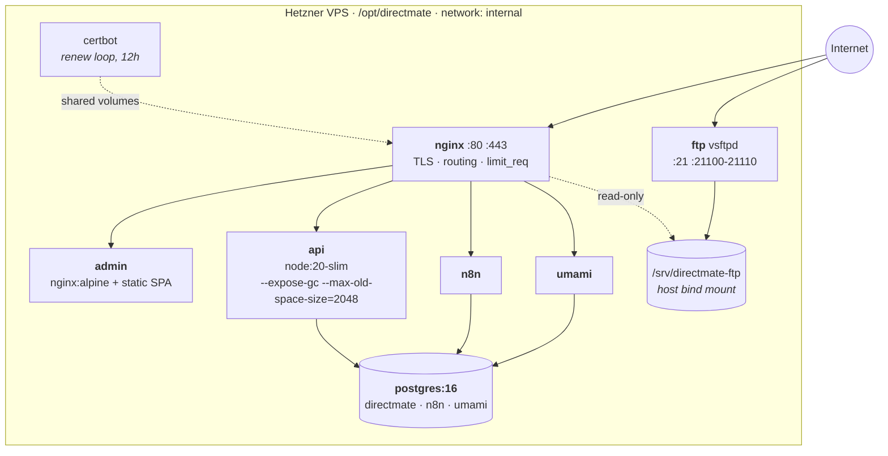
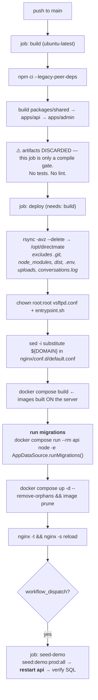
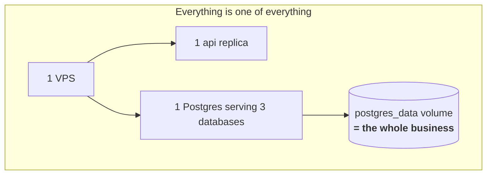

# 10 — Deployment & Operations

← [09 Admin Frontend](09-admin-frontend.md) · [Index](00-README.md) · Next: [11 Testing & Tooling](11-testing-and-tooling.md)

**One VPS. Docker Compose. rsync-and-rebuild.** No orchestrator, no replicas, no blue/green.

---

## 1. Local development

```bash
# 1. Database (only service actually used day-to-day)
cd infra/docker && docker compose up -d      # Postgres on host port 5433

# 2. Shared package — the API imports the COMPILED js
cd packages/shared && npm run build

# 3. Migrations
cd apps/api && npm run migration:run

# 4. Seed
npm run seed                 # pilot tenant + admin@directmate.app / admin123
npm run seed:demo:all        # demo-women-clothes + demo-cosmetics

# 5. Run
cd apps/api && npm run dev       # :3000
cd apps/admin && npm run dev     # :5173, proxies /api and /uploads to :3000
```

| Service | Port | Notes |
|---|---|---|
| `postgres` | **5433** → 5432 | 5432 is taken by another project on the dev machine |
| `api` (containerised) | 3000 | ⚠️ build context is `apps/api` only, so it **does not build `packages/shared`**; and the compose env has **no `OPENAI_API_KEY` or `ENCRYPTION_KEY`** — engine calls fail in this container. Run the API natively instead |
| `admin` (containerised) | 5173 | |

---

## 2. Production topology



**Named volumes:** `postgres_data`, `uploads`, `logs`, `certbot_etc`, `certbot_var`, `certbot_www`,
`n8n_data`.

⚠️ **Healthchecks exist only on `postgres` and `ftp`.** `api`, `admin`, `nginx`, `n8n` and `umami` have
none — `restart: unless-stopped` catches a process exit but **not a wedged event loop**, and nothing
restarts a hung API.

### Container images

| Image | Notes |
|---|---|
| `api.prod.Dockerfile` | Two stages, **both `node:20-slim`**. Builds `packages/shared` first. Explicitly COPYs `privacy.html`/`terms.html`/`data-deletion.html` and `test-assets/` into the runtime image |
| `admin.prod.Dockerfile` | Stage 1 apt-installs Chromium for **react-snap** prerendering; stage 2 is `nginx:alpine` |

⚠️ **Both api stages must stay Debian slim, never Alpine.** Three separate commits chased musl/glibc
mismatches in native modules (`ERR_DLOPEN_FAILED`, then `onnxruntime-node` SIGABRT). Do not "optimise"
this back.

📌 `--expose-gc` exists so `ProductMediaEmbedderService` can call `global.gc()` between CLIP ticks —
instrumentation left in from the memory-pressure investigation.

---

## 3. nginx routing

`${DOMAIN}` is a literal placeholder substituted at deploy time.

| Location | Upstream | Notes |
|---|---|---|
| `/` | `admin:80` | SPA |
| **`/api/testing/`** | `api:3000/testing/` | ⚠️ **must precede `/api/`** — longest-prefix match. 600 s timeouts for simulator runs |
| `/api/` | `api:3000/` | prefix **stripped**; `limit_req zone=api burst=20` |
| `/channels/` | `api:3000/channels/` | Instagram webhooks; `limit_req zone=webhooks burst=10` |
| `/auth/` | `api:3000/auth/` | includes the OAuth callback |
| `/internal/` | `api:3000/internal/` | `allow 172.16/12, 10/8, 127.0.0.1; deny all` |
| `/docs` | `api:3000/docs` | ⚠️ Swagger, **unauthenticated** |
| `/static/` | `api:3000/static/` | ⚠️ required, or the SPA catch-all swallows privacy/terms with a 200 |
| `/uploads/` | `api:3000/uploads/` | `expires 7d, immutable` |
| `/n8n/` | `n8n:5678/` | WebSocket upgrade headers |

**Global:** `client_max_body_size 20M`, gzip, and always-on `X-Frame-Options` / `X-Content-Type-Options` /
`Referrer-Policy`. ⚠️ **No HSTS.**

⚠️ **The 20 MB nginx cap contradicts the 50 MB app body limit** — 20 MB is the effective ceiling for a
Torgsoft catalogue import.

⚠️ **The `/internal/` IP allowlist is bypassable via `/api/internal/…`** (see [07 §7](07-auth-and-tenancy.md#7-the-internal-api-key)).

### The CDN vhost

`cdn.directmate.app` serves `/srv/directmate-ftp` read-only through a **single case-insensitive regex
whitelist**: `^/[^/]+/images/[^/]+\.(jpe?g|png|webp|gif)$`, plus `location ~ /\. { return 404; }`,
`autoindex off`, and a catch-all 404.

📌 **That regex is a security boundary** — each tenant's `sync/TSGoods.trs` lives in the same tree and is
unreachable only because the regex admits nothing but `images/`.

### TLS

`certbot` runs `while :; do certbot renew; sleep 12h; done` sharing volumes with nginx.

⚠️ **Certbot never signals nginx after a renewal.** nginx keeps the old certificate in memory until the
next reload — which happens on every deploy, so this is safe only because deploys are frequent.

---

## 4. CI/CD



**Ordering guarantee:** migrations always run **before** `up -d`; the seed always runs **after** both. A
non-zero migration exit stops the job before any restart.

📌 **The `seed-demo` job is manual-only and destructive** — it hard-deletes demo tenants through ~25
cascading FKs. It must be followed by an api restart because `DemoService` caches tenants at boot.
**Never wire it to `push`.**

📌 **`chown root:root` on the vsftpd files is mandatory.** rsync stamps uid 1001, and vsftpd refuses to
start unless its config is root-owned — without this step the ftp container crash-loops after every
deploy.

📌 **nginx config is a bind mount**, so `up -d` (which only recreates containers whose image changed)
misses config changes. Hence the explicit reload.

⚠️ **Deploy = api restart**, which drops every in-memory cache and `conversations.log`. There is no
blue/green, no drain, no readiness gate — **brief 502s during the restart are structural**.

⚠️ **There is no rollback path.** The documented recovery is revert-and-reship for code, and a new
forward migration to undo a schema change.

### `infra/production/deploy.sh` — use with caution

A near-duplicate of the CI deploy job with one **behavioural divergence**: it writes
`nginx/conf.d/default.active.conf` and **leaves the un-substituted `default.conf` in place**. Since nginx
`include`s `conf.d/*.conf`, both load — producing a literal `server_name ${DOMAIN}` block and an
`nginx -t` failure.

> **The CI path (`sed -i` in place) is the one that works.** Treat `deploy.sh` as bootstrap /
> disaster-recovery only.

---

## 5. Configuration

Production config comes **entirely from the `environment:` block** of `docker-compose.prod.yml`,
interpolated from `/opt/directmate/infra/production/.env` (rsync-excluded, lives only on the box).

⚠️ **Adding an env var is a two-file change.** Docker Compose interpolates `.env` for `${VAR}`
substitution, but **the container only sees what is listed under `environment:`**. This has bitten the
team twice (`REPLICATE_*`, `CLIP_BACKFILL_BATCH`, `APP_BASE_URL`).

**Joi-required (boot fails without them):** `DATABASE_URL`, `JWT_SECRET`, `INTERNAL_API_KEY`.

| Group | Vars |
|---|---|
| Domain / URLs | `DOMAIN`, `APP_BASE_URL`, `ADMIN_BASE_URL`, `ADMIN_ORIGIN`, `BACKEND_BASE_URL` |
| Database | `POSTGRES_USER/PASSWORD/DB` → composed into `DATABASE_URL` |
| Auth | `JWT_SECRET`, `JWT_EXPIRES_IN`, `ENCRYPTION_KEY` |
| Meta | `META_APP_ID`, `META_APP_SECRET`, `META_WEBHOOK_VERIFY_TOKEN`, `INSTAGRAM_OAUTH_REDIRECT_URI` |
| AI | `OPENAI_API_KEY`, `OPENAI_MODEL`, `OPENAI_FALLBACK_MODEL`, `OPENAI_CLASSIFIER_MODEL`, `OPENAI_VISION_MODEL` |
| CLIP | `CLIP_ENABLED`, `REPLICATE_API_TOKEN`, `REPLICATE_CLIP_MODEL_VERSION`, `CLIP_BACKFILL_BATCH` |
| Integrations | `INTERNAL_API_KEY`, `N8N_ORDER_SYNC_WEBHOOK_URL`, `TELEGRAM_*` |
| Demo | `DEMO_DEBOUNCE_MS`, `DEMO_MAX_MESSAGE_LENGTH`, `DEMO_RATE_LIMIT_SESSIONS_PER_HOUR`, `DEMO_BUDGET_CENTS_*`, `DEMO_CORS_ALLOWED_ORIGINS` |
| Infra | `FTP_PASV_ADDRESS`, `N8N_DB`, `N8N_BASIC_AUTH_*`, `UMAMI_APP_SECRET` |

⚠️ **`APP_BASE_URL` must be the public HTTPS origin.** `SizeChartsService.publicUrl()` and the Instagram
image sender build Meta-fetchable URLs from it; a localhost fallback produces a silent 400 from Meta on
every size-chart send. This was a real incident.

⚠️ **Recognised by the app but NOT forwarded in compose** — unusable in production today:
`ANTHROPIC_API_KEY`, `CLASSIFIER_MODEL`, `MONO_MERCHANT_TOKEN`, `CLIP_BACKFILL_TICK_MS`,
`CLIP_BACKFILL_BACKOFF_MIN`.

⚠️ **`.env.example` has drifted** — it lacks `UMAMI_APP_SECRET`, all `CLIP_*`/`REPLICATE_*`,
`OPENAI_CLASSIFIER_MODEL`, `OPENAI_VISION_MODEL`, and every `DEMO_*`. A VPS built strictly from it comes
up with a broken Umami and CLIP silently disabled.

---

## 6. Static assets — three distinct surfaces

Do not conflate these.

| Surface | Backed by | Written by |
|---|---|---|
| `/static/*` | `apps/api/src/*.html`, shipped in the image | the repo (Meta app-review requirement) |
| `/uploads/*` | the `uploads` named volume at `/app/apps/api/uploads` | multer (size charts, training screenshots) + seed builders copying from `test-assets/` |
| `cdn.directmate.app/<tenant>/images/*` | host `/srv/directmate-ftp`, bind-mounted read-only into nginx | the FTP server. **Never touches the API process** |

📌 `apps/api/test-assets/` (~37 MB) ships with every rsync **and** into the image — it is the source for
the demo seed's `copyFileSync`.

---

## 7. Observability

| Signal | Where | Gaps |
|---|---|---|
| Structured per-turn traces | `conversation_traces` → admin Trace tab | ⚠️ **no TTL, no partitioning, no purge job** |
| Engine decision log | `audit_logs` → `GET /logs/conversation/:id` | ⚠️ no retention policy |
| JSONL trace file | `conversations.log` → `npm run replay` | ⚠️ see below |
| Container logs | `docker logs production-api-1` | ⚠️ **no log rotation configured** |
| Health | `GET /api/health` | ⚠️ returns `dataSource.isInitialized` — a **boot-time flag, not a ping**. A dead Postgres still reports `ok`. **Nothing polls it** |
| Product analytics | self-hosted Umami | frontend only |
| Cost | `demo_spend_daily` (demo only), `conversation_traces.openai_calls` (all) | no aggregate dashboard |

⚠️ **`conversations.log` is ephemeral and unrotated.** It is written to `/app/apps/api/conversations.log`
while the `logs` volume is mounted at `/app/apps/api/logs` — **a directory nothing writes to**. The file
therefore lives in the container's writable layer and is **destroyed on every deploy**. Pull it before
shipping if you need conversation forensics.

⚠️ **No error tracking, no APM, no metrics, no alerting anywhere in the repo.**

---

## 8. FTP tenant operations

Root-only CLIs in `scripts/ftp/`:

| Script | What |
|---|---|
| `add-tenant.sh <slug>` | Validates the slug, creates `{sync,images}` (owner `14:80`, mode 755), generates a 32-hex password, appends to `users.txt`, regenerates the Berkeley DB, writes the per-user conf, prints credentials **once**. Full rollback trap |
| `remove-tenant.sh <slug>` | Revokes the login and **moves** (never deletes) storage to `/srv/directmate-ftp-archive/<slug>-<date>` |
| `list-tenants.sh` | Read-only inventory + drift report between `users.txt` and `user_conf.d/` |
| `lowercase-images.sh` | `flock`-guarded, cron `*/5`, renames uppercase extensions (Torgsoft uploads `.JPG`; the CDN is case-sensitive) |

📌 `LOCAL_UMASK=022` in compose is load-bearing — uploads land mode 644 so the nginx worker (a different
UID) can serve them. Without it the CDN 403s.

📌 The Berkeley DB regeneration writes via `cat >` rather than `mv`, **deliberately**, to preserve the
inode the ftp container has bind-mounted.

⚠️ **FTP credentials are unrecoverable by design** — printed once. Loss means remove-then-add, which
archives (does not restore) the storage tree.

---

## 9. Single points of failure



| Risk | Detail |
|---|---|
| **No backups** | No `pg_dump` cron, no snapshot script, no offsite target anywhere in the repo. Explicitly declared out of scope in a planning doc |
| **No healthcheck on `api`** | `restart: unless-stopped` does not catch a wedged event loop |
| **In-memory state** | Makes >1 replica *incorrect*, not merely suboptimal — see [08 §2](08-async-and-events.md) |
| **Deploy drops state** | rate-limit windows, demo buffers, IG echo maps, `conversations.log` |
| **n8n workflows unversioned** | live only in the `n8n_data` volume |
| **Secrets** | one `.env` file on the box + two GitHub secrets. No vault, no rotation. **Deploys authenticate as `root`** |
| **No `.dockerignore` anywhere** | the api build context is the repo root, so `test-assets/` (37 MB), `uploads/`, and `.claude/worktrees/` are all sent to the daemon on every server-side build |

---

## 10. Operational runbook

```bash
# Where things live
ssh root@$SERVER_HOST
cd /opt/directmate/infra/production

# Status / logs
docker compose -f docker-compose.prod.yml ps
docker logs -f production-api-1
docker exec production-api-1 tail -f /app/apps/api/conversations.log | jq .

# DB
docker exec -it production-postgres-1 psql -U postgres -d directmate

# Manual migration run
docker compose -f docker-compose.prod.yml run --rm api \
  node -e "const d=require('./dist/database/data-source');d.AppDataSource.initialize().then(s=>s.runMigrations())"

# nginx config change (bind-mounted — needs an explicit reload)
docker exec production-nginx-1 nginx -t && docker exec production-nginx-1 nginx -s reload

# Add a demo-only template WITHOUT reseeding (a reseed CASCADE-deletes conversations)
docker compose -f docker-compose.prod.yml run --rm api npm run backfill:prod:price-variants

# Check a demo tenant hasn't drifted before a live demo
npm run verify:men-demo
```

### Triage: "images are broken in the demo widget"

1. Is the file in `apps/api/test-assets/`? (it ships with rsync **and** into the image)
2. Did the seed copy it into `uploads/`? The seed logs `copied / existed / missing` per file.
3. Is `/uploads/<name>` reachable through nginx?
4. For Meta sends specifically: is `APP_BASE_URL` the **public HTTPS** origin?

### Triage: "the bot stopped replying to a customer"

1. `conversations.status` — is it `human_in_control`? A handoff sets it and **only a manager reply sets
   `auto_resume_at`**, so it can stay paused indefinitely.
2. `store_configs.operating_mode` — is it `learning`? The bot runs shadow-mode and never sends.
3. `subscription_plans.status` — the engine soft-blocks on an inactive plan.
4. Check `conversation_traces` for that conversation, filtered by `source = 'instagram'`.
5. Check `pg_locks` for a stuck advisory lock ([08 §6.2](08-async-and-events.md)).

---

## 11. Open questions

1. **Where are the `n8n` and `umami` Postgres databases created?** The image only creates `POSTGRES_DB`.
   Nothing in the repo runs `CREATE DATABASE` — presumably a manual one-off, not reproducible.
2. **Backups** — none found. Whether Hetzner snapshots are enabled is outside the repo.
3. **Firewall / DNS** — referenced in docs, no infrastructure-as-code.
4. **Does `apps/api/.env` exist on the box?** It is rsync-excluded and not mounted, so prod config appears
   to come entirely from compose — but `data-source.ts` calls `dotenv.config()` unconditionally and would
   silently pick one up.
5. **`DEMO_CORS_ALLOWED_ORIGINS` defaults to `directmate.ua`** while compose overrides it to
   `${DOMAIN}` (`directmate.app`). Whether a separate `.ua` marketing front-end exists is not
   determinable from this repo.
6. **The `logs` named volume has no writer** in `apps/api/src`. Either dead, or something writes there
   that grep did not find.
