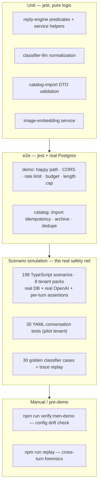
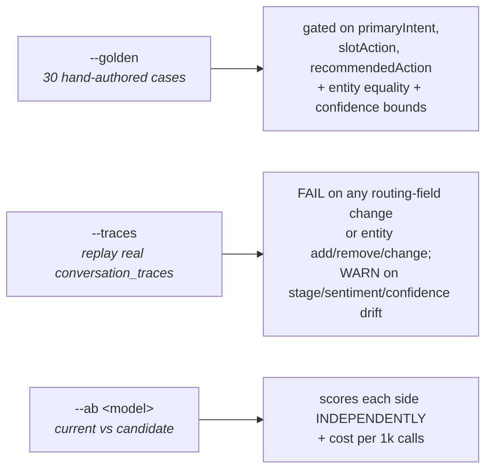
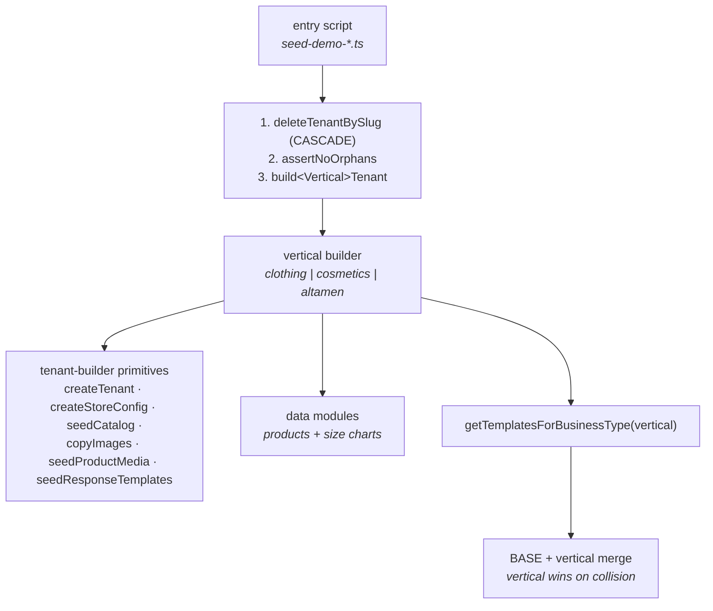
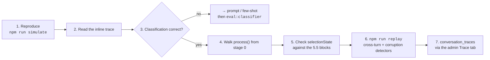

# 11 — Testing & Developer Tooling

← [10 Deployment](10-deployment.md) · [Index](00-README.md) · Next: [12 Risks & Tech Debt](12-risks-and-tech-debt.md)

The test strategy here is unusual and worth understanding before you judge it: **unit tests cover pure
predicates, and correctness is verified by ~198 end-to-end conversation scenarios run against a real
database and a real LLM.**

---

## 1. The testing pyramid, as actually built



⚠️ **None of this runs in CI.** The GitHub Actions `build` job is a compile gate only — no tests, no lint.
Layers 3 and 4 spend real money and are run manually.

---

## 2. Unit tests — `npm test`

Config is inlined in `apps/api/package.json` (`rootDir: src`, `testRegex: .*\.spec\.ts$`).

| Spec | Covers |
|---|---|
| `reply-engine.predicate.spec.ts` (645 lines) | Pure predicates, no Nest container: `isCheckoutCommitOnFullCart` (13 cases **+ an invariant suite proving the predicate is a strict subset of the 5.5a-2 trigger** — that is what makes standing down on the `product_not_found` handoff safe), `isPivotToDifferentProduct` (11), `matchCartItems` (5), `isNarrowingSlotFill` (8), `syncRecommendedSizeWithStatedSize` (6) |
| `reply-engine.service.spec.ts` (1,187 lines) | Builds a real service with hand-rolled mocks, then exercises private methods: `maybeMidFlowSizeHelp` (14), `handleSizeChartRequest` diversion (5), `matchVariant` colour-in-title (9), `narrowByProductName` (6), `markRepliedOnResult` (5), `colorsOverlap` (7), `show_products` fallthrough hygiene (5), **the `before_search` pre-qualify gate (6)** |
| `reply-engine.variant-unavailable.spec.ts` | The 5.5o guard: a bare «Так» carrying a *leaked* size must not become `variant_not_available` |
| `classifier-llm.spec.ts` | `isAnthropicModel` routing + `normalizeForAnthropic` message hygiene |
| `catalog-import.dto.spec.ts` | class-validator rules: Torgsoft payloads, bad gender, `salePrice > price`, >10 categories, >10000 products |
| `image-embedding.service.spec.ts` | Replicate contract: disabled states, 768-dim success, polling path, **rejects a 512-length response** |

📌 The unit tests deliberately target **pure predicates and helpers**, not the pipeline. The pipeline is
covered by scenarios, because its behaviour depends on real catalogue data and real classification.

---

## 3. e2e — `npm run test:e2e`

Hits a **real Postgres**. `test/demo/setup.ts` boots the full `AppModule`, re-applies the pieces of
`main.ts` that matter, clears the rate limiter's private map, and **spies over
`ReplyEngineService.process`** with a fixed stub so no test calls OpenAI.

| Spec | Covers |
|---|---|
| `demo-happy-path` | full `DemoReplyPayload` shape |
| `demo-rate-limit` | 6th distinct sessionKey blocked; replays of a seen key still pass |
| `demo-budget` | `budget_exceeded` short-circuits **before** the engine |
| `demo-length-cap` | 501 chars → 400 `too_long`; 500 accepted |
| `demo-cors` | 403 for a foreign preflight; echoed origin for the whitelist and any localhost |
| `catalog-import` | 100-product insert, idempotency, change-only updates, archive-not-delete, case-insensitive category dedupe, 0-variant parents |

⚠️ **`test/setup-env.ts` loads the developer's `apps/api/.env`**, so e2e runs against whatever
`DATABASE_URL` points at — **including, potentially, your dev database**. There is no separate test DB,
no schema reset, and no CI job.

---

## 4. The scenario simulator — the real safety net

```bash
npm run simulate -- --list
npm run simulate -- --scenario <key>
npm run simulate -- --tenant men-demo-store --message "Привіт || Є сорочка в L?"
npm run simulate -- --all --out run-a.json
```

**198 scenarios across 8 tenant packs:**

| Pack | Count | Focus |
|---|---|---|
| `clothes-store` | 53 | The largest: story/post replies, both pre-qualify strategies, the variant/size-chart matrix, 5 handoff scenarios, FAQ, corrections |
| `men-demo-store` | 43 | The **adversarial** suite: haggling, rudeness, admin impersonation, off-topic, surzhyk, monosyllabic flow, full checkout, cart abandon |
| `showcase-women-clothes` | 30 | Colour-linked media, the sweater-photo label bug, downgrade paths, multi-item cart |
| `luxespace` | 29 | Luxury multi-brand: brand-only search, Cyrillic brand names, browse + narrowing, photo lock |
| `demo-women-clothes` | 20 | Focus gate, size-help chart vs measurements, RU phrasings, grounded product questions |
| `pilot-store` | 8 | Cosmetics baseline, cart add/remove/abandon, customer photo |
| `demo-altamen` | 8 | Men's `before_search` measurements, size correction after recommendation, narrow-broaden |
| `cosmetics` | 7 | `before_search` skin type, mask variants, safety handoff |

### The assertion vocabulary

```ts
expect: {
  decision?: 'reply' | 'handoff' | 'create_draft_order';
  scenario?: string;                          // exact templateScenario
  replyContains?: string | string[];          // matched across reply AND every extraReply
  replyNotContains?: string | string[];
  imageCount?: number;  imageCountMin?: number;
  extraReplyCount?: number;  extraReplyImageContains?: string;
  state?: {
    selectionState, selectedProductId, selectedVariantName,
    selectedColor, selectedSize, variantStep,
    cartLength, cartHasVariant, lastAction, awaitingField,
    preQualifyCollected, recommendedSize, recommendedSkinType,
    shouldOfferSizeHelp, awaitingPreQualifyAnswer, orderCreated,
  };
  note?: string;                              // what this turn tests
}
```

📌 **`message` accepts an array** — that simulates a debounced burst (joined with `\n`, exactly like
production).

📌 **Substring assertions check the primary reply *plus* every `extraReplies[].text`**, because the
welcome-prepend promotes the greeting to primary and demotes the contextual reply.

### Two first-class concepts

📌 **`flaky: true`** — scenarios testing LLM-extraction robustness on natural phrasing are counted
separately and **never affect the exit code**. The split is "engine-flow correctness (gating)" vs
"extraction robustness (best-effort)". 16 scenarios are marked flaky.

📌 **Missing tenants are skipped, never silently passed.** `--all` skips scenarios whose tenant isn't in
this environment and prints the list — "never let a skip read as a pass". `--scenario <name>` still fails
loudly.

### ⚠️ The CLI and the API simulator differ

| | CLI (`simulate-conversation.ts`) | API (`SimulatorService`) |
|---|---|---|
| `flowConfigOverride` merge | **deep** | **shallow spread** ⚠️ |
| Backup on override | write-tmp-then-rename to `.simulator-backups/`, startup self-heal, SIGINT/SIGTERM restore | `finally` only ⚠️ |
| Assertions | full vocabulary | missing `imageCountMin`, `selectedColor`, `selectedSize`, `variantStep`, and the `null`-means-unset semantics ⚠️ |
| Identity | `sim-customer-001` | `sim-api-001` (scenarios) / `sim-live-001` (console) |

> ⚠️ **A nested override run through the API simulator will delete sibling keys**, and a process kill
> mid-run leaves the tenant permanently misconfigured with nothing to detect it. This is the exact
> failure that corrupted `demo-women-clothes` and motivated the CLI hardening. Prefer the CLI.

---

## 5. Classifier evaluation — `npm run eval:classifier`

Calls `ClassifierService.classify()` directly, bypassing the engine entirely.



**Golden case families:** the "L підійде" statement-pick family (including Russian variants), fit
questions, history-leak defence, offer accept/decline, awaiting-variant colour fills, size-chart flows,
size corrections, and two clean controls.

**The trace-diff workflow** (documented in the script):
```bash
git stash                                    # park your prompt edits
npm run eval:classifier -- --traces --save baseline.json
git stash pop
npm run eval:classifier -- --traces --diff baseline.json
```

📌 It **excludes traces whose `openai_calls[].source === 'classifier_fallback'`** — those didn't come from
the prompt under test. Per-tenant categories and business type are reconstructed and cached, because
traces don't store them.

📌 **`--ab` scores each side independently on purpose.** The first version let one side's error suppress
the other's score, which invalidated the comparison.

**`compare-simulator-runs.ts`** diffs two simulator JSON outputs turn-by-turn, splitting disagreements
into **routing** differences (template scenario or decision changed — these matter) vs **classifier-only**
differences (intent/entities changed but routing is identical).

---

## 6. `npm run replay` — offline forensics

Pure offline: **no Nest, no DB, no network.** Reads `conversations.log` as JSONL, groups by conversation.

```bash
npm run replay                # last conversation
npm run replay -- --last 3
npm run replay -- --id <uuid-prefix>
```

Renders per event type: `classification` (colour-coded confidence + entities), `product_search`,
`flow_override` (`classifierSaid → engineDid`), `reply`, `handoff`, `handoff_verification`.

📌 **Three built-in bug detectors** make this more than a pretty-printer:

| Detector | Meaning |
|---|---|
| ❌ **BUG** | `selectionState ∈ {awaiting_confirmation, confirmed}` with no `selectedProductId` |
| ⚠ **WARN** | `selectionState = 'confirmed'` with no `selectedVariantId` |
| ❌ **REPEATED TEMPLATE** | the same non-fallback `templateId` three turns running |

⚠️ `conversations.log` is destroyed on every deploy ([10 §7](10-deployment.md)). Pull it first.

---

## 7. The YAML conversation suite

`npm run test:conversations` runs 30 YAML scenarios (`01-happy-path.yaml` … `30-…`) against the **pilot
tenant**.

⚠️ **`ConversationTestRunner` hardcodes the pilot tenant UUID and `cleanupTestData()` deletes all its
conversations, messages and audit logs** on every scenario — regardless of which tenant triggered the
run. `POST /testing/run` as *any* tenant wipes pilot-store data and attributes results to the wrong
tenant.

⚠️ **Scenario extraction is log-scraping.** The runner records `fs.statSync(LOG_FILE).size` before the
call, sleeps 50 ms, reads only the new bytes, and finds the `reply` event. Fragile (concurrent writers,
rotation, the sleep) — and it is why `conversations.log` must stay append-only JSONL.

⚠️ `expect.slotAction` is declared in the YAML schema and **never evaluated**.

📌 Whether these 30 YAML files still matter is an open question — they overlap conceptually with the much
larger TypeScript registry and nothing declares one as superseding the other.

---

## 8. Seeding



### Tenant inventory

| Slug | `is_demo` | Purpose |
|---|---|---|
| `demo-women-clothes` | ✅ | clothing demo, `after_search_offered` |
| `demo-cosmetics` | ✅ | cosmetics demo, `before_search` |
| `demo-altamen` | ✅ | men's clothing, 128 products scraped from altamen.com.ua |
| `men-demo-store` | ✅ | ⚠️ **not reproducible from this repo** — authored in prod and copied down |
| `showcase-women-clothes` / `showcase-cosmetics` | ❌ | non-demo twins for live sales demos on a real IG account |
| `pilot`, `clothes-store`, `luxe-space` | ❌ | production/legacy tenants |

📌 **Demo vs showcase is exactly one flag.** `is_demo` decides (a) whether `DemoService` resolves the slug
for the public widget, (b) whether the `is_demo`-scoped backfills touch it, (c) whether the demo caller
skips order creation.

### Templates as code — demo tenants only

`apps/api/src/scripts/seed/templates/{base,clothing,clothing-men,cosmetics}` are the **single source of
truth for demo tenants**. Production tenants author templates in the DB via the admin panel.

📌 **`getTemplatesForBusinessType` throws if any merged `clothing-men` template still contains `💛`** — a
hard build-time guard so a scenario added to `BASE` later cannot leak the heart into a men's store. The
men's pack is a **full pack, not an override layer**.

### ⚠️ Never reseed to add a template

A reseed hard-deletes with CASCADE, taking conversations with it. Use a **backfill** instead:

| Script | What |
|---|---|
| `backfill:price-variants` | adds `show_price_with_variants` to every `is_demo` tenant, idempotent, slug-agnostic |
| `backfill:demo-hardening` | 4 hardening templates + a discount-decline FAQ (tags are **stems**, because FAQ matching is literal substring) |
| `backfill:altamen-templates` | replaces `demo-altamen` templates with the men's pack |

**This is the documented pattern for demo-only template additions.**

### Snapshot / drift for `men-demo-store`

```bash
npm run snapshot:men-demo   # --export the config surface to a committed JSON
npm run verify:men-demo     # --check by NATURAL KEYS, exit 1 on drift  ← run before a live demo
npm run restore:men-demo    # --restore is_demo + templates + FAQ
```

📌 **`--restore` is deliberately asymmetric with `--check`**: it never deletes "extra" rows and never
touches catalogue or prices, because a price change in prod is a business decision, not corruption. It
repairs exactly three things — `tenants.is_demo` (the real incident: the local copy was found
`is_demo=false`, silently excluding it from every `is_demo`-scoped backfill), missing/changed templates,
and missing FAQ items. It is safe to run mid-demo.

---

## 9. The npm script surface

| Script | When you run it |
|---|---|
| `simulate` | **first step of every issue investigation** |
| `replay` | cross-turn forensics after a simulate run |
| `eval:classifier` | **before shipping any classifier prompt or model change** |
| `test` / `test:e2e` / `test:e2e:demo` | unit / e2e / after touching `modules/demo/` |
| `test:conversations` | broad YAML regression sweep (real OpenAI, slow) |
| `migration:run` / `:generate` / `:revert` | schema changes |
| `seed` | bootstrap a fresh local DB (pilot tenant + admin user) |
| `seed:demo:*` / `seed:showcase:*` / `seed:test-tenant` | tenant provisioning (`:prod:` twins run compiled JS) |
| `backfill:*` | add templates to existing demo tenants **without** reseeding |
| `snapshot / verify / restore:men-demo` | protect the cold-outreach demo tenant |
| `reset:test-tenant:conversations` | between Instagram tester runs |

Not wired to npm — run via `ts-node`: `compare-simulator-runs.ts`, `verify-message-ordering.ts`
(deterministic, LLM-free reproduction of the message-ordering bug), `verify-embedding-compat.ts`
(pre-deploy Replicate smoke test: reachability, 768 dims, L2 norm).

---

## 10. The debugging loop



**Classify before fixing** — bug / AI-went-wrong / architectural. See
[04 §13](04-conversation-pipeline.md#13-debugging-playbook).

📌 The admin **Trace tab has a `traceToMarkdown` clipboard export designed to paste into an LLM chat**.
That is the intended workflow for a hard engine bug.

---

## 11. Gaps

| Gap | Impact |
|---|---|
| **No tests in CI** | Every safety net is opt-in and manual |
| **e2e uses the dev database** | No isolation, no reset |
| **Zero tests for the channels module** | `InstagramService`, `InstagramContentService` and `InstagramCommentService` — ~2,800 lines — have no unit coverage at all. The simulator is the closest thing |
| **No order / checkout / subscription tests** | Billing and order dispatch are unverified |
| **Two divergent assertion runners** | A scenario can silently under-assert when run from the admin UI |
| **Two divergent `flowConfigOverride` implementations** | The API-side one can corrupt a tenant |
| **`ConversationTestRunner` wipes the pilot tenant** | Regardless of caller |
| **`expect.slotAction` unimplemented** | Silently ignored in YAML scenarios |
