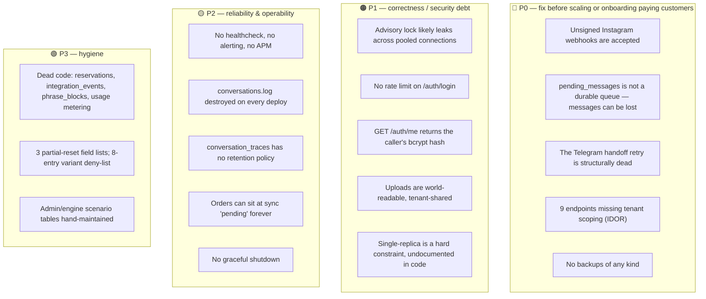
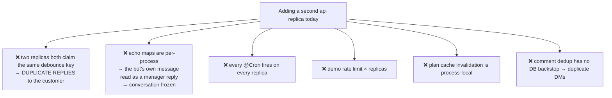

# 12 — Risks & Technical Debt

← [11 Testing & Tooling](11-testing-and-tooling.md) · [Index](00-README.md)

Everything the incoming technical owner should know before planning work. Ordered by severity within each
section, with a fix sketch where the fix is clear.

> **Read this before your first PR.** Several sharp edges in this codebase look like bugs and are
> deliberate; several things that look fine are known hazards. Knowing which is which is the difference
> between a fix and a regression.

---

## 1. Severity summary

---

## 2. 🔴 Security

### 2.1 Unsigned Instagram webhooks are processed

**`instagram.controller.ts`** — `if (req.rawBody && signature) { …verify… }` with **no `else`**.

A POST to `/channels/instagram/webhook` carrying no `x-hub-signature-256` header **skips verification
entirely**. `entry.id` (the IG Business Account ID) is publicly derivable, so this is an unauthenticated
write into any tenant's conversation pipeline. Meta always sends the header — which means this branch
only ever fires for a forged request, precisely the threat model.

Compounding it: `META_APP_SECRET` is `Joi.string().allow('').default('')`, so the app boots without it.

> **Fix:** reject when the signature is absent. Copy the Monobank handler's shape — it is the one webhook
> in the codebase that fails closed.

Related: `timingSafeEqual` throws `RangeError` on a length mismatch, so a malformed signature yields a
500 rather than a 401.

### 2.2 Nine endpoints missing tenant scoping

Full table in [07 §5.1](07-auth-and-tenancy.md#51-known-idor-gaps). The highest impact:

| Route | Why it matters |
|---|---|
| `PATCH`/`DELETE /engine/templates/:id` and siblings | Cross-tenant tampering with **the bot's entire customer-facing voice** |
| `GET /logs/conversation/:id` | Read another tenant's full audit trail |
| `PATCH /checkout/:id/customer-info` | Overwrite another tenant's customer PII |

📌 Sibling handlers **in the same files** scope correctly, which reads as oversight rather than decision.
Worth confirming with the author before filing.

> **Fix:** change `.update(id, …)` → `.update({ id, tenantId }, …)`. Mechanical, low-risk, high value.

### 2.3 No rate limit on authentication

`@nestjs/throttler` is installed, `ThrottlerModule.forRoot` is imported, `@Throttle` decorates
`POST /auth/register` — and **no `APP_GUARD` provider exists anywhere**, so from v5 the guard never runs.

> Unlimited credential stuffing against bcrypt-10, which is also a CPU-exhaustion vector. The only
> control is nginx `limit_req` at 60 r/s per IP.

**Fix:** one provider entry: `{ provide: APP_GUARD, useClass: ThrottlerGuard }`.

Related: `AuthService.login` returns `NotFoundException` for an inactive user and `UnauthorizedException`
for a wrong password — a **user-enumeration oracle**.

### 2.4 `GET /auth/me` returns the caller's password hash

The endpoint returns the raw `User` entity. `passwordHash` has no `@Exclude`, and there is **no global
`ClassSerializerInterceptor`**. Note `login()` deliberately hand-projects the user to avoid exactly this —
`me()` was missed.

### 2.5 Uploads are public and tenant-shared

`POST /size-charts/upload` and `POST /training/screenshots/upload` both write uuid-named files into **one
flat directory** that `main.ts` serves at `/uploads` with **no auth and no path scoping**. Training
screenshots are real customer DM captures. Security is capability-URL only.

### 2.6 Other hardening

| Item | Detail |
|---|---|
| `/docs` is public | Swagger enumerates the whole API including `/internal/*` |
| Telegram webhook fails open | The secret check is skipped when the env var is unset, and it is not in the Joi schema |
| `trust proxy` is fully permissive | Any client-supplied `X-Forwarded-For` becomes `req.ip` — the demo per-IP limiter is trivially spoofed |
| nginx `/internal/` allowlist bypassable | `/api/internal/…` reaches the same handlers; `/conversation/reply` was never under the prefix |
| Impersonation JWT travels in a URL | Lands in history, referrers and access logs; no `impersonatedBy` claim, so audit trails attribute actions to the tenant owner |
| `INTERNAL_API_KEY` | One static, unrotatable, tenant-agnostic secret that vends **decrypted** platform credentials |
| Manager notification webhook | An **arbitrary tenant-supplied URL** — SSRF surface |
| No HSTS | |

---

## 3. 🔴 Correctness & data loss

### 3.1 `pending_messages` is not a durable queue

Rows are `DELETE`d **before** the engine runs — no lease, no visibility timeout, no attempt counter, no
failure state. A crash, a SIGTERM, or a thrown error between the DELETE and the Meta send **silently
drops a paying customer's message**. And because the webhook is acked `200` fire-and-forget, Meta will
not retry.

> **Highest-value single change in the codebase.** Make `flushPending` an atomic claim
> (`UPDATE … SET claimed_at WHERE claimed_at IS NULL RETURNING *`, or `SELECT … FOR UPDATE SKIP LOCKED`)
> and delete only after successful delivery.

### 3.2 The Telegram handoff retry can never fire

`TelegramService.sendMessage` swallows *every* failure and returns normally, so `withRetry` always
observes a resolved promise.

> **When the bot escalates and Telegram is down, nobody finds out.** No retry, no delivery audit trail,
> no outbox.

Any review that "adds retry to Telegram" without changing `sendMessage` changes nothing.

### 3.3 The advisory lock likely leaks

`dataSource.query('SELECT pg_advisory_lock($1)')` takes a pooled connection and returns it; the matching
unlock may run on a **different** connection. Session-level advisory locks belong to their session, so
the unlock returns `false` and the lock persists until that pooled connection closes — after which
conversations hashing to the same key block forever.

**Verify before fixing:** `SELECT * FROM pg_locks WHERE locktype = 'advisory';` on prod.
**Fix:** hold a dedicated `QueryRunner` for the turn, or wrap the turn in a transaction and use
`pg_advisory_xact_lock`.

Related: the lock key folds a UUID into a **signed 32-bit int**, so unrelated conversations serialise.

### 3.4 No LLM timeouts

Not one OpenAI/Anthropic call has a timeout or a retry. A hung provider connection pins the advisory lock
and a DB connection indefinitely — and because `flushReadyMessages` is sequential, **one stuck turn
stalls every other tenant's flush on that replica**. The default pg pool is 10 connections.

### 3.5 Orders can sit at `pending` forever

`triggerExternalSync` is fire-and-forget in three layers. There is **no reconciliation cron and no
timeout**; the only recovery is a human clicking "retry sync". The `idempotencyKey` is also constant per
order (`order-{id}-sync-1`), so a downstream dedupe keyed on it would silently swallow every retry.

### 3.6 Billing edge cases

| Issue | Consequence |
|---|---|
| `cancelPlan` never calls Mono | The customer loses access immediately while Monobank **keeps billing** |
| Trial→paid promotion matches **by price** | Two plans at the same price, or a price change mid-flow, mis-assigns the plan and its limits |
| `createUpgradeSubscription` uses `update({tenantId})` with no `affected` check | If the trial row is missing, the subscription is created and paid for, and every charge webhook logs "unknown subscription" forever |
| The Mono public key is cached in-process forever | A key rotation requires an API restart |

### 3.7 No graceful shutdown

No shutdown hooks. On SIGTERM: in-flight `processInbound` is not drained (the reply is lost, the advisory
lock stays held), and pending demo HTTP resolvers are **never resolved or rejected** — those requests hang
until the client times out. **Every deploy takes this path.**

---

## 4. 🟠 Scaling: single-replica is a hard constraint

Eight in-memory singletons; exactly **one** cross-process-safe counter (`demo_spend_daily`).

> **Treat single-replica as a documented invariant, not a default.** Horizontal scaling requires: an
> atomic claim on `pending_messages`, Redis (or DB) for the echo/comment/rate-limit state, and a
> distributed lock or leader election for the crons.

---

## 5. 🟡 Operability

| Gap | Detail |
|---|---|
| **No backups** | No `pg_dump` cron, no snapshot script, no offsite target. The `postgres_data` volume **is the business** |
| **Health check is a lie** | `GET /health` returns `dataSource.isInitialized` — a boot-time flag. A dead Postgres still reports `ok`. Nothing polls it anyway |
| **No alerting, no APM, no error tracking, no metrics** | |
| **`conversations.log` is destroyed on every deploy** | Written to `/app/apps/api/` while the `logs` volume is mounted at `/app/apps/api/logs` — a directory nothing writes to. Also unrotated, and its write errors are swallowed by an empty `fs.appendFile` callback |
| **No container log rotation** | |
| **`conversation_traces` has no retention** | Written every turn with several large jsonb blobs. No TTL, no partitioning, no purge job. `subscription_plan_configs.history_days` exists and is unenforced — possibly the intended lever |
| **`audit_logs` has no retention either** | |
| **n8n workflows are unversioned** | They live only in the `n8n_data` volume |
| **No `.dockerignore`** | The api build context is the repo root; 37 MB of test assets ship to the daemon on every server-side build |
| **`deploy.sh` is subtly broken** | Writes `default.active.conf` and leaves the placeholder file, so nginx loads both. Use the CI path |
| **No tests in CI** | The `build` job is a compile gate only |

---

## 6. 🟢 Dead code

Flagged so you neither trust it nor delete it without checking.

| Item | Evidence |
|---|---|
| **`ReservationsModule`** | No controller, nothing injects it. `create`/`cancel` unreachable; a `@Cron('*/5')` scans an always-empty table. Consequently `stock_balances.reserved_qty` is permanently 0, `pending_checkout_qty` is written by **nothing at all**, and every `effectiveAvailable` degenerates to `available_qty` |
| **Usage metering** | `incrementConversationCount` and `checkConversationLimit` have **zero callers**. `subscription_usage` is never written, the admin usage bar always renders 0, and every plan limit except `conversationLimit`/`price` is display-only |
| **`integration_events`** | Table, entity, and both service methods have zero callers. No FKs, no indexes |
| **`phrase_blocks`** | Seeded by migration, CRUD'd by the admin UI, **read by no runtime code** |
| **`CheckoutService` + `/checkout/*` + `/orders/draft`** | A dormant HTTP checkout path. Nothing in the repo drives it |
| **`extracted_phrases` / `extracted_voice_signals`** | Extracted, reviewed, approvable — **nothing converts them into anything** |
| **`TenantsService`** | Zero callers |
| **`checkout_config`, `recommendation_config`** | Seeded, merge-able via the API, **no runtime reader** |
| **`brand_config`** (except `skuPatterns`) | The rich seeded blob has no reader; brand voice reaches the AI fallback via `tenant_settings.brandTonePrompt` |
| Others | `notifyNewOrder`, `AuditService.recordIntegrationEvent`, `IntegrationsService.getDecryptedToken`, `AvailabilityService.getByProductId`, `CatalogService.upsertProduct/upsertVariant`, `ConversationTracesService.listErrors`, `dto/reply.dto.ts`, `product_variants.image_url`, `stock_balances.warehouse_code`, 4 of 6 `ConnectionType` members, `ConnectionStatus.Error`, `AuditLogType.SyncEvent`/`.ReservationCreated`, `Conversation.autoResumeAt` reader in conversations, `ConversationState.activeCheckoutSessionId`/`lastAiConfidence` |

---

## 7. Engine-specific hazards

These are documented in depth in [04](04-conversation-pipeline.md); the register is here for planning.

| Hazard | Risk |
|---|---|
| **`context_json` is an unversioned schema** | ~35 optional fields, no migration, no validation. **Any change to `AssistantMemory` is a live schema change against in-flight conversations** |
| **Three partial-reset field lists** | The greeting reset, the post-order reset, and `clearSelectionForNewProduct`. Keeping three in sync is exactly the drift that produced the `selectedCategory` bug. Promote to one `resetSelection()` when a fourth appears |
| **`skipVariantUpdate` deny-list is at 8 entries** | Every new non-confirming scenario must be added explicitly or state is corrupted next turn. 8 is the documented threshold for promoting to an explicit allow-list |
| **`entities.productName` holds a category noun** | «Хочу замовити футболку» → `'Футболка'`. Every gate reading it as "did they name a *specific* model?" is answering "did they mention clothing at all?". The pre-qualify gate is defended; `isPivotToDifferentProduct`, the focus gate, `narrowByProductName` and `shouldSearchProducts` still trust it |
| **`memory.selectedCategory` can hold a product name** | Set to `entities.category ?? searchKeywords[0]` |
| **Anti-repetition outranks priority** | You cannot reliably raise a template with a higher priority |
| **Priority ties break with `Math.random()`** | Template selection is non-deterministic in tests |
| **`hasRequiredVariables` treats `''` as missing** | An empty variable silently drops a turn to AI fallback |
| **`recommendedSize` is sticky** | Cleared only by greeting/post-order resets; silently drives filters and rendering |
| **`failedTurns` is never reset** | Incremented only on AI-fallback failure, and no path clears it |
| **`slotAction='correction'` doesn't clear colour/size** | Defended per-branch, not generally |
| **Naming a model inside a generic-token category resolves the wrong product** | Standing red-bug guard: `demo_altamen_tshirt_order` |
| **`ctx.classifierIntent` vs `primaryIntent`** | Three blocks rewrite the intent mid-turn; a late gate reading the live value reads the engine's own bookkeeping |

---

## 8. Documentation drift

`CLAUDE.md` is a rich, high-quality engineering journal — but parts have drifted from the code. Verified
mismatches:

| `CLAUDE.md` says | The code says |
|---|---|
| "Analytics queries must filter `is_demo=false`" | **No query** in `AnalyticsService` or `AdminService` references it. Platform-level stats are inflated by demo traffic |
| Telegram config is at `flow_config.handoff` | It is at `store_configs.handoff_config.telegramChatIds` |
| `{skin_type}`, `{phone}`, `{city}`, `{delivery_branch}` are template variables | `buildVariableMap` never emits them |
| Handoffs: 18 `doHandoff` sites | 17 call sites + 1 non-`doHandoff` gate = 18 exit points ✅ (but earlier prose in places says otherwise) |
| Template-engine line numbers | Drifted — treat `CLAUDE.md` as **intent**, the file as **truth** |
| `extraReplies` "ignored by production Instagram" | Stale — the sender consumes them on both the reply and handoff paths |
| Order sync supports "Shopify or OpenCart" | Shopify only; the enum has no OpenCart member |

Also: `TemplatesPage.SCENARIO_LABELS` lists 6 scenarios with **no engine render path**, and
`SCENARIO_COLORS` covers only 20 of 37.

---

## 9. Suggested first 90 days

```mermaid
flowchart LR
    subgraph W1["Week 1–2 · Security<br/><i>small, mechanical, independently shippable</i>"]
        S1["Reject unsigned IG webhooks"]
        S2["Register ThrottlerGuard"]
        S3["Fix the 9 tenant-scoping gaps"]
        S4["Strip passwordHash from /auth/me"]
    end
    subgraph W2["Week 3–6 · Correctness<br/><i>needs design; investigate before fixing</i>"]
        C1["Atomic claim on pending_messages"]
        C2["Make TelegramService.sendMessage throw"]
        C3["Verify pg_locks, then fix the advisory lock"]
        C4["Add LLM timeouts"]
    end
    subgraph W3["Week 7–12 · Operability<br/><i>backups first</i>"]
        O1["Backups + a restore drill"]
        O2["Real healthcheck + alerting"]
        O3["conversation_traces retention"]
        O4["Move conversations.log onto a volume"]
        O5["Delete or wire the dead modules"]
    end
    W1 --> W2 --> W3
```

**Week 1–2 — security.** All four items are small, mechanical, and independently shippable.

**Week 3–6 — correctness.** The message-loss window is the highest-value engineering change in the
codebase. Do the advisory-lock investigation **before** designing its fix.

**Week 7–12 — operability.** Backups first; everything else is optimisation compared with "the
`postgres_data` volume is the business".

**Not on the list, deliberately:** horizontal scaling. It requires most of the above as prerequisites and
there is no evidence of load pressure yet.

---

## 10. What is genuinely good here

An honest register cuts both ways. These are strengths worth preserving:

- **The engine's determinism.** One LLM call per turn, strict enum-grounded tool calling, and a
  deterministic router. Replies are auditable and cheap. Resist any pressure to "just let the model
  answer".
- **The failure culture in migrations.** Several migrations reconstruct a production incident end to end
  and explain why the chosen fix is right (`1738000` is the exemplar). Keep writing them this way.
- **`conversation_traces`.** Memory before/after, the exact classifier input window, per-call token costs,
  and a `TraceSource` provenance tag that defaults to `'unknown'` rather than lying. This is better
  observability than most products this size have.
- **The scenario suite.** 198 end-to-end conversations with per-turn state assertions, an explicit
  flaky/gating split, and "a skipped tenant never reads as a pass".
- **The classifier eval harness.** A golden set, a real-trace regression differ, and an A/B that scores
  each side independently.
- **Defensive engine gates over prompt-only fixes.** The two-layer pattern (fix the prompt *and* keep a
  deterministic gate) is why classifier non-determinism rarely reaches customers.
- **The customer-photo pipeline's anti-contamination rule** — past auto-accepted matches are excluded from
  future corroboration, so one noisy accept cannot become tomorrow's high-confidence evidence.
- **`snapshot-demo-tenant --restore`'s deliberate asymmetry** with `--check`. Repairing config but never
  touching catalogue or prices is exactly the right call.
